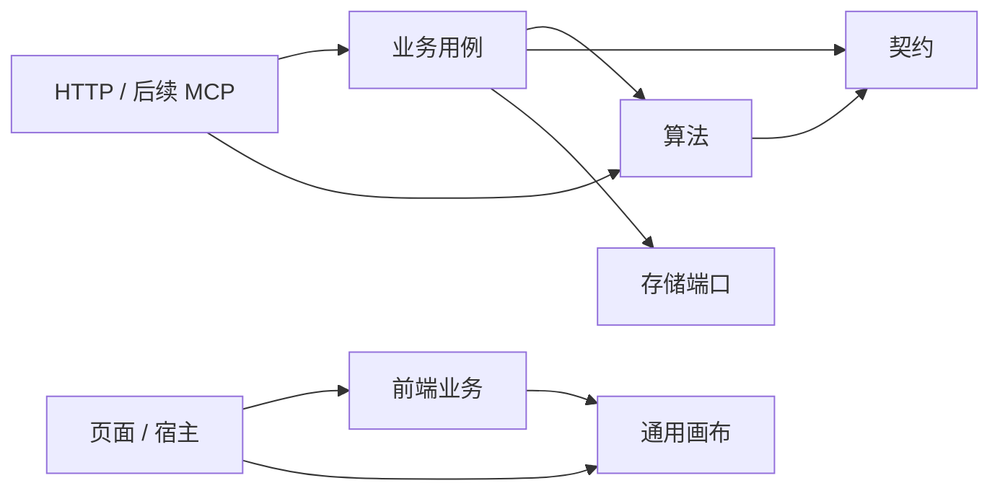

# 代码模块与实施进度

本文件记录实际代码组织和分批验收。总体方案已经批准；首期接入方式为独立服务 + 标准 API。不能把总体设计中的目标能力视为已经交付。

## 1. 模块地图

后端路径均相对 `src/main/java/com/example/cutdemotwo/`：

| 模块 | 路径 | 职责 | 允许的项目内依赖 |
| --- | --- | --- | --- |
| 共享契约 | `contracts/nesting`、`contracts/geometry` | 标准排样输入输出、几何及兼容 DTO | 仅 contracts |
| 算法 | `algorithm/solver`、`algorithm/toolpath` | 引擎注册、求解、独立校验、刀序优化 | algorithm、contracts |
| 业务 | `business/cutting`、`business/model` | 业务请求适配、任务、材料、方案、报工及履约 | business、algorithm、contracts、存储端口 |
| 存储 | `persistence` | 文件/MySQL 快照与冲突控制 | 业务模型、contracts |
| HTTP | `controller` | 请求解码、调用用例、响应状态 | 业务、算法公共入口、contracts |
| 旧一维集成 | `linear`、`changyang` | 一维线程池、导入导出、原有求解 | 现有适配链路，下一批分离 |

前端路径均相对 `src/main/resources/static/js/`：

| 模块 | 路径 | 职责 |
| --- | --- | --- |
| 通用画布内核 | `canvas` | 场景模型、几何绘制、视口换算、命中图与平移缓存 |
| 裁切业务前端 | `business/cutting` | 需求/任务、计算请求、方案编辑、报工、流程引导、业务到画布的适配 |
| 画布宿主适配 | `plugins/cad`、`nesting/nesting-viewer.js` | 挂载舞台、工具交互、业务事件和图层管理 |
| 页面及其他宿主 | `app.js`、`nesting`、`linear`、`inspection`、`plugins` | 组合业务与画布、菜单和页面生命周期 |
| 现有基础设施 | `core` | 请求、消息、工作台共享状态，逐步削减全局依赖 |

### 1.1 依赖方向

画布不加载库存、不提交报工、不依赖全局工作台状态；通过 scene、overlay 和回调接收数据与交互。业务决定如何解释用户操作，服务端最终验证。

这些是**受测试约束的代码模块**，目前仍使用一个 Maven 应用和现有静态 ES modules，不声称已经拆成多个 Maven 制品或完成独立 SDK。

### 1.2 迁移边界与保留事项

- 仅移动 Java 包和内部 ES module 路径；现有 HTTP 路由、JSON 字段、存储快照字段保持兼容。
- 共享几何 DTO 中保留旧展示/质检字段以兼容存量数据；不意味着所有字段都属于最终 v2 算法契约。
- 算法中的 Spring 注册与原生进程适配暂时保留；后续按内核/运行时再拆，当前已禁止依赖业务对象和存储。
- 旧一维入口仍独立，后续接入统一作业服务；不提前改算法与整数单位语义。
- 旧 CAD 舞台仍为宿主的单实例组织；本批抽取通用内核，不声称已完成多画布实例隔离。
- 业务服务仍使用现有存储端口；全局快照持久化向流水模型的迁移是独立阶段。
- 质量复检与处置目前先固化业务规则，正式接口、持久化、库存联动与 UI 待下一阶段闭环实现。

## 2. 分批实施

| 批次 | 内容 | 状态与验收 |
| --- | --- | --- |
| 01 | AI 开发规范、复检流程补充、算法/契约/业务/画布目录与依赖门禁 | 已完成；2026-10-20 验证与本地重启记录见下 |
| 02 | 产出身份、复检判定、转料头/报废、需求冲减、幂等及追溯 | 待实现；验收 10 件转 8 件且原卷耗用不变 |
| 03 | 统一计算作业、持久化结果、能力查询和标准 API 契约 | 待实现 |
| 04 | 执行单与预约、库存流水和对账迁移 | 待实现 |
| 05 | 任务/材料/分析/设置工作台重组 | 待实现；先关键流程原型 |
| 06 | 外部库存适配与 MCP 查询/计算/分析 | 待实现 |

批次 02 不能用覆写原报工或调用整单撤回来替代复检。异形回收不能凭外接矩形生成超出实物的库存。

## 3. 验证入口

- Java：`sh mvnw clean test`（模块迁移需清理旧 class），边界门禁与业务/算法测试一起执行。
- JavaScript：`node --test src/test/js/*.test.mjs`。
- 浏览器：`src/test/browser/` 中现有场景；通过临时库存启动写入测试，纯排样场景可使用运行服务。
- 打包启动：正常构建后启动项目 JAR，确认 `/api/health`、首页、库存与纯求解 API。
- Docker CI 仅复制 `pom.xml` 与 `src` 到构建阶段，架构测试不得依赖缺失的仓库文档或外部路径。

## 4. 批次 01 验收记录（2026-10-20）

- 迁移 42 个后端生产类、26 个前端模块，更新调用方与测试路径；旧包/旧业务目录不残留在打包产物中。
- 消除算法校验对业务 SolveRequest 的依赖，以及几何 DTO 对算法面积计算的反向依赖；共用规则归入契约。保留既有 HTTP/JSON 和算法行为。
- 新增 4 项 Java 架构测试及 4 项 JS 模块/入口检查。Java 门禁在修复前确实发现两项反向依赖，修复后通过。
- 浏览器验收发现已有连续工位缺陷：需求字段顺序不同被 JSON 字符串比较误判为内容修改。改成结构化比较，增加先失败后通过的回归测试；真实需求修改仍被拒绝。
- 修正服装画布测试假设，按裁片身份与实际形状核验多边形和矩形，避免把合法矩形当作漏绘。

| 验证 | 发现/计划项数 | 实际执行 | 成功 | 失败 | 跳过 |
| --- | --- | --- | --- | --- | --- |
| Java（最终 verify） | 195 | 186 | 186 | 0 | 9 |
| JavaScript | 202 | 202 | 202 | 0 | 0 |
| 独立排样浏览器场景 | 21 | 21 | 21 | 0 | 0 |
| 共享画布浏览器场景 | 7 | 7 | 7 | 0 | 0 |
| 服装完整业务流程 | 4 | 4 | 4 | 0 | 0 |
| 连续工位/报工/余料/撤回 | 15 | 15 | 15 | 0 | 0 |
| 重启后 5 个页面加载 | 5 | 5 | 5 | 0 | 0 |

Java 的 9 项跳过因本机缺少原生 C++ 引擎；不代表原生引擎已验证。没有更改构建配置或跳过开关。

写入浏览器测试使用独立 18080 服务和临时库存。8080 已使用新包重启，`/api/health` 返回 UP，库存档案正常读取、健康接口料头数量重启前后均为 112。现有演示初始化逻辑会在启动时保存快照并递增版本，因此不以库存文件字节哈希相等作为重启验收依据。

本批只完成代码模块与开发规范基础；复检处置、统一异步服务、库存流水和页面重组尚未实现，不将其计入本批完成范围。
