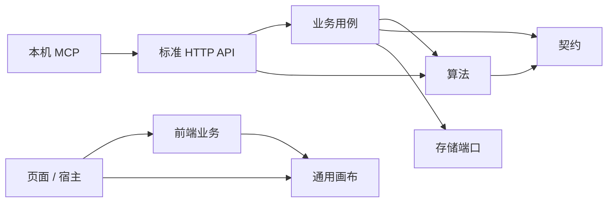

# 代码模块与实施进度

## 全量 React 化与历史旧代码彻底剔除（2026-11-25，已验证交付）

　　完成全仓历史经典页面、旧兼容 React 页面、后端旧一维宿主与零调用旧接口、`changyang` 旧 Excel/REST/ReCut 死代码与 POI 依赖、旧静态 JS/外链三方库及失效浏览器脚本的全面清退与复审清零（核心提交 `044e811`、`d857768`、`1132622`、`6f5dcbf`、`e57124a`、`e6f7a2d` 零冲突合入 `react`，累计 417 文件变更 +2,058 / -41,845 净删 39,787 行，成品 JAR 卸载 POI 后由 `137.3 MB` 瘦身至 `118.9 MB` 净减 `17.61 MB`；详见 [`docs/logs/2026-11-25_全量React化与历史旧代码彻底剔除交付.md`](logs/2026-11-25_全量React化与历史旧代码彻底剔除交付.md)）：
- **经典原生静态资产全面清退**：删除 17 个经典 `.html`、24 个 `static/css/**`、全部历史 `static/js/**`、`static/app/js/**`、`static/app/dist/**`、`static/vendor/**` 与 `static/konva.min.js`；将 1.62 MB 原始 DXF 样本迁出生产目录至 `src/test/resources/fixtures/dxf/`。`src/main/resources/static/` 从 209 文件瘦身至 27 文件，顶层严格仅保留 `api-v2/`（5 个 OpenAPI/Schema 契约）与 `app/`（Vite 直接构建产物）。
- **现代页补齐报工冲销并下线 5 个旧 React 兼容页**：在 `ResultsCenterPage.tsx` 与 `ReconciliationPage.tsx` 落地基于 `POST /api/cutting/reports/{planId}/reverse` 的报工冲销弹窗与纯函数校验模块 `reportReversalUtils.ts`（含全量复检历史 `dispositions.length === 0` 拦截与 1D 多车 LIFO 逆序串行冲销）；下线 `TasksPage`/`TaskEditPage`/`ExecutionCenterPage`/`QualityPage`/`AnalysisPage` 及专属 CSS，通过 `routeUtils.ts` 收敛轻量旧书签重定向并明确兼容范围：`#/task/<taskId>` → `#/demands?append=<taskId>`（`#/task` 与 `#/task/new` → `#/demands`）、`#/execution/...?intent=quality` 或 `/quality` → `#/reconciliation`（不含单据级 URL 定位参数）、非 `quality` 的 `#/execution/<taskId>/<planId>` → `#/results?taskId=<taskId>`（旧 `planId` 与新版 `SchedulingScheme.id` 聚合模型不同，按 `taskId` 筛选）、`#/tasks` → `#/demand-library`、`#/quality` → `#/reconciliation`、`#/analysis` → `#/cost-analytics`。
- **前端工程单一化收口与细节清零**：解耦剥离 `slitting.js` 与 `task-form.js` 冗余依赖后将 31 个纯计算模块迁入 `frontend/src/lib/{core,canvas,domain,nesting,model}/`（并删除 `frontend/src/lib/core/util.js` 中 7 个零调用旧导出：`esc`/`errorBox`/`solverSettings`/`DEFAULT_PREFS`/`loadPrefs`/`savePrefs`/`dismissOnOutside`），将 `konva`（v9.3.18）与 `sheetjs`（CE 0.20.3）迁入 `frontend/src/vendor/` 由 Vite 统一打包/懒加载分包，新建 `frontend/index.html` 并彻底删除 `@static/*` 别名；同步升级 `Dockerfile:42`、`SiteEntryTests`（含 `/index.html` 与 `/linear.html` 404 断言）与 `module-boundaries.test.mjs`，浏览器脚本从 45 个精简至 4 个现代现役脚本（`garment-width.cjs` 同步移除 `localhost:8080` 默认兜底并强制本机非 `8080` 隔离端口）。
- **后端旧一维宿主、零调用旧接口与 `changyang` 纯内核瘦身**：删除 `com.example.cutdemotwo.linear/**` 及其测试、删除 `src/main/java/changyang/**` 中全部 31 个不可达旧 Excel/REST/ReCut/PatternSolver 死类（精留 48 个纯计算内核文件）、删除 `src/main/resources/linear/output-template.xlsx` 并从 `pom.xml` 移除不再使用的 `org.apache.poi:poi-ooxml:5.2.5`；`ModuleBoundaryTests` 升级至 **14/14**（移除 `legacyLinearFiles` 白名单并新增 `changyang` 纯内核扫描门禁，禁止旧宿主包、`poi`/`spring-web`/`servlet`/`cutdemotwo` 依赖及 `resources/linear` 回流）；清理 `FabricCutController` 中 4 个零调用纯旧端点（`GET /api/scenario/{id}`、`POST /api/cutting/slitting-cars`、`POST /api/solve`、`POST /api/toolpath/optimize`）及 `ScenarioOneService`/`ToolpathRequest`，并将 `NativeSolverFallbackApiTests` 等价迁移至 `/api/v2/optimization-jobs`。

| 验证套件 | 发现/计划 | 实际执行 | 成功 | 失败 | 跳过 | 说明 |
| --- | --- | --- | --- | --- | --- | --- |
| Java 全量打包（`.\mvnw.cmd clean package`） | 573 | 558 | 558 | 0 | 15 | `e6f7a2d` 实跑；10 项缺原生 C++、5 项按需基准；`ModuleBoundaryTests` **14/14**、`SiteEntryTests` 1/1、`AuthSecurityFilterTests` 6/6、`NativeSolverFallbackApiTests` 4/4 全绿；成品 JAR `118,879,171 B`（较前版再减 `17.61 MB`），`linear/`、`changyang` 旧宿主包、`poi-*.jar` 均 0，`static/` 仅 `api-v2`/`app`（27 文件） |
| Frontend TypeScript（`tsc --noEmit`） | 1 | 1 | 1 | 0 | 0 | `e6f7a2d` 实跑 0 错误 |
| Frontend Vitest（`npm test --prefix frontend`） | 72 | 72 | 72 | 0 | 0 | `e6f7a2d` 实跑 15 个测试文件全绿（含 `reportReversalUtils` 4/4、`routeUtils` 4/4） |
| JS 模块与架构门禁（`node --test src/test/js/*.test.mjs`） | 164 | 164 | 164 | 0 | 0 | `e6f7a2d` 实跑 24 个文件全绿，含零 `@static` 与 `static/` 顶层白名单强门禁 |
| Benchmark 工具自测（`node --test benchmark/*.test.mjs`） | 21 | 21 | 21 | 0 | 0 | `6f5dcbf` 实跑通过（后续未改 `benchmark/`）；非真机求解质量门禁 |
| MCP 企业级集成测试（`npm test --prefix integrations/mcp`） | 12 | 12 | 12 | 0 | 0 | `6f5dcbf` 实跑通过（后续未改 `integrations/mcp/`）；14 工具与 OpenAPI 契约全绿 |
| Outbox 同步 Worker（`sync-worker.test.mjs`） | 7 | 7 | 7 | 0 | 0 | `6f5dcbf` 实跑通过（后续未改 `integrations/inventory/`）；崩溃自愈全绿 |
| 隔离 `18089` 真机浏览器验收（Playwright） | 35 | 35 | 35 | 0 | 0 | `e6f7a2d` 最新瘦身 JAR 实跑 `app-ui-preview.cjs` 22/22 + 旧书签上下文重定向专项 4/4（零写零错，库存 SHA-256 零变动）；`6f5dcbf` 实跑 `app-unified-workflow.cjs` 5/5 + `app-react-closure-and-perf.cjs` 4/4（带孔+20mm 疵点 18 点零侵入、跨任务复检三端一致、80 件 4 层 Konva 缩放/平移 P95 `16.8ms`）；另于 `e6f7a2d` 实测 `garment-width.cjs` 缺 `BASE_URL` 与传 `8080` 均断言 exit 1 拒跑（未重跑完整服装长耗时试算） |
| **合计（自动化测试用例）** | **885** | **870** | **870** | **0** | **15** | 正式 `8080` 已使用最新瘦身 JAR 常驻重启且 `/api/health`、`302 /app/`、`/app/assets/*` 均 200，`/index.html`/`/linear.html`/`/konva.min.js`/`/app/js/main.js` 均 404；原生 C++ 与 MySQL 8.4 由 GitHub Actions CI 承接 |

## 跨环节加工正确性、复检一致性与生产闭环全面清零（2026-11-25，已验证交付）

　　完成本轮四路 5 笔提交的零冲突合入、OpenAPI 契约同步、前端统一构建、全仓自动化验真及隔离端口 `18087` 三套真机 Playwright 验收（详见 [`docs/logs/2026-11-25_跨环节加工正确性复检一致性与生产闭环全面清零.md`](logs/2026-11-25_跨环节加工正确性复检一致性与生产闭环全面清零.md)）：
- **带孔裁片 CNC 先孔后外与全链路 `shape.holes` 无损**：打通 `StudioDemandPoolService`、`nesting-request-adapter.js`、`StudioMaterializer`、`SchedulingStudioService`、`useWorkbenchSolver.ts` 与 `cam-format.js` 全链路内孔无损透传与旋转变换；G-Code 严格按“先切全部内孔（`INNER HOLE`）、后切外轮廓（`OUTER CONTOUR`）”输出，AutoCAD R12 DXF 扩展至 7 个图层（新增 `1_PIECES_HOLES`）。
- **工位边界 20mm 安全边距避疵裁窗前后一致**：前端新建 `defectWindowUtils.ts`（1:1 对齐 `CuttingWorkflowService.windowDefects` 先扩边再裁切语义），后端 `GlobalPlanningService.sliceDefectsForWindow` 同步对齐，根治起切线外沿 20mm 安全禁区跨窗丢失；同步解除联排预筛中对异形 90° 旋转的限制。
- **跨任务合排复检归属、采购适配过滤、1D 刀架硬约束与 Outbox 崩溃自愈**：`ProductionCostAndProcurementService` 结合 `pieceSources`/`pieceResults`/`qualityDispositions` 实现跨任务复检净良品面积与残值精确守恒归属，采购备料剔除窄幅/异缸/异色不可适配库存且强同缸严禁跨缸凑数；工作台接入一维刀架物理硬约束（最大刀数、最小刀距、细边丝禁区、切缝、换刀统计）与 `/api/v2/reconciliation/reports` 报工复检实绩投影；`IntegrationService` 新增 `REJECTED` 态按需返回的 `rejectedToken`（同步补录 `openapi.json` 可选字段）配合 `sync-worker.mjs` 本地原子状态文件实现崩溃重启双保险自愈。
- **现代 React 真机双链路与四层画布性能基线**：新增并实跑 `src/test/browser/app-react-closure-and-perf.cjs`（同时修正含“内孔”名称裁片对 `[OUTER CONTOUR]` 注释行解析优先级），归档旧 DOM 性能脚本并清零进度文档断链与口径偏差。

| 验证套件 | 发现/计划 | 实际执行 | 成功 | 失败 | 跳过 | 说明 |
| --- | --- | --- | --- | --- | --- | --- |
| Java 全量（`.\mvnw.cmd clean package`） | 584 | 569 | 569 | 0 | 15 | 10 项本机缺原生 C++ 二进制跳过，5 项按需基准；`GlobalPlanningAndCostTests` 12/12、`IntegrationDeliveryTests` 8/8、`ModuleBoundaryTests` 13/13 全绿 |
| Frontend TypeScript（`tsc --noEmit`） | 1 | 1 | 1 | 0 | 0 | 0 错误 |
| Frontend Vitest（`npm test --prefix frontend`） | 64 | 64 | 64 | 0 | 0 | 13 个测试文件全通过（含 `defectWindowUtils` 5/5、`slittingConstraintsAndQualityProjection` 7/7） |
| JS 全量（`node --test src/test/js/*.test.mjs`） | 344 | 344 | 344 | 0 | 0 | 含 `cam-format` 6/6、`nesting-request-adapter` 5/5 与模块边界门禁 |
| Benchmark 工具自测（`node --test benchmark/*.test.mjs`） | 21 | 21 | 21 | 0 | 0 | 仅校验基准题目生成、统计聚合与红线判定逻辑（非真机求解质量门禁） |
| MCP 企业级集成测试（`npm test --prefix integrations/mcp`） | 12 | 12 | 12 | 0 | 0 | 14 工具、HTTP 鉴权、脱敏审计与 OpenAPI 契约全绿 |
| Outbox 同步 Worker（`sync-worker.test.mjs`） | 7 | 7 | 7 | 0 | 0 | 含本地原子持久化恢复、`rejectedToken` 列表兜底与 `STALE_ATTEMPT` 自愈 |
| 隔离 `18087` 真机浏览器验收（Playwright） | 19 | 19 | 19 | 0 | 0 | `app-react-closure-and-perf.cjs` 4/4（带孔+20mm边界疵点 `.nc` 内孔2段先于外轮廓2段/18点零侵入；双任务复检三端一致 `netGoodA=1/openA=1/netGoodB=2/quality=3/costA=0.20m²/costB=0.48m²`；80件四层 Konva 缩放 P50 `16.7ms`/P95 `16.8ms`、平移 P50 `16.7ms`/P95 `16.8ms`）+ `app-ui-preview.cjs` 10/10 + `app-unified-workflow.cjs` 5/5；验毕彻底清理临时目录，正式库存 SHA-256 零变动 |
| **合计（自动化测试用例）** | **1,052** | **1,037** | **1,037** | **0** | **15** | 原生 C++ 二进制与 MySQL 8.4 集成验证由 GitHub Actions CI 承接 |

## 全流程真机浏览器端到端走查、10 项实质缺陷清零与体验闭环（2026-11-25，已验证交付）

　　基于独立免登隔离服（`18085`）与企业认证隔离服（`18086`，`cutdemo.auth.enabled=true`），使用内置浏览器完整走查 4 条真实工厂业务链路，并彻底修复复测了走查暴露的全部 10 项功能闭环、鉴权协议、算法约束与暗色/平板视觉问题（详见 [`docs/logs/2026-11-25_全流程真机浏览器走查缺陷清零与体验打通.md`](logs/2026-11-25_全流程真机浏览器走查缺陷清零与体验打通.md)）：
- **母卷来料质检放行与待检卷禁领料闭环**：新增 `RemnantService.completeMotherRollInspection` 与 `POST /api/v2/quality/rolls/{rollId}/inspect-complete`（`ADMIN`/`INSPECTOR` 权限并补录 OpenAPI 3.1），领料过账拦截非 `PASSED` 母卷；前端 `InspectionPage` 新增自动落盘待存疵点 + 「✓ 质检合格放行 / 判不合格」弹窗闭环，`DocumentsPage` 增加采购过账回执直达验布按钮、历史行直达链接及领料下拉禁用未放行卷。
- **企业认证 SSE 鉴权 HTTP 200 与防越权旋转零 400**：升级 `job-client.js` 浏览器侧优先以 `fetch` 流式读取 `text/event-stream`（复用全局 Bearer 拦截器并由 `AbortController` 优雅收口），彻底消除认证模式下原生 `EventSource` 必吃 401；修复 `nesting-request-adapter.js` 与 `useWorkbenchSolver.ts` 策略强行覆盖禁用旋转/半转约束导致的确认落库 400。
- **工作流跨页打通与现场防呆**：修复 `ResultsCenterPage` 复盘画布硬编码「演示材料」并隐藏已完工/冲销方案的 MES 派工按钮；`GlobalPlanningPage` 补齐联排 CSV 导出及联排/分床「一键生成需求族并转工作台」；`CuttingWorkbenchPage` 增加同缸/色号防色差顶部红色前置拦截条与「一键切同缸卷」按钮；`DemandLibraryPage` 新增生产属性快捷编辑弹窗（支持 `StudioDemandPoolService` 空串清空可选字段）；`ProductionCostAndProcurementService` 纳入非报废历史/待检卷门幅避免误回退 `1500mm`。
- **暗色主题全站清零与工业平板/桌面响应式修复**：`WorkbenchBoardCanvas` 暗色母卷改为深岩灰 `#1e293b`，`tokens-dark.css` 全面清零 `#/results`、`#/planning`、`#/cost-analytics`、`#/inventory`、`#/demands`、`#/demand-library` 暗色亮白块与隐形字；采购弹窗加宽至 `1120px`、库存操作列紧凑防截断、工作台 `.ctool` 换行、Toast 移至顶部居中不遮挡主按钮、全局 `.cards > .card` 垂直分层、`<=1120px` 平板默认折叠右侧方案栏（`1024×768` 画布实测宽度 `592px`）。
- **验证结果**：Java 全量 `579` 发现 / `564` 执行 / `564` 成功 / `0` 失败 / `15` 跳过（仅原生 C++/按需基准跳过）；`tsc --noEmit` 0 错误；Vitest `52/52`；JS 全量 `341/341`（含新增 fetch SSE 与防越权旋转单测）；Benchmark 工具自测 `21/21`（`node --test benchmark/*.test.mjs`，不含真机求解质量门禁）；MCP `12/12`；Outbox Worker `4/4`；隔离服 `18085` 与 `18086` 双路浏览器真机复测全部通过（`inspector` 放行 HTTP 200、`planner` 4 路 SSE 全部 HTTP 200）。

## 第三波（阶段四）工业算法、CAM 刀路与 AI 生态跃升终验与全四阶段收官（2026-11-25，已验证交付）

　　完成第三波 4 路并行改造的零冲突合入、跨端契约与真机联调修正、全仓自动化验真及隔离端口 `18083` 浏览器与 SSE 专项验收（详见 [`docs/logs/2026-11-25_第三波阶段四工业算法CAM刀路与AI生态跃升终验.md`](logs/2026-11-25_第三波阶段四工业算法CAM刀路与AI生态跃升终验.md)），标志着本轮一至四阶段全部演进目标闭环收官：
- **二维原生工艺、孔洞内套料与工业级 CAM 刀路优化**：`NestingProblem` 新增双轴对格（`repeatXMm/phaseXMm/patternAnchorXMm`）、同组一致倒顺毛（`grainGroupId`）、内孔洞（`Shape.holes`）与直刀通切阶数上限（`Process.maxStages`），放开原生 `kerf ∈ [0, 50]` mm 与矩形原生 `pieceGap ∈ [0, 100]` mm；自主异形引擎实现带孔内套料（`Hole IFP`）与 JTS 负 Buffer 微缩修复 U/C 形深凹轮廓自交，纯布边禁区支持分区并行求解；`ToolpathOptimizerService` 升级真正 2-Opt/Or-opt、任意角度共边去重与闭合轮廓 CAM 刀路（先内孔后外轮廓、先子后母、小件防飞料、废料侧引入线与微连接），`RectangularResultValidator` 补齐直刀防劈穿与 `halfKerf` 侵蚀验真。
- **一维物理刀架硬约束、换刀 TSP 排序、2D/1D 双池隔离与 SSE 实时推送**：`SlittingProblem` 新增并独立验真单车刀数上限 `maxKnives`、最小刀距 `minBladeSpacingMm`、危险细边丝禁区、切缝 `kerfMm` 与多规格母卷宽幅池 `candidateRollWidths`，配套 `ConstrainedSlittingSolver` 与 `KnifeSetupSequenceOptimizer`（输出 `estimatedKnifeChanges` / `knifeChangesSaved`）；`OptimizationService` 拆分 2D/1D 算力双池、去除全类 `synchronized(this)` 改为按 `jobId` 细粒度锁并上线 `GET /api/v2/optimization-jobs/{jobId}/events`（`text/event-stream` 推送 `progress`/`done` 且自动注销防泄漏、`capabilities()` 公布 `sse: true`）；`JdbcOptimizationJobStore` 实现锁外校验与按节点槽位水平扩容。
- **全局联合排产、服装自动分床与实绩成本采购建议**：新建 `GlobalPlanningController` 暴露 4 个纯只读零写库接口——多料头接力+多门幅母卷对比联排（`POST /api/v2/planning/multi-material`）、服装颜色×尺码多床自动分床与尺码守恒核对（`POST /api/v2/planning/cut-plan`）、遵循净良品/复检撤销口径的实绩成本与残值核算（`GET /api/v2/analytics/cost-summary`）及跨订单安全库存预警与采购建议（`GET /api/v2/analytics/procurement-suggestions`）；`MotherRollInfo` 补充可选采购单价字段。
- **企业级 14 工具 MCP、Outbox 同步 Worker、SSE 前端与高级规划分析页面**：MCP 补齐至 14 工具并支持 Streamable HTTP（强制 `>=16` 位 Bearer 鉴权 + 脱敏 JSONL 审计）与待审批草稿令牌（绝不写库）；新增外部库存 Outbox 同步 Worker（`integrations/inventory/sync-worker.mjs`）；前端 `job-client.js` 优先 SSE 并无缝降级轮询；新建懒加载页面 `#/planning`（`GlobalPlanningPage`）与 `#/cost-analytics`（`CostAnalyticsPage`）。联调阶段同步收口 `optimization-request.schema.json` 与 `openapi.json` 严格双向契约对齐、`AuthSecurityFilter` 对 `/api/v2/planning/**` 的 `PLANNER/ADMIN` RBAC 授权、`GlobalPlanningPage` 请求签名与两页数字表单 `step="any"` 修复、`NumberInput` 渲染阶段即时同步及 `GlobalPlanningService` 0.1 mm 保守精度对齐。

| 验证套件 | 发现/计划 | 实际执行 | 成功 | 失败 | 跳过 | 说明 |
| --- | --- | --- | --- | --- | --- | --- |
| Java 全量（`./mvnw.cmd clean package`） | 579 | 564 | 564 | 0 | 15 | 10 项本机缺原生 C++ 二进制跳过，5 项按需基准；`ModuleBoundaryTests` 13/13、`AuthSecurityFilterTests` 6/6 与全部第三波算法/SSE/规划测试全绿 |
| Frontend TypeScript（`tsc --noEmit`） | 1 | 1 | 1 | 0 | 0 | 0 错误 |
| Frontend Vitest（`npm test --prefix frontend`） | 52 | 52 | 52 | 0 | 0 | 11 个测试文件全通过 |
| JS 全量（`node --test src/test/js/*.test.mjs`） | 337 | 337 | 337 | 0 | 0 | 含 SSE/轮询降级回归与模块边界门禁 |
| Benchmark 工具自测（`node --test benchmark/*.test.mjs`） | 21 | 21 | 21 | 0 | 0 | 仅校验题目生成、统计聚合与 `thresholds.json` 红线判定逻辑（不启动真实求解服务）；真机质量阈值门禁须另行启动隔离服务运行 `node benchmark/run.mjs --check-thresholds` |
| MCP 企业级测试（`npm test --prefix integrations/mcp`） | 12 | 12 | 12 | 0 | 0 | 14 工具、HTTP 鉴权、脱敏审计与 7/7 严格 Schema 校验全通过 |
| Outbox 同步 Worker（`sync-worker.test.mjs`） | 4 | 4 | 4 | 0 | 0 | 领取、幂等转发、退避重试与滞后告警全通过 |
| 隔离 `18083` 浏览器与 SSE 验收（Playwright） | 19 | 19 | 19 | 0 | 0 | `app-ui-preview.cjs` 10/10 + `app-unified-workflow.cjs` 5/5 + 阶段四真机浏览器与 SSE 专项 4/4（`#/planning`、`#/cost-analytics`、2D/1D 真实 SSE 流、`/app/dist/` 全部 chunk 200、零错误） |
| **合计（自动化测试用例）** | **1,025** | **1,010** | **1,010** | **0** | **15** | 原生 C++ 二进制与 MySQL 8.4 集成验证由 GitHub Actions CI 承接 |

## 第二波（阶段三）工厂投产闭环交付与验收（2026-11-25，已验证交付）

　　完成第二波 4 路并行改造的集成合入、跨端契约联调修正、全量自动化验真与隔离浏览器实测（详见 [`docs/logs/2026-11-25_第二波阶段三工厂投产闭环交付与验收.md`](logs/2026-11-25_第二波阶段三工厂投产闭环交付与验收.md)）：
- **认证鉴权、全局异常、OpenAPI 契约与架构债清零**：落地默认关闭、按需开启的轻量企业认证（HS256 令牌 + 5 角色 RBAC + 2MB 请求体 413 保护 + 600 次/分写限流）与 `GlobalApiExceptionHandler` 全局异常脱敏兜底；同步 OpenAPI 3.1（49 路径 / 82 Schema）与 JSON Schema；将 `StoredOptimizationJob`/`OptimizationFailure` 迁入 `contracts/jobs/` 彻底解除 `persistence -> business.optimization` 循环依赖并收紧 `ModuleBoundaryTests`；清理 0 引用死文件与全仓 `@CrossOrigin`。
- **工厂生产闭环单据与 V10 持久化**：落地隔离料头质量放行单、复检处置受控撤销（追加痕迹、原母卷消耗不变、派生料头转 `REVOKED`）、采购批量入库单、车间领/退料单、母卷级受控报废单、缸号/色号/缩水率防色差校验、需求生产主数据与一键同缸加急补片单；新增 Flyway V10 迁移表与 File/JDBC append-only 校验，补齐主流列表分页摘要及聚合报工分页接口（`/api/v2/reconciliation/reports` 彻底消 N+1）。
- **四层工业 CAD 画布重构与工作台核心工具回迁**：拆分纯几何/标尺内核并重构四层独立 Konva Layer + 贴边标尺 + 视口裁剪；修复 `InspectionPage` 10Hz 跑布全量销毁重建；回迁撤销/重做栈、方向键微调、右键菜单、计划余料抛弃、走刀动画仿真、连续开卷起切点调节与避疵建议拉布；新增草稿保护、切料二次确认、CNC 后处理参数、暗色车间主题 `tokens-dark.css` 及平板触控适配。
- **路由懒加载拆包瘦身与工厂业务页面闭环**：非首屏 15 个路由全面接入 `React.lazy` + `Suspense`（主入口 `react-app.js` 降至 640.35 kB / gzip 199.47 kB，拆出 24 个按需 JS chunk）；落地认证门控弹窗、库存隔离放行/母卷报废/扫码定位、采购入库与领退料单据页、Code128B SVG 随工单条码与扫码定位、对账消 N+1 分页与复检撤销；联调修复复检撤销读模型/嵌套字段、入库单 `lines`/领退料 `toLocation` 对齐、结果中心 CNC 参数透传与 `AuthContext` 控制器层透传。

| 验证套件 | 发现/计划 | 实际执行 | 成功 | 失败 | 跳过 | 说明 |
| --- | --- | --- | --- | --- | --- | --- |
| Java 全量（`./mvnw.cmd clean package`） | 541 | 526 | 526 | 0 | 15 | 10 项本机缺原生 C++ 二进制跳过，5 项按需基准；`ModuleBoundaryTests` 13/13、认证/异常/工厂单据全通过 |
| Frontend TypeScript（`tsc --noEmit`） | 1 | 1 | 1 | 0 | 0 | 0 错误 |
| Frontend Vitest（`npm test --prefix frontend`） | 48 | 48 | 48 | 0 | 0 | 10 个测试文件全通过 |
| JS 全量（`node --test src/test/js/*.test.mjs`） | 334 | 334 | 334 | 0 | 0 | 含复检撤销投影回归与模块边界门禁 |
| Benchmark 工具自测（`node --test benchmark/*.test.mjs`） | 21 | 21 | 21 | 0 | 0 | 仅执行基准工具与红线评估逻辑单测（不启动真实求解服务，非真机求解质量门禁） |
| MCP 集成测试（`npm test --prefix integrations/mcp`） | 8 | 8 | 8 | 0 | 0 | 协议发现与权限边界 |
| 隔离 `18082` 浏览器验收（Playwright） | 19 | 19 | 19 | 0 | 0 | `app-ui-preview.cjs` 10/10 + `app-unified-workflow.cjs` 5/5 + 第二波工厂闭环与懒加载专项 4/4（21 个 chunk 全 200、零错误） |
| **合计（自动化测试用例）** | **972** | **957** | **957** | **0** | **15** | 原生 C++ 二进制与真实 MySQL 8.4 Flyway V10 验证由 GitHub Actions CI 承接 |

## 第一波 P0 止血与工程防回归护栏全清零（2026-11-25，已验证交付）

　　完成第一波 4 路并行改造的集成合入与联调收口（详见 [`docs/logs/2026-11-25_第一波P0止血与工程防回归护栏全清零.md`](logs/2026-11-25_第一波P0止血与工程防回归护栏全清零.md)）：
- **运维、可观测性、CI 与架构门禁**：接入 Actuator/Prometheus、优雅停机、`TraceIdFilter` 请求追踪与结构化/JSON 日志；收口 `application-mysql.properties` 生产契约、Docker/Compose 配置、GitHub Actions Buildx 缓存与 MySQL 8.4（`utf8mb4_bin`）集成测试；新增 MySQL 备份/恢复脚本与 Benchmark 质量红线门禁；扩展 `ModuleBoundaryTests` 至 13 项覆盖 `config`/`controller`/`persistence`/`changyang.*` 边界；归档 5 篇根目录开发日志至 `docs/logs/`。
- **算法稳定性与资源防失控**：文件/JDBC 作业存储落地终态滚动清理与动态 `capabilities()` 上报；修复一维温热子 JVM 取消死锁并外部化子进程池与 4KB stderr 诊断缓冲；原生 2D 引擎接入 `--memory-limit` 与退出前 `solver.log` 尾部摘录；重构 `ColumnGenerationSolver` 为单次 GCD 压缩扁平 DP 并加装状态上限与超时中断；窗帘约束下自动绕过原生直刀引擎并透传唛架 `fabricRule`。
- **持久化性能、安全底线与账本闭环**：移除 `JdbcInventoryStore.load()` 读锁、新增无锁 `currentRevision()` / 健康探针与 503 降级、收敛快照有序性与单次反序列化；收紧演示接口硬开关（403）与 MES 常量时间 Bearer 鉴权（401/503），并将 MES 工单同步/完工回传收敛为单一原子写事务且审计透传真实操作人；统一活跃 `SchedulingScheme` 与执行单双轨预约锁及报工冲销 `REVERSED` 联动；落地跨任务多族合排 `sourceAllocations`、二维手调/物化四重几何与旋转许可校验、1D 禁丢车与全局 `pieceSeq`、自动建卷默认 `PENDING`（禁止跳过质检）及无副作用 `POST /api/v2/schemes/validate-layout`。
- **前端工业防呆与测试护栏**：手调接入 `layoutDirty` 门控与后端校验重建刀路；补齐异形轮廓 G-Code 导出；A4 车间工单移除行数截断并完善工单号/SVG/打印样式；一键完工增加二次确认弹窗并清零全站 `window.confirm()`；联调对齐待检母卷提示引导与 1D `allocations.quantity` 字段契约；接入 `tsc --noEmit` 与 Vitest（19 项单测）。

| 验证套件 | 发现/计划 | 实际执行 | 成功 | 失败 | 跳过 | 说明 |
| --- | --- | --- | --- | --- | --- | --- |
| Java 全量（`./mvnw clean test`） | 525 | 510 | 510 | 0 | 15 | 10 项因本机缺原生 C++ 二进制跳过，5 项为 `SlittingQualityBenchmarkTest` 按需基准；`ModuleBoundaryTests` 13/13 全通过 |
| Frontend TypeScript（`tsc --noEmit`） | 1 | 1 | 1 | 0 | 0 | 0 错误 |
| Frontend Vitest（`npm test --prefix frontend`） | 19 | 19 | 19 | 0 | 0 | 4 个测试文件 |
| JS 全量（`node --test src/test/js/*.test.mjs`） | 333 | 333 | 333 | 0 | 0 | 含 `cam-format.test.mjs` 与模块边界门禁 |
| Benchmark 工具自测（`node --test benchmark/*.test.mjs`） | 21 | 21 | 21 | 0 | 0 | 仅执行基准工具与红线评估逻辑单测（不启动真实求解服务，非真机求解质量门禁） |
| MCP 集成测试（`npm test --prefix integrations/mcp`） | 8 | 8 | 8 | 0 | 0 | 协议与权限边界 |
| 隔离 18081 浏览器回归（Playwright） | 15 | 15 | 15 | 0 | 0 | `app-ui-preview.cjs` 10/10 + `app-unified-workflow.cjs` 5/5（含新建 `PENDING` 卷质检放行后绑卷） |
| **合计（自动化测试用例）** | **921** | **906** | **906** | **0** | **15** | 本机未验证原生 C++ 二进制与远程 MySQL 8.4 CI（由 GitHub Actions 承接） |

## 左栏分页模态弹窗式「系统与引擎设置」重构（2026-11-18，已验证交付）

　　将左下角「系统与引擎设置」由独占主内容区的稀疏单页重构为原生 `<dialog>` 模态弹窗（`SettingsModal.tsx`），点击侧栏底部入口、顶部栏右上角「求解引擎」状态胶囊或工作台「基础工艺 → 更多全局工艺与引擎设置…」均原位弹出，不卸载底层 CAD 画布与在编输入，同时保留 `#/settings` 与 `#/settings/<tab>` 路由深链兼容。弹窗采用定高双栏结构（左栏纵向 5 模块 Tab 导航 + 右栏滚动设置区）：覆盖「画布与常规」、「裁切工艺与预设」（复用 `industry-profiles.js` 四套工厂预设一键套用与自动匹配识别）、「料头与余料策略」、「求解引擎与配额」（实时并发池监控与 7 内核状态表）及「导出与系统接入」，由 `studioSettings.ts` 与 `useStudioStore` 统一桥接 `cam_*` / `cutplan.app.prefs` 本地持久化并真实注入工作台排料请求与结果中心导出/工票，清退废弃单页 `SettingsPage.tsx`。验证结果：Node.js 前端单元与边界测试发现/实际执行/成功 325 项，隔离 `18080` 服务 Playwright 浏览器验收发现/实际执行/成功 15 项（`app-ui-preview.cjs` 10 项 + `app-unified-workflow.cjs` 5 项），失败 0、跳过 0；`8080` 已重打包重启且健康状态 `UP`。

## 四大业务域与「搭切前→搭切中→搭切后」统一排程闭环重构（2026-11-18，已验证交付）

　　按现场排产与 MES 协同链路完成产品信息架构、领域模型、持久化快照（File + Flyway V9 JDBC）、REST 契约与 React 工作台的整体重构。左侧导航收敛为四大核心业务域加独立示例场景：`1. 需求管理`（待排需求池 `#/demands`、需求模板库 `#/clusters`）、`2. 搭切工作台`（智能搭切排程 `#/workbench`，统一二维异形/矩形与一维定长分切）、`3. 结果管理`（排程方案与导出 `#/results`、复检补排与对账 `#/reconciliation`）、`4. 库存管理`（母卷与料头台账 `#/inventory`、跑布验疵定位 `#/inspection`、移库与盘点单据 `#/documents`），并将原位于求解场景下的「多门幅工艺对比」（`#/garment`）归位至 `示例场景`，旧路由（`#/tasks`、`#/execution`、`#/quality`、`#/analysis`、`#/slitting`）完整保留兼容。

　　后端新增 `DemandTemplate`（可复用纸样簇/套系/分条需求模板）与 `SchedulingScheme`（已选定排程方案一等聚合，冻结二维精确坐标或一维刀组配方，确认时零重算），配套 Flyway `V9__demand_templates_and_schemes.sql`、`SchedulingStudioService` 与 `StudioWorkflowController`。需求池统一建立 `总需求 orderedQty = 待排余量 openQty + 已排预占 plannedQty + 实切合格 completedQty` 三态守恒账本：工作台试算不扣库存，点击「选定此方案」即时将对应数量从 `openQty` 转入 `plannedQty`；默认画布自动创建虚拟新母卷直接排程（生成 `AWAITING_ROLL` 方案及建议备料门幅/最小卷长），亦可选在库合格母卷或料头直接锁料（生成 `READY_TO_CUT`）；结果管理支持虚拟母卷一键建卷/绑实卷、CAD DXF / CNC G-Code / 分切 CSV / Excel / MES 派工指令包 / A4 车间随工裁切单打印、一键或明细完工过账，以及作废回滚恢复待排需求。母卷管理新增 `/api/rolls/{rollId}/spatial-map` 与全长比例切割空间条（`看已切割区域`），同屏展示已切割历史区、排程预占区、净可排余量与疵点分布，并贯通 MES 工单下推与完工反馈闭环（`/api/v2/mes/*`）。

　　自动化验证结果：Java 全量测试发现/实际执行/成功 419 项，Node.js 前端单元与模块边界门禁发现/实际执行/成功 325 项，MCP 集成测试发现/实际执行/成功 8 项，隔离 `18080` 服务 Playwright 浏览器验收发现/实际执行/成功 14 项（`app-ui-preview.cjs` 10 项 + `app-unified-workflow.cjs` 4 项），合计 766 项全部通过，失败 0、跳过 0。

## 服装分支的唛架幅宽试算

　　服装示例默认在齐套后试排同款补片。标准作业策略接收各裁片的备片上限，按原片位置和实际版长搜索空隙，再对原片与补片一起做几何校验。返回的补片清单和含补片利用率独立于原配码的齐套指标。1950 × 1202 mm 上衣原图从 18 片加到 21 片，含补片利用率从 84.46% 升至 87.66%。[原图复核](服装唛架密排实测.md)

　　服装页现有 10 个可编辑示例。试算条件首行的「允许 180° 旋转」复选框控制逐幅方向对比，参数说明可通过标题旁的问号查看。唛架策略 v2 在原有缩长搜索后增加直接定幅搜索和轮廓压紧。掉头紧窗缺片时可按原始起长复试，并保留同幅已验证固定方案。原七个示例的 15 个幅宽和新增三例的 5 个幅宽均已实算，40 个方向对照均有齐套图。简化六片裙在 1270 mm 幅宽达到 91.07%，直裁抽褶裙在 1400 mm 幅宽达到 100%。[逐幅数据与计算口径](服装唛架密排实测.md)

　　本轮 Java 395 项、JavaScript 306 项、MCP 8 项、服装浏览器 17 项全部通过，均失败 0、跳过 0。Windows 队列测试在普通后台计时环境下超出 60 秒，测试 JVM 显式请求并启用 1 ms 计时精度后通过，原有吞吐门槛与断言保持有效。正式 8080 新产生的 29 对 HTTP 输入及输出均通过契约核验，另验证了半裙紧窗缺片后复试的浏览器回放。

　　服装试算支持按幅宽比较固定方向与 180° 掉头。轮廓裁片的可选字段 `allowHalfTurn` 在 `allowRotation=false` 时增加 180° 方向；原生 PackingSolver、Java 轮廓引擎和独立几何校验共用允许角度。旧输入保留原有方向语义。结果显示本轮已验证齐套方案的最高利用率、实际掉头片数与同幅宽差值。

　　默认上衣 M/L 各 1 件，本地最终浏览器验收中，1600、1850、1950 mm 固定方向的利用率分别为 75.93%、82.28%、80.64%，允许掉头后分别为 82.10%、84.14%、82.63%，实际掉头 3、7、5 片。六个方案均齐套。结果仅代表本轮限时搜索。Java 388 项、JavaScript 303 项、MCP 8 项、服装浏览器 13 项通过，失败和跳过均为 0。

　　试算页第一批提供七组可编辑示例，选择后填入款式、M/L 配码、有效幅宽、布边和克重，点击「试算幅宽」才提交计算。该批新增背心、短裤和围裙三款简化样板，沿用固定纱向和主辅片齐套校验。

　　`feather1130` 在新版增加「服装 → 唛架幅宽试算」，以 M/L 成衣配比展开内置衣片，逐幅调用标准齐套缩短作业，比较唛架图、利用率和布边计重单耗。入口为 `/app/#/garment`。彩页字段、指标口径及订单分床等后续范围见[服装行业设置与求解](服装行业设置与求解.md)。

　　Windows 一维分切的运行时探测与子进程启动统一使用 JDK 的 `bin/java.exe`。本地 Java 全量 387 项、前端单元测试 303 项、MCP 8 项和一维浏览器流程 4 项均通过。原用例库浏览器回归执行 26 项，21 项通过，5 项达到求解时限（场景 4、6、批量上衣、批量长裤、整单服装）。从基线 `118d82b` 生成的这五个请求与当前输入逐项相同，在同一二维服务重放均超时。原有三个齐套缩短用例通过。

## 工作台 UI 统一与自动拉布（2026-11-16，已确认交付）

任务列表合并名称、编号和来源，以数值及进度条表达良品完成量，操作名称随任务状态变化。工作台统一任务标题、状态、输入摘要和控件规格；计算/报工主操作固定在右栏底部。同区间候选可直接切换，指标按当前方案统计，失效候选突出重新计算并禁止报工。执行页空状态提供任务方案入口，减少说明性文案。

“计算本工位/重新计算”接入自动拉布：窗口短于剩余需求时，在第一次请求前自动延长；若返回 `NO_SOLUTION_FOUND`，按后续疵点安全边界与单片尺寸逐次延长，起点始终保持不变，并重新截取窗口内疵点。只尝试卷尾及账面余量范围内的有限候选长度；服务错误、其他失败状态或离页时停止，不把整个搜索过程宣称为无解证明。重算成功才替换旧候选，失败保留原候选。

母卷导航旁保留“按需求拉布 · 建议长度”手动入口，复用经典版最长单片、旋转、纵切及切头规则，扣除已完成和已预约需求。手动入口只调整当前预览，不保存任务工艺、不创建候选、不扣库存。

拉布纯函数归入 `js/business/cutting/feed-length.js`，经典雷达原路径保留重导出。新版长度界限复用卷尾、账面余量和切头规则，移除固定 500–6000 mm 范围，输入保留 0.1 mm。料头整块投料、一维定长出车、执行锁定、报工/复检/调整和执行操作待确认期间均受保护。按最长单片不代表全部数量一次排完，疵点仍由求解验证；未改变算法或库存记账。

最终验证：Java 发现/执行/成功 387、JavaScript 发现/执行/成功 300、浏览器发现/执行/成功 24（自动拉布 8、工作台 9、候选 6、真实任务副本 1），合计 711，均失败 0、跳过 0。真实任务副本从起点 70302.4 mm、原窗口 1698.3 mm，点击一次即以 3570 mm 求解并生成 1 件候选；后端按实际排料收尾后方案范围为 3122.8 mm，库存、报工及完成量不变。通幅疵点用例验证从 4470.3 自动延长到 6490.3 mm 后成功，未跳过起点。另覆盖键盘操作、报工禁用、失败保留候选、卷尾拒绝和两种桌面尺寸。UI 首轮另有页面冒烟 10 项、管理入口 7 项、产出画布 6 项通过，未重复计入最终 711 项。首次沙箱 Java 执行出现 61 项 JVM attach/本地进程权限错误，正常本机环境同配置重跑全量通过，未修改构建配置或跳过校验。

8080 已打包重启，健康 UP、两种原生引擎可用，重启前后正式库存哈希相同；提交前核对全部 9 个受影响生产文件与验收包一致。截图、日志和回退命令位于 `data/releases/20261116-auto-feed-primary-preview/`。旧标签页须刷新才能加载新模块。用户已确认推送本版，远程 CI 与自动部署结果以本次提交的 GitHub Actions 为准。本批不宣称旧版全部能力迁移完成，既有 R1 性能门槛和其他迁移缺口仍按实施路线保留。

本文件记录实际代码组织和分批验收。总体方案已经批准；首期接入方式为独立服务 + 标准 API。不能把总体设计中的目标能力视为已经交付。

## 1. 模块地图

后端路径均相对 `src/main/java/com/example/cutdemotwo/`：

| 模块 | 路径 | 职责 | 允许的项目内依赖 |
| --- | --- | --- | --- |
| 共享契约 | `contracts/nesting`、`contracts/geometry`、`contracts/jobs`、`contracts/slitting` | 标准排样输入输出、几何、计算作业及兼容 DTO | 仅 contracts |
| 算法公共入口 | `algorithm/api` | 二维 NestingSolver、一维 ISlittingSolverEngine、刀路 ToolpathOptimizer；只暴露契约与计算异常 | api、contracts |
| 二维算法实现 | `algorithm/nesting` | 二维引擎注册、横切/矩形/异形求解、候选结果与独立校验 | nesting、api、geometry、toolpath、contracts、公共取消工具 |
| 一维算法实现 | `algorithm/slitting` | 一维标准契约到现有纯内核的隔离进程适配 | slitting、api、contracts、旧一维纯内核 |
| 几何与刀路 | `algorithm/geometry`、`algorithm/toolpath` | 无业务状态的几何计算、输入校验、刀路计算与调整校验 | 几何不依赖求解实现；刀路不依赖一维/二维求解实现 |
| 业务 | `business/cutting`、`business/model` | 业务请求适配、任务、材料、方案、报工及履约 | business、algorithm、contracts、存储端口 |
| 计算用例 | `business/optimization` | 独立计算作业、幂等、调度、取消与结果归档，不改写库存 | algorithm、contracts、存储端口 |
| 库存集成用例 | `business/integration` | 按序领取已提交事实、独立回执、过期隔离与重试，不写库存余额 | business/model、库存只读入口、存储端口 |
| 存储 | `persistence` | 文件/MySQL 快照与冲突控制 | 业务模型、contracts |
| HTTP | `controller` | 请求解码、调用用例、响应状态 | 业务、algorithm/api、contracts |
| 一维纯算法内核 | `changyang`（独立顶层包） | 既有 1D 分切纯算法与 OR-Tools 求解内核，受 `ModuleBoundaryTests` 严格限定仅由 `algorithm/slitting/` 适配调用（旧一维页面宿主 `linear` 已彻底删除） | 仅由 `algorithm/slitting/` 复用 |

前端源码统一收口于 `frontend/`（构建输出直写 `src/main/resources/static/app/`，彻底移除 `static/js/`、`static/app/js/` 与 `@static/*` 别名）：

| 模块 | 路径 | 职责 |
| --- | --- | --- |
| React SPA 壳与路由 | `frontend/index.html`、`frontend/src/{main,App}.tsx`、`frontend/src/utils/` | 应用入口、4 大业务域导航、14 个现代路由懒加载、5 条旧路由自动重定向与认证客户端 |
| 业务工作台与管理页面 | `frontend/src/pages/`、`frontend/src/store/` | 需求管理/模板库、搭切工作台（2D/1D 统一排程）、联合排产与成本分析、结果管理/报工冲销/复检对账、库存/验疵/单据、服装试算与能力展示，及 Zustand 全局状态 |
| 四层 CAD 画布与通用组件 | `frontend/src/components/`、`frontend/src/components/canvas/` | 四层独立 Konva Layer（`WorkbenchBoardCanvas` / `CadCanvasView`）、标尺几何、模态弹窗、设置弹窗与条码组件 |
| 纯计算模型与纯画布库 | `frontend/src/lib/{core,canvas,domain,nesting,model}/` | 纯前端几何场景、CAM 导出、需求导入、复检投影、优化作业客户端、1D/2D 排料适配与示例数据（`lib/canvas/` 严禁请求与存储访问） |
| 本地打包三方库与样式资产 | `frontend/src/vendor/{konva*,sheetjs/}`、`frontend/src/styles/`、`frontend/public/` | Vite 打包 Konva v9.3.18 与懒加载 SheetJS CE 0.20.3、明/暗色主题样式与静态示例图；`src/main/resources/static/` 顶层仅保留 `app/` 构建产物与 `api-v2/` OpenAPI 契约 |

MCP 独立 Node 模块位于 `integrations/mcp`：只调用标准 REST 并读取 OpenAPI 契约，不直接访问数据库、Java 内核或前端状态；比较规则统一放在计算用例。

### 1.1 依赖方向

画布不加载库存、不提交报工、不依赖全局工作台状态；通过 scene、overlay 和回调接收数据与交互。业务决定如何解释用户操作，服务端最终验证。

这些是**受测试约束的代码模块**，目前使用单个 Maven Spring Boot 应用配合 `frontend/` 统一 Vite React SPA 构建，不声称已经拆成多个 Maven 制品或完成独立 SDK。

### 1.2 迁移边界与保留事项

- `src/main/resources/static/` 顶层已严格收敛为 `app/`（Vite 产物）与 `api-v2/`（OpenAPI 3.1 / JSON Schema 契约）；全部历史经典 `.html`/`.css`/`static/js` 与 5 个旧 React 兼容页已彻底清退，旧 Hash 路由自动重定向至对应现代页面。
- 共享几何 DTO 中保留部分兼容展示/质检字段以兼容存量数据；不意味着所有字段都属于最终 v2 算法契约。
- 算法中的 Spring 注册与原生进程适配暂时保留；当前受 `ModuleBoundaryTests` 严格约束，禁止依赖业务对象和存储。
- 旧一维页面宿主 `linear/` 已彻底移除；标准 `SLITTING_1D` 通过 `algorithm/slitting/` 隔离进程适配复用 `changyang` 纯算法内核，`ModuleBoundaryTests` 已移除白名单并禁止全仓其他任何包引用 `changyang.*`。
- 标准业务和 HTTP 调用不得直接依赖 `algorithm/nesting`、`algorithm/slitting` 或 `algorithm/toolpath` 实现；通过 `algorithm/api` 注入，纯几何函数可复用 `algorithm/geometry`。
- 前端画布已重构为组件级四层独立 Konva Layer（`WorkbenchBoardCanvas` / `CadCanvasView`），`frontend/src/lib/canvas/` 保持零业务/零传输边界。
- 业务服务同时支持 File 与 MySQL JDBC（Flyway V1–V10）存储端口，含不可变账本流水、企业轻量认证（默认关闭按需开启）、Outbox 投递与复检处置受控撤销。

## 2. 分批实施

| 批次 | 内容 | 状态与验收 |
| --- | --- | --- |
| 01 | AI 开发规范、复检流程补充、算法/契约/业务/画布目录与依赖门禁 | 已完成；2026-10-20 验证与本地重启记录见下 |
| 02 | 产出身份、复检判定、转料头/报废、需求冲减、幂等及追溯 | 已完成；10 件转 8 件且原卷耗用不变，验收见下 |
| 03a | 单实例统一计算作业、持久化结果、能力查询和标准 API 契约 | 已完成；单材料二维输入、独占文件存储，验收见下 |
| 03b | 数据库作业与租约、多实例调度、引擎停止能力、更多问题适配及 UI 接入 | 进行中；内置算法协作停止、唛架编排与页面接入已完成；JDBC 租约调度及归档迁移通过 H2 与本机 MySQL 8.4 验证；一维标准作业及隔离进程已接入；多材料等问题、其余页面与统一资源限制仍待完成 |
| 04 | 执行单与预约、库存流水和对账迁移 | 进行中；二维任务执行、整料预约、不可变库存/需求流水及期初迁移、内部对账、移库单及盘点单已接入；其他库存单据、独立复验放行、一维业务闭环及外部对账仍待完成 |
| 05 | 任务/材料/分析/设置工作台重组 | 进行中；四主导航、多页签工作台、任务管理、现有材料档案/单据、实际报工分析/流水、本机设置入口、通用画布能力清单及二维顶部任务栏收敛已接入；C1–C6 画布实例抽离、更完整业务单据与页面内部重组继续实施 |
| 06 | 外部库存适配与 MCP 查询/计算/分析 | 进行中；本机 stdio MCP 查询、受控计算、指标比较和业务只读，以及内部权威库存 Outbox、专用凭据、按序投递/回执已接入；外部权威库存、完整跨系统对账、远程用户认证及持久化权限审计仍待实现 |

批次 02 不能用覆写原报工或调用整单撤回来替代复检。异形回收不能凭外接矩形生成超出实物的库存。

## 3. 验证入口与验收口径

- Java：`sh mvnw clean test`（模块迁移需清理旧 class），边界门禁与业务/算法测试一起执行。
- Frontend（React + TS）：`npm run typecheck --prefix frontend && npm test --prefix frontend && npm run build --prefix frontend`。
- JavaScript：`node --test src/test/js/*.test.mjs`。
- Benchmark 口径区分（与 `Dockerfile` `frontend-tests` 阶段严格对齐，绝不混称）：
  - **镜像/CI 构建阶段基准工具单测（21 项）**：`node --test benchmark/*.test.mjs`，仅校验基准题目哈希、调度轮次、统计口径与 `benchmark/thresholds.json` 红线判定函数本身，**不启动求解服务**；
  - **真机求解质量阈值门禁**：须独立启动隔离端口服务（配置原生 C++ 求解器路径与临时状态文件）后执行 `node benchmark/run.mjs --check-thresholds <服务地址>`（详见 [benchmark/README.md](../benchmark/README.md)），不可用上述 21 项工具单测冒充真机求解质量门禁。
- MCP：`npm ci --ignore-scripts --prefix integrations/mcp && npm test --prefix integrations/mcp`；真实协议链路另按该模块 README 在隔离服务执行。
- 浏览器（当前 React 主路由，强制非 8080 隔离端口 `BASE_URL`，全仓仅保留以下 4 个现役现代脚本）：
  - `src/test/browser/app-ui-preview.cjs`（14 个现代核心路由 + 5 条旧路由自动重定向只读冒烟）；
  - `src/test/browser/app-unified-workflow.cjs`（四大业务域与三阶段排程主流程回归）；
  - `src/test/browser/app-react-closure-and-perf.cjs`（现代闭环与性能基准：带孔异形裁片 + 边界 20mm 疵点加工闭环、跨任务复检三页一致性闭环含 `#/reconciliation` 冲销禁点、`WorkbenchBoardCanvas` 四层 Konva 画布滚轮缩放与拖拽平移 P50/P95 帧耗时采样）；
  - `src/test/browser/garment-width.cjs`（服装多门幅齐套试算回归）。
- 打包启动：正常构建后启动项目 JAR，确认 `/api/health`、`/` 302 跳 `/app/`、`/app/` 与 `/app/assets/*` 返回 200、旧 `/index.html` 与 `/linear.html` 返回 404。
- Docker CI 说明：`Dockerfile` 的 `frontend-tests` 阶段复制 `src`、`frontend`、`integrations/mcp` 与 `benchmark`（执行上述前端检查、JS 单测、`benchmark/*.test.mjs` 与 MCP 单测）；`build` 阶段仅复制 `pom.xml`、`src` 与 `static/app` 统一构建产物并执行 `mvn -B -Dcutdemo.requireNativeSolvers=true verify`，架构测试不得依赖缺失的仓库文档或外部路径。

## 4. 批次 01 验收记录（2026-10-20）

- 迁移 42 个后端生产类、26 个前端模块，更新调用方与测试路径；旧包/旧业务目录不残留在打包产物中。
- 消除算法校验对业务 SolveRequest 的依赖，以及几何 DTO 对算法面积计算的反向依赖；共用规则归入契约。保留既有 HTTP/JSON 和算法行为。
- 新增 4 项 Java 架构测试及 4 项 JS 模块/入口检查。Java 门禁在修复前确实发现两项反向依赖，修复后通过。
- 浏览器验收发现已有连续工位缺陷：需求字段顺序不同被 JSON 字符串比较误判为内容修改。改成结构化比较，增加先失败后通过的回归测试；真实需求修改仍被拒绝。
- 修正服装画布测试假设，按裁片身份与实际形状核验多边形和矩形，避免把合法矩形当作漏绘。

| 验证 | 发现/计划项数 | 实际执行 | 成功 | 失败 | 跳过 |
| --- | --- | --- | --- | --- | --- |
| Java（最终 verify） | 195 | 186 | 186 | 0 | 9 |
| JavaScript | 202 | 202 | 202 | 0 | 0 |
| 独立排样浏览器场景 | 21 | 21 | 21 | 0 | 0 |
| 共享画布浏览器场景 | 7 | 7 | 7 | 0 | 0 |
| 服装完整业务流程 | 4 | 4 | 4 | 0 | 0 |
| 连续工位/报工/余料/撤回 | 15 | 15 | 15 | 0 | 0 |
| 重启后 5 个页面加载 | 5 | 5 | 5 | 0 | 0 |

Java 的 9 项跳过因本机缺少原生 C++ 引擎；不代表原生引擎已验证。没有更改构建配置或跳过开关。

写入浏览器测试使用独立 18080 服务和临时库存。8080 已使用新包重启，`/api/health` 返回 UP，库存档案正常读取、健康接口料头数量重启前后均为 112。现有演示初始化逻辑会在启动时保存快照并递增版本，因此不以库存文件字节哈希相等作为重启验收依据。

批次 01 只完成代码模块与开发规范基础；复检处置单列在批次 02，统一异步服务、库存流水和页面重组仍待后续实现。

## 5. 批次 02 验收记录（2026-10-20）

- 报工记录内增加复检处置入口。原良品转料头或报废后扣回需求完成量；原异常件不重复扣量。原报工事实和原材料耗用保留。
- 追加式处置事件、派生料头、需求投影在现有事务中保持一致；验证写入失败回滚、数据库多实例竞争、重启和响应丢失后的幂等重试。
- 回收矩形必须完全位于实物轮廓内；包括凹口穿越校验。隔离料头可在库存查看和追溯，不能扫码选料。禁止通过原报工撤回或演示重置破坏复检链路。
- 报工列表、工位摘要、需求变化说明、当前面积指标、画布异常状态与打印追溯同步更新。利用率仍为净良品面积 ÷ 实际耗用面积，未把回收面积计入良品。
- 浏览器测试发现并修复了表单 `length` 名称与原生集合属性冲突，真实入口现已通过；验证了 1366×768 和 1920×1080 的回收表单。

| 验证 | 发现/计划项数 | 实际执行 | 成功 | 失败 | 跳过 |
| --- | --- | --- | --- | --- | --- |
| Java（最终 verify） | 205 | 196 | 196 | 0 | 9 |
| JavaScript | 207 | 207 | 207 | 0 | 0 |
| 复检真实浏览器流程 | 7 | 7 | 7 | 0 | 0 |
| 连续工位/报工/余料/撤回回归 | 15 | 15 | 15 | 0 | 0 |
| 重启后 5 个页面加载 | 5 | 5 | 5 | 0 | 0 |

9 项 Java 测试因缺少原生 C++ 引擎跳过。写入验收使用独立 18080 服务和临时库存；8080 已打包重启，健康状态 UP。重启前备份库存，核对原有 17 条报工及 15 个任务保持完整，料头可用数量为 112；之后用户新增任务不算作数据漂移。

当前边界：每件一次最终处置、每件最多回收一个矩形；尚无处置撤销、隔离放行、已认证检验人、独立质量流水表或外部库存对账。详见《复检处置接口与验收》。下一批为统一计算作业、能力查询和标准 API。

## 6. 批次 03a 验收记录（2026-10-20）

- 新增 `/api/v2` 能力查询、问题校验、异步提交/查询/取消、归档输入及结果读取；提供 OpenAPI 3.1、JSON Schema 与可运行示例。详见《统一计算作业接口与验收》。
- v2 作业外壳明确使用 `nesting-v1` 单材料二维载荷。输入严格解码；降级与齐套要求显式传入。旧 v1 接口保持兼容。
- 先持久化再受理，幂等键绑定输入哈希；有界并发与队列。取消和超时等待算法真正退出后释放名额，不承诺硬抢占。
- 结果须通过既有独立校验，执行成功、几何可行、齐套完成分别表示；计算不会创建业务任务或改写库存。
- 独占目录、原子文件替换、重启保留结果与幂等记录；未完成作业重启后明确失败，不静默重算。数据库及分布式实现属于 03b。

| 验证 | 发现/计划项数 | 实际执行 | 成功 | 失败 | 跳过 |
| --- | --- | --- | --- | --- | --- |
| Java（最终 verify） | 223 | 214 | 214 | 0 | 9 |
| JavaScript | 207 | 207 | 207 | 0 | 0 |
| 独立排样浏览器场景 | 21 | 21 | 21 | 0 | 0 |
| 共享画布浏览器场景 | 7 | 7 | 7 | 0 | 0 |
| 打包服务 OpenAPI/Schema/HTTP 契约 | 5 | 5 | 5 | 0 | 0 |
| 打包进程重启后结果与幂等 | 1 | 1 | 1 | 0 | 0 |
| 重启后 5 个页面加载 | 5 | 5 | 5 | 0 | 0 |

9 项 Java 测试因缺少原生 C++ 引擎跳过。契约验收脚本为 `src/test/integration/optimization-contracts.py`，使用独立临时库存和 18080 服务；本机 Python 验证依赖安装在临时 venv，不改变项目构建配置。

8080 已使用本批打包产物重启，健康状态 UP，新能力接口可访问。重启前备份库存，逐字段核对除启动版本号外数据保持一致：17 条报工、16 个任务，可用料头数量为 112。重启后首页、裁切、独立排样、服装和库存 5 个页面均返回 200，未出现页面脚本异常。

## 7. 持续目标与独立审查（2026-10-20）

用户要求持续推进直到批准方案全部完成，并安排独立 agent 审查、测试和寻找缺陷。总体目标保持进行中；03b、04、05、06 的未完成项不能以兼容层或文档代替验收。

本轮修复：

- 内置横切、直刀、异形搜索、刀序及独立校验增加协作中断检查；保留中断标志，由作业服务负责最终状态和持久化。取消时不发布未经完整校验的候选解。仍不承诺单次原生几何调用可硬抢占。
- 独立审查复现线程交接时的误拒绝：业务名额已释放但线程池尚未腾出线程，10,000 次受理出现 34/63 次 QUEUE_REJECTED。保持原受理限额，内部队列增加交接槽；独立复测误拒绝为零，主线增加有时限的 10,000 次回归。
- 修复可选 `engine`、裁片 `name` 省略后归档为 null 与公开 Schema 不一致；增加省略字段的实际 HTTP 契约验收。

| 验证 | 发现 | 实际执行 | 成功 | 失败 | 跳过 |
| --- | --- | --- | --- | --- | --- |
| 修改前取消复现 | 7 | 7 | 0 | 7 | 0 |
| 修改后取消专项（含真实运行中中断） | 9 | 9 | 9 | 0 | 0 |
| 全量 Java verify | 233 | 224 | 224 | 0 | 9 |
| 打包服务契约 | 6 | 6 | 6 | 0 | 0 |
| 排样浏览器回归 | 21 | 21 | 21 | 0 | 0 |

原生引擎 9 项仍因环境缺失跳过。独立审查在隔离源码副本和临时库存上执行，不修改用户库存。审查发现的问题按证据修复，随后继续服务编排、数据库调度和管理闭环。

本轮打包后已重启 8080，健康状态 UP；17 条报工、16 个任务和库存内容保持不变（仅启动版本号递增）。首页、唛架页、能力接口及 OpenAPI 均返回 200。

## 8. 服务端唛架编排与页面接入验收（2026-10-20）

- 将固定门幅齐套缩长从浏览器迁入统一计算用例；页面只提交一个作业，API 调用方得到相同的试排历史、已验证结果与利用率口径。算法、业务编排、画布职责保持分离。
- 多次试排共享总时间预算；保留已经验证的最佳齐套结果，后续未齐套、取消或引擎异常不会替换它。缩长属于启发式搜索，不宣称全局最优或不可行证明。
- 增加可选策略及版本契约、API 示例和实际 HTTP 验收；未传策略的旧请求序列化不增加 null 字段，避免改变原幂等输入哈希。
- 独立审查发现并复现轮询网络失败会丢失已受理作业句柄；现已先请求取消服务端作业再清理客户端状态。新增回归及审查方原始故障脚本均通过。

| 验证 | 发现/计划 | 实际执行 | 成功 | 失败 | 跳过 |
| --- | --- | --- | --- | --- | --- |
| 全量 Java verify | 242 | 233 | 233 | 0 | 9 |
| 全量 JavaScript | 210 | 210 | 210 | 0 | 0 |
| 最终打包服务 HTTP 契约 | 7 | 7 | 7 | 0 | 0 |
| 最终打包服务排样浏览器场景 | 21 | 21 | 21 | 0 | 0 |
| 独立审查网络故障复测 | 1 | 1 | 1 | 0 | 0 |

9 项 Java 测试因缺少原生 C++ 引擎跳过，未更改构建配置。写入测试使用 18080 临时库存。8080 已使用最终包重启，健康状态 UP；备份并逐字段核对库存（除启动版本号），17 条报工、16 个任务保持完整，可用料头 112。首页、唛架页、能力接口和唛架 API 示例均返回 200。

03b 仍未全部完成：数据库作业/attempt/租约、多实例调度、一维等问题适配仍需实施；执行与库存流水、工作台重组、外部集成及 MCP 继续按批准方案推进。

## 9. JDBC 作业与租约调度（2026-10-20）

- 新增显式 `cutdemo.jobs.storage=mysql`；默认 file 不变。Flyway V2 添加作业、attempt、结果和全局调度配置，使用既有数据源，迁移完成后启动调度。
- 全局事务控制幂等、配额及领取；跨节点查询读取数据库，取消意图可传递给实际 worker。租约、owner 和递增 token 共同限制进度、续租和最终结果写入。
- 失租尝试保留历史，最多三次、共享首次领取后的总预算；退出节点不取消共享队列。失租终态明确标为 LEASE_LOST，不声称远端进程已实际停止。
- 独立审查确认并修复缺引擎节点抢走作业的问题；领取时按实际能力筛选，跳过不兼容队首。同键重放在当前引擎不可用时仍返回已受理作业。
- 验证覆盖双实例、过期 token 拒写、取消保留、重试预算/次数、全局配额、结果事务失败回滚、持锁期间租约过期，以及真实 Spring 配置和 HTTP 调用。数据库时钟在 MySQL 使用 epoch 毫秒，避免各节点时区差异。

| 验证 | 发现 | 实际执行 | 成功 | 失败 | 跳过 |
| --- | --- | --- | --- | --- | --- |
| 全量 Java verify | 256 | 247 | 247 | 0 | 9 |
| 其中 JDBC 调度专项 | 13 | 13 | 13 | 0 | 0 |
| 其中 JDBC 配置与真实 HTTP | 1 | 1 | 1 | 0 | 0 |
| 独立审查原始探针复测 | 2 | 2 | 2 | 0 | 0 |
| 独立审查持锁过期专项 | 1 | 1 | 1 | 0 | 0 |
| 最终打包服务 HTTP 契约 | 7 | 7 | 7 | 0 | 0 |

新增数据库测试和独立探针均使用隔离 H2 MySQL 模式。真实 MySQL 锁/隔离级别、文件归档导入、已认证租户及配额运维修改仍未验收；不得把本批通过当作数据库生产可用性已完成。原生引擎 9 项跳过原因不变。总体目标仍在进行中。

8080 已使用最终包重启，继续使用原 file 模式，健康状态 UP。重启前备份库存并在启动后逐字段核对（除版本号）：17 条报工、16 个任务和库存内容保持不变，可用料头 112；首页、唛架、独立排样、库存和能力接口均返回 200。本批不改前端代码，未重复上一批 JS 和浏览器套件。

## 10. 文件归档迁移与真实 MySQL 验证（2026-10-20）

- 显式导入旧作业目录，在调度启动前完成。保留 ID、幂等键、输入哈希、终态和结果；未完成作业明确中止，原始 JSON、来源和导入指纹另行保留。
- 持有源目录锁且不修改源 JSON；目标空库校验、作业/结果/迁移证据同事务提交。同归档重复或并发导入安全，不同归档竞争不会部分混入。
- 独立 agent 在隔离副本及真实 MySQL 上复审，8 项全部通过；其新增两项并发探针已纳入主线测试。
- 测试基础设施允许同一批测试选择 H2 或本机临时 MySQL，每项创建独立 UUID schema；不复用用户库存库，不改构建配置或跳过开关。

| 验证 | 发现 | 实际执行 | 成功 | 失败 | 跳过 |
| --- | --- | --- | --- | --- | --- |
| 全量 Java verify（默认 H2） | 267 | 258 | 258 | 0 | 9 |
| 真实 MySQL 8.4.11 调度/迁移/HTTP/配置专项 | 25 | 25 | 25 | 0 | 0 |
| 独立 MySQL 迁移审查与并发探针 | 8 | 8 | 8 | 0 | 0 |
| 最终 JAR 双进程迁移、跨节点查询及源文件保留 | 3 | 3 | 3 | 0 | 0 |
| 最终 JAR MySQL 模式 HTTP 契约 | 7 | 7 | 7 | 0 | 0 |

真实 MySQL 使用本机 13306 与独立临时数据目录，默认 REPEATABLE READ；覆盖双节点竞争、失租写入保护、事务回滚、跨时区续租、迁移与启动顺序。9 项 Java 原生引擎测试仍因缺少原生二进制跳过。上述证据不代表远程 CI 或生产部署完成；其余问题类型、业务闭环、工作台与 MCP 仍继续实施。

最终包在 18080/18081 使用独立 MySQL 库完成实际文件作业迁移和 API 验收，源归档逐文件 SHA-256 不变。8080 已重启，继续保留原文件存储：健康 UP，库存（除启动版本号）、17 条报工、16 个任务均保持一致，可用料头 112；首页、唛架、库存与能力接口返回 200。本轮没有对用户正在使用的数据执行迁移。

## 11. 一维标准计算、独立验收与进程隔离（2026-10-20）

- `SLITTING_1D` 接入相同作业服务和文件/JDBC 归档；统一外壳的 `problem` 按问题类型解码，保留旧二维输入序列化和幂等兼容。补充标准请求、OpenAPI/Schema 与可运行示例。
- 直接复用纯计算内核，不经过旧 REST/Excel DTO 或业务上下文。订单使用字符串身份，卷长 mm 必须为整数米，禁止截断；结果不再按宽度猜测订单、不把订单最大卷长冒充实际排刀卷长。
- 独立验收覆盖候选宽度/步长、切边、工位、逐订单卷长/表面处理/数量、全局超产、面积及履约。审查真实复现的 8 个缺口均修复，原探针复测 8/8 成功。
- 子 JVM 承载原生求解线程；取消和超时等待真实退出，父进程异常退出时子进程自行停止。Java 堆、候选并行、产出总量及输出大小有限额；未声称原生总内存已获得 OS 级硬配额。
- 两种利用率明确分母：计划母卷面积（含固定切边）与计划可用面积（扣固定切边）。输出仅为计划，不改变库存或履约账。

| 验证 | 发现 | 实际执行 | 成功 | 失败 | 跳过 |
| --- | --- | --- | --- | --- | --- |
| 最终全量 Java verify | 287 | 278 | 278 | 0 | 9 |
| 真实 MySQL 一维作业专项（含文件模式对照） | 5 | 5 | 5 | 0 | 0 |
| 独立错误输入/结果探针复测 | 8 | 8 | 8 | 0 | 0 |
| 独立隔离 JUnit 唯一用例 | 10 | 10 | 10 | 0 | 0 |
| 最终 JAR HTTP/OpenAPI/Schema 契约 | 9 | 9 | 9 | 0 | 0 |
| 最终 JAR 运行中取消与超时 | 2 | 2 | 2 | 0 | 0 |
| 8080 重启后页面及新入口 | 5 | 5 | 5 | 0 | 0 |

全量测试首次发现迁移配置测试未注册新增依赖（实际执行 278，成功 277，错误 1，另跳过 9），补齐测试上下文后全量通过，未修改构建配置。9 项原生 C++ 引擎测试仍因环境缺失跳过；一维 OR-Tools Java 子进程已实际运行。打包模式通过 PropertiesLauncher 启动纯计算入口，测试确认服务端进程下不残留取消/超时的子 JVM。

8080 已用最终包重启，健康 UP。重启前已备份库存；逐字段核对除启动 revision 外内容一致，17 条报工、16 个任务、112 个可用料头保持不变。旧一维页面、二次裁切、执行单/预约、库存流水、多材料、工作台重组及 MCP 尚待后续完成，总体目标保持进行中。本批不含远程 CI 或生产部署验收。

## 12. 执行单与整料预约（2026-10-20）

- 二维任务方案可以创建执行单、下达、开工、取消和报工。下达预约整卷/整块及需求，开工后不自动释放；失败或重复请求不会重复扣料或履约。查询区分持久状态与预约过期状态。
- 文件/JDBC 共用库存事务，V4 持久化执行单与操作历史。JDBC 使用数据库时间，每次业务操作固定一次时间采样，CAS 保护跨实例竞争。
- 所有旧报工入口检查同一预约；保护方案修改、材料修改、任务编辑、父卷重置和派生料头撤回。新报工拒绝同一方案改变正文的重试，历史回执保留兼容行为。
- 独立审查真实复现并修复大写 `REMNANT` 绕过预约；补充主线回归。数据库故障探针在最后写入执行单时拒绝 `REPORTED`，确认此前的母料、料头、需求、方案、回执及版本全部回滚。
- 新接口和当前边界见《执行单与预约接口》及 `/api-v2/openapi.json`。本批不包含执行单页面、不可变库存流水、对账迁移、一维执行单或认证。

| 验证 | 发现 | 实际执行 | 成功 | 失败 | 跳过 |
| --- | --- | --- | --- | --- | --- |
| 最终全量 Java verify | 298 | 289 | 289 | 0 | 9 |
| 执行单专项（真实 MySQL 配置） | 9 | 9 | 9 | 0 | 0 |
| 独立隔离审查与时钟探针 | 31 | 31 | 31 | 0 | 0 |
| 打包服务 HTTP 契约与旧入口防绕过 | 10 | 10 | 10 | 0 | 0 |
| 8080 重启后健康、页面及接口 | 6 | 6 | 6 | 0 | 0 |

MySQL 专项的两项 JDBC 用例实际使用本机 MySQL 8.4：双实例预约竞争、报工末尾数据库约束失败回滚；其余用例为文件存储或存储端口故障/时钟注入。独立审查使用隔离 H2。9 项原生 C++ 测试因环境缺失跳过，未改变测试跳过配置。

8080 已打包重启并健康 UP。重启前备份库存；除 revision 和新增空 executions 字段外逐字段一致：17 条报工、16 个任务、112 个可用料头保留。正式库存未注入验收订单。整体目标仍在进行中；本批不代表远程 CI 或生产部署验收完成。

## 13. 不可变流水、期初迁移与内部对账（2026-10-21）

- V5 增加流水表，按同一库存事务追加母卷、料头、需求实际完成量与报工前后值；文件存储也校验历史前缀。拒绝修改、截短、重排或重复身份，不使用余额表的同步删除逻辑处理流水。
- 历史数据建立明确的迁移期初，不伪造旧报工/入库过程；第一笔成功写入时原子生成期初与本次变化，失败不留下半套迁移。查询和预演不写库，幂等重试不重复追加。
- 复检冲减良品、回收/报废产出时原卷耗用不变；冲销追加关联记录，原流水保留。演示重置禁止删除任何已报工记录，包括未关联任务的旧报工。
- 独立审查复现并修复批次撤回关联过宽：单张撤回不再引用同批另一张 REPORT 流水；同账户批次合并余额保留部分冲销关联与实际前后值。
- 只读 API 支持筛选、游标分页、流水重放、余额/需求/母卷长度核对和有效报告面积分解。发现余额与链条差异时拒绝后续业务覆盖，查询保留异常证据。

| 验证 | 发现 | 实际执行 | 成功 | 失败 | 跳过 |
| --- | --- | --- | --- | --- | --- |
| 最终全量 Java verify | 309 | 300 | 300 | 0 | 9 |
| 流水与执行专项（真实 MySQL 配置） | 19 | 19 | 19 | 0 | 0 |
| 独立隔离流水审查及原失败探针复测 | 46 | 46 | 46 | 0 | 0 |
| 8080 重启后健康、页面、流水及对账 API | 8 | 8 | 8 | 0 | 0 |

MySQL 配置专项中四项实际运行 MySQL：并发预约、执行状态写入失败回滚、流水写入失败回滚、已记流水篡改拒绝；其他用例为文件存储和业务层对照。9 项原生 C++ 测试仍因环境缺失跳过。独立探针使用临时副本和 H2，不修改主仓库或用户库存。

先用现有库存隔离副本启动最终 JAR：业务数据逐字段不变，只建立 276 条 MIGRATION_OPENING；17 张有效报告面积核对通过、整体 BALANCED；筛选分页与查询无写入；再次重启仍为 276 条，无重复期初。

8080 随后备份并重启最终包：健康 UP、内部对账 BALANCED，除 revision 与新增 ledger 外库存逐字段相同，17 条报工、16 个任务、112 个可用料头均保留。正式数据未注入测试订单。API/范围说明见《库存流水与内部对账》。预约事件仍由执行单保存；不可变为应用追加约束，不代表数据库管理员不能篡改。整体目标继续进行，工作台与外部集成/MCP 等未完成；本批未验收远程 CI 或生产部署。

## 14. 工作台执行与预约接入（2026-10-21）

- 新方案主操作接入创建执行单、下达预约、确认开工、填写实切结果；执行记录可跨页面只读装载原方案。点击阶段与查看方案不再调用恢复命令，只有明确恢复已取消方案才写入。
- 服务端查询返回 `allowedActions` 与原因，命令仍再次校验；同内容任务保存允许幂等复用，真实编辑仍受预约保护。查询校验使用方案请求副本，避免规范化污染历史快照。
- 前端业务模块负责执行对话框和命令重试，通用画布不新增业务 API。命令先持久化原操作号、版本与正文，未知响应可在刷新后重试；下达中的方案禁止拖动、旋转、删除及刀路调整。
- 有效执行单逐工位报工，使用专用执行单接口；已有本机连续工位批次保留兼容流程，不与执行单混报。新主流程之外仍保留连续工位暂存入口，暂存尚不是服务端执行单。
- 独立审查复现按钮迁移导致 DOM 插入失败、迟到查看响应反向切换任务；已分别修正稳定锚点与任务/弹窗有效性检查。

当前验证：全量 Java 309 项发现、300 项实际执行成功、0 失败、9 项原生 C++ 环境缺失跳过；JavaScript 216 项执行成功、0 失败/跳过；执行工作台浏览器 6 项、原连续裁切浏览器 15 项成功。所有写入验收使用 18080 隔离库存。最终 JAR 资源与源码逐文件一致；8080 已备份、重启并完成 8/8 HTTP 检查，健康 UP、对账 BALANCED。除启动 revision 外，原库存快照逐字段一致：31 母卷、114 料头、17 报工、16 任务、73 方案、276 流水均保留。没有向正式库存写入验收订单。独立 agent 在隔离副本完成 Java 专项 22/22、JavaScript 220/220（主线 216 + 4 项额外幂等探针）、执行浏览器 6/6、连续裁切 15/15、迟到响应 3/3。迟到方案与母卷响应探针已纳入主线并复跑 3/3。上述各项均 0 失败；本批未验收远程 CI 或生产部署。

本批仅完成工作台执行路径；四主导航、业务库存单据、预约需求可排量的统一展示、服务端连续工位、外部集成/MCP、认证与一维业务执行等仍继续实施。不得视为整体目标完成。

## 15. 任务管理入口与真实预约汇总（2026-10-21）

- `/tasks.html` 独立展示任务、来源、型号、状态、净良品、有效预约、可排量与材料占用；工作台提供任务管理入口。状态/搜索筛选保存在 URL，查看任务、执行、方案、报工都是读操作。
- 汇总按同一库存版本与时钟计算；复检和冲销重新打开未满足需求。独立审查的两个失败探针已修正并纳入主线：其他方案完成后旧过期预约不再把任务标成异常；旧执行重新下达并再次过期不会被已取消的新草稿掩盖。
- 指定任务 URL 优先读取服务器任务，原本机草稿完整保留；不存在或服务失败显示阻断错误。显式新建保留已有草稿。成功切换更新 URL，返回/前进不加载错任务；旧无参数工作台恢复规则不变。
- 未新增算法/画布业务依赖，不增加虚构活动时间。四主导航及一维统一任务尚未完成，本批保留既有页面地址与导航。

验证：Java 全量 verify 发现 315 项，实际执行 306、成功 306、失败 0、跳过 9（原生 C++ 环境缺失）；JavaScript 218/218 成功、0 失败/跳过。管理入口浏览器 8/8、真实执行服务与汇总浏览器 7/7、迟到响应浏览器 3/3，均 0 失败/跳过。浏览器写入仅使用隔离库存或受控 HTTP fixture。草稿保存会在 beforeunload 更新更新时间，回归逐字段核对业务内容与草稿身份，未将正常保存时间更新误判为丢失。

独立 agent 最初执行汇总探针 6 项，4 成功、2 失败；上述两处已在主线修正，相关边界探针纳入 ExecutionOrderTests 并随最终 verify 成功。agent 后续受账户用量限制停止，未声称完成最终独立复测。旧 `task-drafts.cjs` 的按钮选择器与已重组的需求窗口不匹配，试跑发现超时后中止；本批未修改该旧套件，不能将它列作通过，后续须迁移。新的任务入口测试通过真实需求窗口输入验证草稿保留。

8080 已使用最终 JAR 重启并完成 8/8 HTTP 检查，健康 UP、内部对账 BALANCED；查询前后库存文件不变。重启前备份后逐字段比较，除 revision 外 31 母卷、114 料头、17 报工、16 任务、73 方案、276 流水保持一致。打包的 8 个新增/修改资源逐文件与源码一致。本批未验收远程 CI 或生产部署；整体目标继续进行。

## 16. 四主导航、分析与设置入口（2026-10-21）

- 主导航统一为任务、材料、分析、设置，介绍和示例收纳到“演示与帮助”。二维/一维工作台仍保留旧地址，通过任务入口进入；验疵移到材料关联入口。工作台、库存维护与演示编辑页的导航在新页打开，原画布和未保存输入保留；管理只读页面可在同页切换。
- 分析页读取现有库存对账快照，展示扣除复检后的净良品面积、回收、不良、其他废料/损耗及逐单证据。面积加权计算实际良品产出率，未初始化、对账异常、缺失面积不显示估算百分比。解释料头重复加工的投入累计口径，不冒充采购原料消耗或计划利用率。
- 流水提供类型/精确对象编号筛选、分页、失败重试、前后值展开和已载入记录 CSV 导出。导出标明范围并转义公式前缀；业务文本采用文本节点，非 HTML。材料页连接验疵、流水对账和任务预约。
- 设置页读取真实算法可用性与资源限额；显示本机主题、参考工艺模板及当前任务设置入口。工艺保存通过既有事件回写草稿，刷新后可恢复；有有效预约或连续工位待报工时阻止参数写入。没有新增虚假的服务器配置保存。工厂级模板、设备、权限和外部集成仍待实现。
- 独立 agent 完成现有库存/对账/设置边界审查，并只迁移旧草稿浏览器套件；原 12 条业务断言保留。后续新页面独立复审因账户用量限制中止，未将其记为完成。

验证：最终 Java verify 发现 315、实际执行 306、成功 306、失败 0、跳过 9（原生 C++ 环境缺失）。JavaScript 221/221 成功，0 失败/跳过。管理页面边界浏览器 4/4、任务与工艺草稿 10/10、草稿旧套件 12/12、旧导航与库存兼容专项 3/3（该套件另 53 项按筛选未执行）、介绍/真实演示 9/9。浏览器均使用受控 fixture 或 18080 隔离服务；未向正式库存注入订单。草稿旧套件主线曾出现一次“非预期写请求”断言失败，原日志未列 URL；补充请求诊断后连续两次 12/12 成功，独立 agent 同样 12/12 成功，暂未再次复现，保留后续观察。介绍页取消校验同步到真实“已请求停止”语义，取消后仍验证迟到结果不可导出。

8080 已备份并重启最终 JAR，健康 UP；除 revision 外库存逐字段一致，31 母卷、114 料头、17 报工、16 任务、73 方案、276 流水保留。重启后四管理页面真实浏览器 4/4 成功、零业务写入、无脚本异常，1366 宽无横向溢出，分析对账 BALANCED。整体方案继续实施：库存管理单据、服务端连续工位、一维业务任务、更多计算问题、外部对账/MCP/认证等尚未完成。未验收本批远程 CI 或生产部署。

## 17. 材料移库单与跨页提交保护（2026-10-21）

- 新增母卷/料头批量移库用例、标准 API 和材料子页面。读取可移材料与库存版本，逐项核对原库位、目标库位、原因与经办人；已预约/加工、已耗尽或不在库材料拒绝移动，隔离料保持隔离，数量/质量/谱系不变。
- V6 保存不可变移库单；库存位置、单据、流水同一事务提交。全局版本冲突、同键异体、重复材料、无变化移动和批次中途失败均拒绝；文件与 JDBC 保存禁止改删历史单据。
- 旧母卷档案改库位入口改为指引移库单。独立审查发现演示重置可恢复料头旧库位，已按母卷及所属料头移库追溯阻止；独立后端复测 40/40 成功。
- 本机草稿、提交凭证、断网刷新重试沿用原幂等键及正文。审查发现跨页覆盖凭证、迟到失败误清新请求，两项均已修复：Web Locks、存储版本比较、跨页同步、按请求身份处理响应；失效选择可清空。
- 更新 OpenAPI 和《库存流水与内部对账》。经办人仍为手工声明，不声称已认证；审批、盘点及其他库存单据、外部库存和 MCP 等仍待后续实施。文件模式仍限单应用实例，移库列表暂未分页。

| 验证 | 发现 | 实际执行 | 成功 | 失败 | 跳过 |
| --- | --- | --- | --- | --- | --- |
| 最终全量 Java verify（含新增 9 项） | 324 | 315 | 315 | 0 | 9 |
| JavaScript 全量 | 221 | 221 | 221 | 0 | 0 |
| 正式移库浏览器回归 | 7 | 7 | 7 | 0 | 0 |
| 独立后端隔离审查及原失败复测 | 40 | 40 | 40 | 0 | 0 |
| 独立浏览器探针最终复跑 | 6 | 6 | 6 | 0 | 0 |
| 最终 JAR 临时库真实浏览器/HTTP | 4 | 4 | 4 | 0 | 0 |
| 8080 重启后 HTTP | 8 | 8 | 8 | 0 | 0 |

独立 agent 完成后端 40 项及前端缺陷定位；最后一次前端修复后因 agent 用量限制，由主代理复跑其原脚本 6 项并将迟到响应纳入正式浏览器回归，未冒称 agent 已复审最终代码。数据库故障注入为 H2；本批没有追加真实 MySQL 验证。9 项原生 C++ 测试因环境缺失跳过，未修改测试框架/构建配置。

8080 已备份并重启最终 JAR，健康 UP、对账 BALANCED。除启动 revision 与新增空 transfers 字段外，库存逐字段一致：31 母卷、114 料头、17 报工、16 任务、73 方案、276 流水保留。正式库没有写入验收单。1366×768、1920×1080 临时库页面无横向溢出或脚本异常。整体目标仍未完成，本批不代表远程 CI 或生产部署验收。

## 18. 本机 MCP 与统一结果比较（2026-10-22）

- `integrations/mcp` 为独立 Node stdio 适配器，只调用标准 REST。默认提供能力、输入校验、作业/输入/结果查询和比较；宿主显式开关分别启用提交/取消计算、任务/流水只读，模型参数不能提升权限。尚无库存写工具。
- 输入和输出复用 OpenAPI，拒绝未知字段；限定回环服务、禁止重定向、限制请求/响应体和超时。默认返回指标摘要，需要时读取完整布局；输出与原始数据均不能授予权限。stdio 日志仅写 stderr 摘要，不包含完整需求或布局。
- 结果比较放在 Java 计算用例，REST 与 MCP 共用。硬约束一致且指标名称、单位、口径、版本一致才给差值；保留双方履约和指标定义，不把 PARTIAL、计划值或百分比差值解释为实际生产完成或最优证明。一维超产、表面处理、材料/需求及几何约束差异均阻止差值。
- 设置页提供接入范围和入口说明；开发规范新增 MCP 边界与协议测试要求。README 提供安装、宿主配置和隔离 smoke；附 10 题 AI 评估模板，未将模板当作已完成模型评估。
- 初次真实 MCP 验收曾发现摘要删掉布局后仍套用完整结果 oneOf，导致合法摘要被拒绝；已区分摘要契约并增加回归，随后真实链路 11/11 成功。独立 agent 本批审查 27/27 成功，恢复副本再复核 MCP 8/8 成功，未发现新缺陷。

最终恢复副本验证：Java verify 发现 330、实际执行 321、成功 321、失败 0、跳过 9（缺少原生 C++）；JavaScript 221/221、MCP 单元/协议 8/8、管理页面浏览器 4/4、最终 JAR 设置页浏览器 1/1、真实 stdio 到隔离服务 11/11，均 0 失败/跳过。真实 MCP 覆盖能力、校验、提交、重复幂等、轮询、摘要/布局/输入、比较、取消已完成作业、流水读取，前后库存对账完全一致。没有向 8080 写入验收数据。

交付环境出现外部迁移：原 Documents 项目路径消失，iCloud 归档只保留部分文件，缺失 pom/mvnw/Git HEAD。已备份全部可读源码、未提交改动、Git 对象及库存，在临时目录从 origin/master `004ad6f` 恢复并叠加本批改动；独立 agent 对照迁移前快照确认生产源码无意外差异。当前 8080 旧进程仍健康 UP，112 可用料头。用户确认后已恢复到 `/Users/atmoos/Code/CurDemoTwo`，保留原归档和两次安全备份。新目录使用同一已验证 JAR 启动 8080，健康 UP、对账 BALANCED；除启动 revision 外库存逐字段一致（31 母卷、114 料头、17 报工、16 任务、73 方案、276 流水），112 可用料头保留。重启后 HTTP 8/8 成功、读取未写库存。新目录 MCP 依赖按 lockfile 恢复；最新用户协作规则要求主动本地提交，替代了旧版自动推送约定，本批不自动推送。未核验原 iCloud 账号全部云端文件，仅确认项目恢复与当前库存。

本批只覆盖本机受信任单用户 stdio，未实现远程身份认证、多租户数据权限、Streamable HTTP、外部库存/Outbox 或持久化权限审计。最终 npm 安装因网络审计请求长时间无响应，确认依赖命中完整缓存后终止该安装进程，按 lockfile 离线安装成功并执行全部 8 项测试；未修改构建配置来跳过测试，也未将这次离线安装称为依赖安全审计通过。代码中加入 Docker Node 阶段 MCP 测试，本机无 Docker CLI，未验收镜像构建、远程 CI 或生产部署。整体目标仍进行中。

## 19. 库存事务事件与独立投递回执（2026-10-23）

- 内置库存每笔真实流水事务原子追加一个不可变事件，V7 保存事件与独立投递状态。旧流水期初、演示初始化不补发；幂等报工不重复发事件；复检事件不再次扣原卷。文件原子替换与 JDBC 事务失败回滚均验证。
- 外部适配器按序领取事件、提交接受/拒绝回执。原 requestId 可重放，过期不续租；首次确认必须匹配最新未过期尝试。拒绝后必须携带原拒绝 token 显式重试，迟到拒绝回执不覆盖新尝试。外部按 eventId 原子去重，未知响应保留原身份与正文。
- 回执使用独立文件目录或数据库表，不改库存 revision/余额；按集成方行锁支持竞争领取，恢复时核对事件流身份。接口默认关闭，专用 Bearer 凭据由服务进程配置；页面只提供说明，不保存密钥。未将专用服务凭据扩大宣称为全系统身份认证。
- 独立探针发现非法分页被误报为可重试 503、数字 requestId 被转换为字符串两项缺陷，已修复并纳入主线真实 HTTP 回归。继续追踪证明流水 businessId 的空值已由 transactionId 补齐，未根据被证伪的审查假设修改正确契约。
- 新增最终 JAR 隔离验收脚本 `integrations/inventory/test/live-smoke.py`：随机本机端口、临时库存、SQLite 外部凭证、独立进程重启，重现外部已提交但确认丢失的恢复链路。它是测试接收端，不是客户 WMS 对接。

| 验证 | 发现 | 实际执行 | 成功 | 失败 | 跳过 |
| --- | --- | --- | --- | --- | --- |
| 最终 Java verify | 347 | 338 | 338 | 0 | 9 |
| JavaScript 全量 | 221 | 221 | 221 | 0 | 0 |
| MCP 单元与协议 | 8 | 8 | 8 | 0 | 0 |
| 管理页面浏览器 | 4 | 4 | 4 | 0 | 0 |
| 独立审查：11 项探针及 17 项专项 | 28 | 28 | 28 | 0 | 0 |
| 最终 JAR 进程与接收端链路 | 7 | 7 | 7 | 0 | 0 |
| 真实响应 OpenAPI 校验 | 19 | 19 | 19 | 0 | 0 |
| 8080 重启后 HTTP | 9 | 9 | 9 | 0 | 0 |

9 项跳过均为缺少原生 C++ 环境，未修改构建配置跳过测试。本批 JDBC 与独立探针使用 H2，未追加真实 MySQL 验证。首轮验收脚本误用了 `/actuator/health` 和 `/materials.html`，根据代码更正为 `/api/health` 和 `/inventory.html` 后完成上述检查；这两次脚本失败不计为通过，也未改业务路由迎合测试。

8080 更新前完整备份运行数据，正常停止旧进程后启动最终 JAR；健康 UP、对账 BALANCED、集成接口默认关闭。除启动 revision 与新增空 outbox 外，快照逐字段一致：31 母卷、114 料头、17 报工、16 任务、73 方案、276 流水保留，112 可用料头；旧历史没有产生新对外事件。所有业务写入验收仅使用隔离库存，正式查询前后文件字节不变。

本批依据用户持续目标恢复逐批提交并推送，包含前一批本机 MCP 提交；历史记录保留当时的本地交付状态。当前仅 INTERNAL 权威、单集成方、至少一次投递；不包含外部权威库存导入/预约、完整对账、多租户、历史压缩及吞吐压测。整体目标保持进行中；代码推送不等于远程 CI 或生产部署已验收。

## 20. 业务操作设计与 UI 重构基线（2026-10-23）

按用户最新优先级，先梳理全部业务操作及其状态、副作用、恢复路径，再设计页面；本批没有修改生产前端。详见《业务操作与UI重构设计》0.2 和《UI现有控件清单.csv》。四主入口下按任务、执行单、报工单、材料和库存单据组织操作；主操作随状态变化，参数、证据、工具归属对象，避免继续堆叠全局按钮。

- 源码抽取得到 334 个控件候选、31 个来源文件，均保留待验证状态；另补画布右键、手势、快捷键及草稿恢复，不能把候选数量当作功能保留验收率。
- 独立只读审查提出四项设计问题，已修订：切尾/进料不是纯显示工具；当前报废仅支持料头；一维重切与撤销条件不同；复检同页重试已具备，但跨刷新恢复待补。
- 实施顺序：操作基线 → 三个核心流程交互原型 → 页面壳和对象地址 → 任务到报工纵向迁移 → 材料单据与检验 → 专用视图和工具 → 全面回归。原功能、新旧链接、状态锁和业务语义共同验收。
- 盘点后端工作区改动保留，专项主线 21 项执行/21 成功/0 失败/0 跳过；独立专项 19 项执行/19 成功/0 失败/0 跳过（含重叠测试，不能相加作独立覆盖率）。尚未完成全量验证、OpenAPI、真实 HTTP 和发布，生产仍为 c23cc26，盘点前端不提前开放。

本设计批次应用测试实际执行 0 项，不宣称测试通过；文档与源码证据审查不等于运行验收。没有为文档重启服务，没有将工作区盘点改动混入设计提交。整体目标继续进行，外部权威库存、身份权限等原定目标仍保留。

## 21. 保留完整画布的多页签业务工作台（2026-10-23）

用户修正了 UI 方向：完整算法与画布是标准工具，业务重构必须保留；左侧导航点击后在右侧应用内页签打开，来回切换保留作业。此前模拟原型退出交付并备份到临时目录，51526 预览已停止。设计稿更新为 0.3，不再以模拟画布替代工作台。

- 新入口 `/workspace.html` 持续挂载原有二维、一维、服装、验疵、库存等页面。隐藏页签保持尺寸和实例，避免 Konva 自动缩放或清空结果；页签支持键盘切换，非活动页面不可聚焦。原入口仍可直接使用，并提供工作台入口。
- 页面壳只负责导航、页签和生命周期；桥接校验同源及登记 iframe 身份。内部业务链接进入工作台页签，任务地址复用二维实例，由原业务模块检查未保存草稿和忙锁。
- 隐藏验疵/刀序页面暂停播放，返回不自动恢复；计算继续运行。一维示例带入先确认，取消不改变原需求、结果或草稿。独立审查发现的忙状态读取错误、带入前过早写草稿两项缺陷已修复并复测。
- 当前不销毁页签，不承诺浏览器刷新恢复全部内存状态；复杂页面内部仍沿用原布局，下一批继续按业务操作目录收敛。334 项控件仍待逐项迁移验收，此批不能等同于全部功能保留验收完成。

| 验证 | 发现 | 实际执行 | 成功 | 失败 | 跳过 |
| --- | --- | --- | --- | --- | --- |
| 最终安装包 Java verify | 347 | 338 | 338 | 0 | 9 |
| JavaScript 全量 | 224 | 224 | 224 | 0 | 0 |
| 管理页面浏览器回归 | 4 | 4 | 4 | 0 | 0 |
| 独立 agent 真实工作台浏览器审查 | 9 | 9 | 9 | 0 | 0 |
| 最终 JAR 独立库存浏览器复跑 | 9 | 9 | 9 | 0 | 0 |
| 8080 重启后只读 HTTP | 10 | 10 | 10 | 0 | 0 |

浏览器验证覆盖实际算法产出、同一 Konva/DOM、手动视口与需求草稿保留、任务深链接取消保护、计算忙锁、验疵/刀序暂停、线性示例带入取消与确认、内部链接、消息来源校验、键盘与外壳小屏。两轮 9 项是同组测试重复验证，不能相加宣称覆盖 18 个独立场景。9 项 Java 跳过因缺少原生 C++ 引擎；未修改构建配置。小屏验收仅覆盖外壳无横向溢出，不等于原有复杂画布全部移动端交互已验收。

从已提交后端基线及本批静态资源建立隔离发布副本，排除未完成盘点后端；最终 JAR 中所有静态文件逐字节匹配源码，不含 InventoryCount/V8。8080 重启前备份数据和旧包，重启后健康 UP、对账 BALANCED；除启动 revision 外正式库存逐字段不变，31 母卷、114 料头、17 报工、16 任务、73 方案、276 流水、112 可用料头保留。HTTP 读取前后库存文件字节不变，没有向正式库写验收数据。完整目标继续进行，外部权威库存、认证/权限及后续业务页面重组不因本批发布而视为完成。

## 22. 真实盘点单与材料单据入口（2026-10-23）

本批将此前未发布的盘点后端接入真实业务页面。材料管理下统一“材料单据”入口，内部切换移库单、盘点单；盘点仍可作为右侧工作台页签常驻，不增加左侧顶层分支。原二维画布、算法、工具和其它作业页面继续保留。

- 盘点单保存版本、账面/实测尺寸、在场情况、前后状态、面积差、原因及声明经办人。母卷只调未切余长和总长，保留已用长度、历史报工和需求；料头未见实物转 LOST 并保留旧几何，找回转 QUARANTINED。盘点差额不算生产产出或裁切损耗。
- 文件和 JDBC 同事务保存材料、不可变盘点单、COUNT/材料流水及 Outbox，V8 添加只追加单据表。预约/加工阻断；疵点、跳段报工边界不可被测量截断；盘点版本使旧方案失效，盘点后的报工撤回不能覆盖实测事实。
- 独立审查复现同键重试仍推进全局 revision，已在刷新后、保存前返回不可变回执，并验证文件/JDBC 快照不变。旧内核领用和状态方法补齐隔离/已耗用/报废保护；它们没有生产 HTTP 调用者，未将此项宣称为现有 HTTP 漏洞。
- 页面默认记录列表，单一新建操作进入实测，先核对差异再过账。原账面快照随草稿保存，刷新历史不偷偷换版本；明确更新账面保留实测并要求重核。跨页面锁、原键/原正文凭证、响应身份核对和本机存储失败阻断用于未知响应恢复。首次回执与重启后回执的盘点版本数字类型已统一，未放宽旧报工测试。
- OpenAPI 新增盘点契约；分析页新增盘点/移库流水筛选及中文事件名称；MCP 继续只暴露原授权能力，没有新增 AI 库存写工具。

| 验证 | 发现 | 实际执行 | 成功 | 失败 | 跳过 |
| --- | --- | --- | --- | --- | --- |
| 最终 Java verify | 370 | 361 | 361 | 0 | 9 |
| JavaScript 全量 | 234 | 234 | 234 | 0 | 0 |
| MCP 单元/协议 | 8 | 8 | 8 | 0 | 0 |
| 盘点真实 JAR 浏览器 | 8 | 8 | 8 | 0 | 0 |
| 原完整画布工作台浏览器 | 9 | 9 | 9 | 0 | 0 |
| 管理页面浏览器 | 4 | 4 | 4 | 0 | 0 |
| 真实响应 OpenAPI 校验 | 6 | 6 | 6 | 0 | 0 |
| 独立盘点浏览器恢复探针 | 2 | 2 | 2 | 0 | 0 |

Java 包含独立 agent 编写并运行的 15 项真实随机端口 HTTP 测试，不能重复相加作为独立覆盖。原 9 项 C++ 测试缺少原生环境跳过。JDBC 事务/迁移使用 H2，本批不声称实际 MySQL 验证。初轮 Java 361 项执行中 1 项报工恢复数字类型断言失败，修复后最终全量通过；浏览器曾因测试调度点击已隐藏按钮、读取尚未加载 iframe、未更新旧入口名称而失败，更正测试同步和新文案后复跑，失败轮次不冒称通过。

仍未实现独立复验放行、审批、身份认证、盘点单分页和结构化冲突对象链接；找回料头保持隔离，不能以直接改状态绕过。总体的外部权威库存、多租户与余下 UI 纵向重组目标仍进行中。

独立 agent 复审未发现新缺陷，额外验证服务已过账后本机回执保存失败、服务回执身份不匹配两条恢复路径，原键原正文重试均保持单据数量与 revision 不变。脚本已纳入 `src/test/browser/inventory-count-recovery.cjs`，仅允许隔离本机服务。

8080 已使用最终 JAR 重启，健康 UP、对账 BALANCED，12 项只读 HTTP 检查全部成功。除启动 revision 与新增空 counts 外，正式快照逐字段一致：31 母卷、114 料头、17 报工、16 任务、73 方案、276 流水保留；112 可用料头未变，正式库没有验收盘点单。查询前后文件字节不变。运行包放在独立版本目录，后续 Maven 构建不覆盖正在运行 JVM 的 JAR；发布前保留旧工作台包与完整数据备份。此为本机发布验证，不代表远程 CI 或外部生产环境部署已验收。

## 23. 通用画布能力清单、场景归属纠正与二维任务栏收敛（2026-10-23）

按用户纠正，明确区分“窗帘/服装等业务场景 → 二维排料与计算能力 → 通用画布底座”：服装与窗帘不再各占并列生产入口，统一进入二维排料与切割工作台；独立服装齐套演示 `/marker-demo.html` 收纳到“演示与帮助”，明确标明缩短唛架策略尚未接入生产任务。新增《通用画布能力与场景接入设计》，盘点 C01–C20 共 20 项画布能力、目标实例接口、场景接入规则与 C0–C6 分阶段实施门槛。

- 二维生产页面 `index.html` 顶部收敛为“当前任务身份/状态、主要动作、五阶段导航、任务操作/业务记录/工具与设置”三组下拉菜单；原 245 个 DOM ID 与 83 个内联动作逐项核对保留且无重复 ID。
- 顶部菜单互斥展开，点击内部命令或链接自动收起且不抢占新开对话框焦点；按 `Escape` 优先关闭打开的顶部菜单并把焦点归还 `summary`，不触发画布退出测量工具或清除选中裁片。
- 检验 1920px、1366px、390px 三种宽度下超长任务名称与下拉菜单边界不重叠、不挤掉保存按钮；工作台页签内从任务菜单跳转任务管理或从帮助打开服装演示再返回二维操作台，同一 Konva 舞台实例与视口缩放/平移完全保留。

| 验证 | 发现 | 实际执行 | 成功 | 失败 | 跳过 |
| --- | --- | --- | --- | --- | --- |
| 最终 Java verify | 370 | 361 | 361 | 0 | 9 |
| JavaScript 全量 | 234 | 234 | 234 | 0 | 0 |
| 二维任务栏与场景导航浏览器（`task-toolbar.cjs`） | 9 | 9 | 9 | 0 | 0 |
| 完整画布多页签工作台浏览器（`business-workspace.cjs`） | 9 | 9 | 9 | 0 | 0 |
| 服装三种款式真实排料与报工（`garment-workflow.cjs`） | 4 | 4 | 4 | 0 | 0 |
| 执行单下达/开工/报工（`execution-workflow.cjs`） | 7 | 7 | 7 | 0 | 0 |
| 连续工位/报工/余料/撤回（`continuous-report.cjs`） | 15 | 15 | 15 | 0 | 0 |
| 任务草稿与恢复（`task-drafts.cjs`） | 12 | 12 | 12 | 0 | 0 |
| 任务管理与设置深链接（`task-management.cjs`） | 10 | 10 | 10 | 0 | 0 |
| 旧方案调整套件定向运行（`plan-adjustment.cjs`） | 56 | 5 | 3 | 2 | 51 |
| 8080 重启后只读 HTTP 与对账检查 | 13 | 13 | 13 | 0 | 0 |

9 项 Java 跳过因本机缺少原生 C++ 引擎，未修改构建配置。`plan-adjustment.cjs` 定向执行 5 项中 3 项（设置弹窗键盘关闭、代码导出模态框、工单打印分页）通过；另 2 项失败（对照 `HEAD` 基线同样失败）系旧套件仍假设需求表常驻左侧栏且 1366×768 下画布高度 `>=440px`、以及绕过执行单直接打开旧报工弹窗，如实记录为失败，不计入通过。

8080 已使用独立发布目录 `target/releases/canvas-plan-toolbar/CutDemoTwo.jar` 重启，健康状态 UP、内部对账 BALANCED，13 项只读 HTTP 检查全部返回 200。重启前备份库存快照，逐字段比对除启动 revision（183 → 184）外业务数据完全一致（31 母卷、114 料头、17 任务、75 方案、280 流水，112 可用料头不变），未向正式库存写入测试数据。

本批完成 C0（画布能力盘点、场景导航归属纠正、二维任务栏收敛）；C1–C6（同文档多画布实例抽离、工具/事件作用域隔离、几何编辑命令统一、场景配置持久化与缩短唛架接入生产任务等）以及外部权威库存、身份认证仍待后续分阶段实施。

## 24. 后端标准算法入口与一维/二维实现隔离（2026-10-27）

本批先处理后端，不修改 UI、前端路由、库存模型或求解策略。运行进程实际来自 `/Users/atmoos/Documents/GitHub/CurDemoTwo`（修改前为 `260e72a`）；该目录比旧 `/Users/atmoos/Code/CurDemoTwo` 副本多 3 个前端提交。确认后端基线一致后将本批改动转入实际运行目录，旧副本恢复本轮开始时状态，保留最新界面。

### 已完成

- 将原 `algorithm/solver` 分为 `algorithm/nesting`（二维实现）、`algorithm/slitting`（一维隔离进程适配）、`algorithm/geometry`（共用几何和输入校验）。输入输出继续使用 `contracts/nesting` 与 `contracts/slitting`。
- 二维公共入口为 `algorithm/api/NestingSolver`，现有 `SolverFactory` 实现该接口，原引擎 SPI 和候选结果保留在二维实现内部。一维继续使用 `ISlittingSolverEngine`，移动到公共 API 包；刀路计算和手调校验通过 `ToolpathOptimizer` 注入。
- 标准业务、统一作业和 HTTP 控制器不再依赖求解器实现；移除业务中直接创建一维引擎、刀路实现的默认构造。装配由 Spring 或测试显式完成。健康接口读取能力契约，不再取得引擎实例。
- `EngineCapabilities` 移至二维契约，`ProblemCheck` 从工厂内部移至共用作业契约；超时异常移至算法 API。JSON 字段、URL、单位和作业状态语义不变。
- 轮廓手动调整由算法 API 进行几何校验；业务层只处理标准 placements 和齐套要求，不再创建 `EngineResult` 或直接调用候选结果校验器。
- 新增 4 项架构测试，禁止业务/HTTP 依赖求解实现、公共 API/几何反向依赖实现、一维与二维实现互相调用；覆盖全限定引用与通配导入。原 4 项层级边界测试保留。

### 验证

| 验证 | 发现 | 实际执行 | 成功 | 失败 | 跳过 |
| --- | --- | --- | --- | --- | --- |
| 最终 Java `clean verify` | 374 | 365 | 365 | 0 | 9 |
| 隔离 JAR 的 OpenAPI/Schema/真实计算 HTTP 契约 | 9 | 9 | 9 | 0 | 0 |
| 8080 重启后只读 HTTP 与内部对账 | 7 | 7 | 7 | 0 | 0 |

9 项 Java 跳过仍因缺少原生 C++ 引擎；不能据此声称原生引擎通过。一维 OR-Tools 隔离子进程已在单元测试和真实打包 HTTP 中执行，包名迁移后的 PropertiesLauncher 启动、履约、持久化与幂等均通过。标准试算不创建业务任务、母卷或料头。打包产物确认没有原 `algorithm/solver` 下的旧 class。

首轮专项实际执行 27 项，24 成功、1 断言失败、2 错误：边界检查误将公共取消类识别为子包，另有旧 target 内重复的 Flyway `* 2.sql`。修正检查器，并把旧 target 完整保留在 `data/build-backups/` 后干净构建，全量通过。没有更改构建配置或跳过测试。HTTP 验证首次因旧临时 Python 环境缺依赖未进入测试；创建独立临时 venv 后执行上述 9 项。

8080 使用 `data/releases/backend-boundary-*/CutDemoTwo.jar` 独立发布包重启，健康 UP、对账 BALANCED。发布目录保留重启前库存快照；除启动 revision 外逐字段相等：31 母卷、114 料头、17 报工、17 任务、75 方案、1 执行单、280 流水，未写入验收业务数据。

### 尚未完成的后端边界

- 目前是一个 Maven/Spring Boot 应用内受测试约束的模块，尚未拆成可分别发布的 Maven 制品或独立进程服务。
- 旧一维 `linear` / `changyang` 仍承担页面任务、Excel、重切/撤销等兼容能力；`LinearCutService` 直接创建旧导入导出控制器的反向依赖仍待独立迁移。标准一维入口已隔离，但不能把旧链路也标为完成。旧纯内核命名空间仍被标准一维适配器复用，没有复制算法。
- 业务场景编排（如窗帘/服装、连续工位）目前仍位于现有 `business/cutting`、`business/optimization`；本批没有假设已完成统一场景模块。后续先迁旧一维应用入口，再统一场景用例和外部接口，最后讨论业务 UI。

## 25. macOS 原生 C++ 引擎安装与验收（2026-10-27）

本机此前没有 `data/solver`，两个原生引擎均因缺少可执行文件而显式降级。Apple Silicon 编译器可用，但缺少 CMake。安装 CMake 后，使用 Dockerfile 固定的 PackingSolver 提交 `3f4faae1a4bc42e2276c5729878933010d37ca14` 构建矩形直刀和异形引擎，两个程序均为 arm64 Mach-O，仅动态依赖 macOS 系统库。

新增 `scripts/prepare-macos-solver.sh` 与部署说明，支持固定版本构建、真实小规模求解检查、许可证收集、重复执行及不同程序覆盖保护。沿用现有默认文件名，不修改算法、业务接口或构建测试配置。源码、构建缓存与原生程序均保留在 Git 忽略的 `data` 目录。

| 验证 | 发现 | 实际执行 | 成功 | 失败 | 跳过 |
| --- | --- | --- | --- | --- | --- |
| Java `sh mvnw -B verify` 与打包 | 374 | 374 | 374 | 0 | 0 |
| JavaScript 全量 | 234 | 234 | 234 | 0 | 0 |
| 重启后 HTTP、真实原生求解与库存只读性 | 7 | 7 | 7 | 0 | 0 |

此前因缺少原生程序跳过的 9 项 Java 用例已全部实际执行。HTTP 分别确认矩形排入 2 件、带疵点凹形材料排入 3 件，返回实际引擎 `packingsolver` / `packingsolver-irregular`，`fallbackReason` 均为空；健康接口两个原生引擎可用，内部对账 `BALANCED`。安装脚本重复运行成功。

首轮安装检查因固定上游版本不接受 `--help` 而停止，改为真实排料生成结果后通过；初轮临时 HTTP 探针携带异形工艺不支持的矩形余料参数，得到 422，修正探针输入后复跑通过。上述失败未计为通过，也未放宽应用校验。

8080 已以 `data/releases/native-macos-20261027-134455/CutDemoTwo.jar` 重启，发布目录保留重启前库存、计算作业及集成状态备份，旧发布包保留。除启动 revision（188 → 189）外，库存逐字段一致：31 母卷、114 料头、17 报工、17 任务、75 方案、1 执行单、280 流水。最终纯计算 HTTP 验收前后库存文件字节一致。本批验收针对本机 macOS，不代表远程 CI 或服务器部署验证。

## 26. 新界面方案工具与一维分切并入统一任务（2026-10-27）

**方案工具（`/app/` 工作台）**：手动调整（画布拖动裁片、撤销/重做、旋转、后端校验后另存版本）、空走刀优化并另存刀序版本、G-Code / DXF 导出、打印工单。导出文本生成抽为纯函数 `static/js/plugins/export/cam-format.js`，经典导出改为调用它，输出与原实现逐字节一致；新界面通过 `app/js/model/plan-tools.js` 适配。

**一维分切（定长二维）**：
- 任务新增 `problemType`（空即二维）与 `slitting`（左右切边、组合宽度范围与步长、超产上限）；字段为空不序列化，旧状态文件逐字节不变。一维需求为整数分切宽度 × 整米卷长 × 卷数（与一维内核 1000 mm 卷长分辨率一致），不能旋转或使用轮廓；已有报工不能改类型。
- 组合由既有 v2 计算作业 `SLITTING_1D` 求解；前端 `app/js/model/slitting.js` 负责请求组装、按剩余需求逐车分配条、向后避让条区疵点、组装出车请求与导出行。
- 新接口 `POST /api/cutting/slitting-cars`：核对任务类型、材料与剩余需求，按母卷档案重算疵点（不信任客户端），首刀固定为纵向，用二维同一校验生成刀序与料头后保存为候选；执行、报工、复检、库存流程与二维一致。
- 工作台按任务类型显示“计算分切组合 / 出一车 / 按剩余需求重新计算 / 导出方案（Excel 4 表）”；计算结果按任务版本在本机记作业号，刷新后从服务端恢复，任务改版后自动失效。

**母卷消耗口径修正**：连续母卷不能倒拉。工位起点在已用长度之后时，跳过区段一并扣减并记入回执（`skippedFrom/skipped`）；之后落在已计入跳过区段内的报工只抵扣该区段，报工顺序不影响结果；工位位于已用长度之前的旧调用仍按实切长度扣减。冲销仍按回执快照恢复。此前跳过疵点后再报工会少扣跳过长度，且后续工位可与已切区间之前的位置重叠。

**其他**：工作台在选料表与右栏提示“材料被其他任务的执行单占用”（报工会被后端拒绝，可先排料）；任务列表显示任务类型。

| 验证 | 实际执行 | 成功 | 失败 | 跳过 |
| --- | --- | --- | --- | --- |
| Java `./mvnw clean package` | 382 | 382 | 0 | 0 |
| JavaScript 全量 | 259 | 259 | 0 | 0 |

8091 副本数据端到端：手动调整拖动保存为 v2（父版本作废）、重叠调整被拒；刀序优化后另存 v3；G-Code、DXF、工单内容核对；一维任务新建（非整米卷长被拦）、组合计算（13 卷全部履约）、出车避让疵点（4.37 m、9.66 m、15.85 m 处起车与计算一致）、报工后母卷已用推进到车尾、对账 0 问题、导出 4 张表。

过程中的失败与修正：拖动时整页重绘打断拖动（改为只刷新画布与调整面板）；分条首刀为横向时校验无法贯通（出车固定纵向首刀）；出车先信任客户端疵点导致落在疵点上的车被接受（改为后端按档案重算）；一维内核要求整米卷长（任务校验同步）；消耗口径改动后共 7 项旧用例失败：`BatchReportTests` 1 项与 `RemnantBoundaryTests` 4 个参数化用例（同一断言）断言的是跳过区段不扣减的旧行为，按新口径更新断言并注明原因；`CuttingWorkflowTests`、`MaterialAccountingTests` 各 1 项为工位在已用长度之前的旧调用，增加兼容规则后恢复通过；未修改构建配置，未跳过测试。

## 27. 业务加固：疵点口径、候选有效性与档案保护（2026-10-27）

- 任务排料（带任务的 `/api/solve` 与一维出车）按材料档案（母卷或料头）重算工位疵点，客户端漏传或篡改疵点不再导致方案压在疵点上；独立试算接口不变。
- 新增只读 `GET /api/cutting/tasks/{id}/plan-checks`（与报工、下达同口径）：材料指纹变化、任务改版或材料不在库时返回原因；工作台显示“需重算”并禁用报工、建单、下达、开工、手动调整与刀序优化。
- `POST /api/rolls` 对已登记母卷不能覆盖疵点（原样回传视为未改动），疵点只经跑布验疵追加或作废留痕。
- 演示“重置母卷”现有逻辑在存在报工时已拒绝，不会再产生“已失效”方案；历史遗留仍按“已失效”显示。

| 验证 | 实际执行 | 成功 | 失败 | 跳过 |
| --- | --- | --- | --- | --- |
| Java `./mvnw clean package` | 385 | 385 | 0 | 0 |
| JavaScript 全量 | 259 | 259 | 0 | 0 |

疵点改为按档案重算后，`PartialReportTests`（9）、`QualityDispositionTests`（7）、`CuttingWorkflowTests`（1）共 17 项失败：这些用例的工位覆盖演示母卷 8.5 m（及 14.2 m）处已登记疵点，过去依赖客户端不传疵点而排满。用例目的不是疵点避让，改为在准备阶段通过作废接口（填写原因、留痕）作废对应疵点，断言不变；另新增用例证明客户端漏传疵点时仍按档案避让。8091 端到端确认作废疵点后候选显示“需重算”、相关按钮禁用并可放弃。

## 28. R0 基线与 R1 Konva 实例化基础（2026-10-28）

对照 `61b62f5`。第一批建立 《实施路线与验收》（历史原始草稿已于 2026-11-24 文档归档整理中清理，详见提交 `b1ef873`）、344 条控件迁移映射、71 项接口/存储/输入源码哈希及本机发布包/库存/作业/集成归档备份。纠正设计稿“尚未实施”“原型完成”混用；真实业务迁移与仍借用旧入口分别标注。

新版工作台通过原导入路径接入 `js/canvas/roll-canvas.js`；相机移到共享 `roll-camera.js`，几何复用既有 `nesting-renderer.shapeNode`。舞台、视口、工具、监听、ResizeObserver、RAF 和显隐/销毁属于实例。场景适配保留已旋转多边形和料头轮廓，以真实轮廓命中；显示变换不改业务毫米坐标。手调仅发意图并沿用宿主和服务端校验。窄屏保留桌面操作面积并允许横向滚动。

| 验证 | 实际执行 | 成功 | 失败 | 跳过 |
|---|---:|---:|---:|---:|
| Java clean verify | 385 | 385 | 0 | 0 |
| JS 应用测试 | 262 | 262 | 0 | 0 |
| 基准套件自检 | 19 | 19 | 0 | 0 |
| MCP | 8 | 8 | 0 | 0 |
| 双实例浏览器 | 15 | 15 | 0 | 0 |
| 真实工作台浏览器（隔离库存） | 7 | 7 | 0 | 0 |

2000 件构造长卷三轮交替测量：工位缩放 3.9207→4.4993 ms（+14.8%，符合 ≤20% 门槛），全卷缩放 12.0313→8.5800 ms。保留失败与修正记录；没有通过减少可见轮廓或跳过测试达标。

完整 R1 尚未完成：验疵共用实例、实际逐件产出/复检叠层和完整 C01–C20 仍待接续。批量报工、播放/明细和其余业务迁移属于 R2；统一作业、模块拆分和旧入口退出未提前实施。本批没有修改 Java 业务/算法、HTTP、事务或旧页面。

本机 8080 已用最终发布包启动：`/api/health` 为 UP，矩形与异形原生引擎均可用；根入口、`/app/`、共享模块和经典验疵/一维页面均 HTTP 200；库存对账 0 异常，正式库存快照与启动前逐字节一致。启动前备份保存在发布目录的 `before-start/`。代码推送、CI 与服务器部署结果另行报告。

## 29. R1 续批：验疵共用画布与页面生命周期（2026-10-28）

新版验疵已替换独立 SVG，接入工作台相同的 Konva 实例。保存与作废继续使用原业务接口；全卷坐标不变，已入档记录只读，草稿可框选、拖动、四角调整、测距、撤销和原正文重试。表单刷新保留同一舞台；隐藏和切页暂停跑布。新增路由隔离宿主，防止迟到的页面加载覆盖当前页面或遗留舞台。

JS 263/263/0/0、验疵浏览器 12/12/0/0、真实工作台 7/7/0/0、双实例 15/15/0/0；性能与发布证据见《实施路线与验收》（历史原始草稿已于 2026-11-24 文档归档整理中清理，详见提交 `b1ef873`）。完整 R1 的实际产出/复检叠层和旧工具完整对齐继续实施；没有删除旧页、改求解策略或拆业务事务。

基线 CI 的子 JVM 观察与作业交接测试已单独修复并提交 `7c9d727`，Linux Java 385、JS 262、MCP 8 全通过，镜像构建和服务器部署健康。本续批发布状态另行记录。

## 30. R1 续批：实际产出与复检投影（2026-10-28）

新版工作台按实际回执显示已报工裁片、实切长度、报工回收和复检回收区域。合格、异常、复检报废、复检转料头分别标注状态文字和不同的填充色；未切只计数，计划刀路不当作执行记录。历史缺少逐件记录时明确展示计划参考。原始报工、历史轮廓、母卷耗用保持不变，纯绘图操作不写库存。

将原复检函数抽入 `quality-projection.js`，经典导出与新版复用同一实现；场景纯函数门禁递归检查所有依赖。JS 267/267/0/0，Java clean verify 385/385/0/0；产出浏览器 6/6/0/0、原工作台 7/7/0/0、双实例 15/15/0/0。最终包及发布证据见《实施路线与验收》（历史原始草稿已于 2026-11-24 文档归档整理中清理，详见提交 `b1ef873`）。完整 R1 的旧工具对齐与相关性能/可达性仍继续，R2–R6 未提前下线。

前批 `c0cfda4` 已推送，Linux CI（Java 385、JS 263、MCP 8）及镜像部署均成功。本批推送、CI、部署状态独立记录。

## 31. R1 续批：显示开关与编辑快捷键（2026-10-28）

工位尺寸独立显隐，刀路关闭同时隐藏基础刀线和刀序；增加选中裁片定位与焦点内方向键微调、旋转、撤销重做。画布只发操作意图，宿主沿用原编辑历史、许可和保存校验。验疵框选恢复基线的 0.1 mm 精度，工作台阈值保持不变。

JS 267/267/0/0、双实例含 DPR 19/19/0/0、真实工作台 8/8/0/0、验疵 13/13/0/0；工位缩放相对基线 +1.7%，全卷 −29.1%。详细证据与发布记录见《实施路线与验收》（历史原始草稿已于 2026-11-24 文档归档整理中清理，详见提交 `b1ef873`）。旧菜单、吸附、诊断定位及完整 R1 验收继续。

前批 `e24b84c` 已推送，CI、镜像与服务器部署成功；本批状态另行核对。

## 32. R1 续批：手调预检与真实轮廓旋转（2026-10-28）

共享纯轮廓几何服务于经典和新版宿主；新版拖动、精确坐标、方向键与旋转统一预检，失败回退且不进入历史，显示对象/原因/坐标并可定位冲突区域。轮廓旋转按需求许可，通过既有角度字段保存 180 度等结果；保存仍由后端验证可执行刀路、任务与材料版本。调整过程不扣库存，未知响应原正文重试仅保存一个新版本。

Java 385/385/0/0、JS 274/274/0/0、MCP 8/8/0/0；双实例 20/20/0/0，最终 JAR 手调 7/7/0/0、工作台 8/8/0/0、验疵 13/13/0/0。8080 已重启、健康 UP、库存字节不变、对账 281 条流水无异常。完整证据见《实施路线与验收》（历史原始草稿已于 2026-11-24 文档归档整理中清理，详见提交 `b1ef873`）。旧菜单动作、逐层显隐与更完整大场景手调继续；R1 未整体验收，不提前退出旧页。

前批 `fbc17e6` 已推送，Linux CI 与服务器部署成功；本批交付状态另行核对。

## 33. R1 续批：导航边界与生命周期（2026-10-28）

母卷导航修复拖动监听在销毁/切卷/隐藏后残留，以及吸附/拉长超出卷尾。宿主事件委托与单次拖动清理均属于实例；手调/提交期间工位范围固定，不触发迟到业务回调。

修复前导航浏览器 7/2/5/0，修复并增加只读用例后 8/8/0/0；最终 JAR 工作台 8/8/0/0、手调 7/7/0/0，Java 385/385/0/0、JS 274/274/0/0。详情参阅《实施路线与验收》（历史原始草稿已于 2026-11-24 文档归档整理中清理，详见提交 `b1ef873`）。前批 `979def7` CI 和服务器部署已成功；完整 R1 的旧菜单等继续验收。

## 34. R1 续批：菜单与矩形裁片移除（2026-10-28）

新版工作台接入实例右键命中、旋转、定位、矩形单件移除与撤销/重做；按既有接口另存方案版本。异形保持原齐套要求，最后一件、执行锁、失效、报工草稿和提交中的许可不能通过快捷键或菜单绕过。菜单清理、焦点返回、窄屏边界及空白工位均有真实浏览器用例。

Java 385/385/0/0、JS 276/276/0/0；最终 JAR 菜单 10/10/0/0、双实例 21/21/0/0、异形手调 7/7/0/0、工作台 8/8/0/0。8080 已重启健康，采用最新数据备份，重启前后库存逐字节不变、281 条流水无对账异常。详情参阅《实施路线与验收》（历史原始草稿已于 2026-11-24 文档归档整理中清理，详见提交 `b1ef873`）。

前批 `13a69b0` 已推送，Linux CI 和服务器部署成功。动态菜单在画布设计第 9.1 节逐项补录；去尾、清空预览、逐层显隐及完整大场景编辑继续，完整 R1 不计完成。

## 35. R1 续批：画布节点复用与性能验收（2026-10-28）

画布在手调时复用已有裁片节点，按值比较坐标、真实轮廓与样式；场景结构变化仍重建，清空/销毁释放缓存。标尺、测距与刀路标注线也归实例复用，避免缩放时反复分配。双实例与原地对象修改有回归，不改变求解策略或业务写入。

最终 Java 385/385/0/0、JS 276/276/0/0；最终 JAR 浏览器 67/67/0/0。同机三轮性能中位数：2000 件同工位编辑 −8.2%、长卷工位缩放 +1.6%、全卷缩放 −32.9%，符合原 20% 门槛；最初编辑 +33.0% 和候选缩放 +27.1% 的失败记录保留。8080 已更新且健康，库存字节不变、对账 0 异常。完整证据和测量口径见《实施路线与验收》（历史原始草稿已于 2026-11-24 文档归档整理中清理，详见提交 `b1ef873`）。

前批 `7540303` 已推送，Linux CI 与服务器部署成功。本批状态独立核对；材料背景网格、四角工艺与余下菜单继续，完整 R1 尚未结束。经典已有的尺寸/刀路显示开关已对齐，更多独立图层开关仍是设计待补项。

## 36. R1 续批：参考网格与四角工艺基准（2026-10-28）

新版画布复用经典材料参考网格，场景复用原四角基准换算，加入固定屏幕尺寸的 X/Y 标记与距基准读数。当前方案使用历史请求的拉布长度、切头量和工位偏移；视口兼顾原请求基准，实切长度不覆盖加工原点。显示横竖变化不翻转已求解轮廓、裁片或刀线；纯显示不写库存。

Java 385/385/0/0、JS 279/279/0/0、MCP 8/8/0/0；最终 JAR 浏览器 86/86/0/0，包含母卷和矩形料头四角的八次原生求解结果核对。工位缩放 +17.3%、全卷 −30.7%、2000 件编辑 −8.0%，均通过原门槛。8080 已重启健康，正式库存字节不变、281 条流水对账无异常。失败过程、构造场景口径、发布包和备份见《实施路线与验收》（历史原始草稿已于 2026-11-24 文档归档整理中清理，详见提交 `b1ef873`）。

前批 `65bade0` 的 CI 和服务器部署已成功；本批交付状态单独确认。剩余料头/预览菜单仍在迁移，完整 R1 尚未结束。

## 37. R1 续批：料头点选、高亮与属性联动（2026-10-28）

新版工作台支持画布、表格和右键菜单查看余料属性，按真实轮廓显示面积、高亮与定位；平铺命中、双实例隔离及切页清理均有回归。计划区域明确标为尚未入库，回收区域按实际回执绘制，当前可用性仍以库存档案为准。选择仅存在页面状态，不修改方案、报工或库存。

落实审查意见：未选中时点击空白不再构建场景，普通选中只构建一次；报工、复检和手调面板插入/关闭属性卡时保留原表单的可见位置。后端两种余料 ID 均为 String，原生结果也验证为字符串，严格比较符合契约。

Java 385/385/0/0、JS 279/279/0/0、MCP 8/8/0/0；最终 JAR 浏览器 94/94/0/0。工位缩放 −1.0%、全卷 −28.5%、2000 件编辑 −9.2%。首个候选包缩放 +32.1% 的失败及三版本诊断保留，未调整性能门槛。8080 已重启健康，正式库存字节不变、281 条流水对账无异常。构建、测试过程与备份见《实施路线与验收》（历史原始草稿已于 2026-11-24 文档归档整理中清理，详见提交 `b1ef873`）。

前批 `b4c9f74` 的 CI 和服务器部署成功；本批推送、CI、部署分别核对。新审查提出的导航中断刷新、验疵离页后草稿清理和小目标定位缩放边界另批复现修复。完整 R1 仍未结束。

## 38. R1 审查修复：中断刷新与迟到保存确认（2026-10-29）

修复导航拖动被窗口失焦或隐藏打断后，宿主右栏、报工许可及光标状态仍停留在旧工位的问题：保留当前拖动位置，先解除监听，再通知宿主结束一次。销毁、换卷和切换只读仍只清理，不回调旧页面。

验疵保存成功即按提交快照清理本机已确认记录，离页不再跳过清理；已重新挂载的同卷页面同步更新，后来新增/修改的记录及当前位置保留，撤销历史不能复活已保存记录。请求未知时仍保留原稿，后端 captureId 幂等规则不变。小目标定位居中后采用与滚轮相同的 8 px/mm 上限，避免后续缩放跳变。

修复前浏览器 60/55/5/0；最终 Java 385/385/0/0、JS 279/279/0/0、MCP 8/8/0/0、最终 JAR 浏览器 99/99/0/0。工位缩放 +6.3%、全卷 −32.4%、2000 件编辑 −13.4%，原性能门槛通过。8080 已更新并健康，正式库存字节不变、对账无异常。详细失败/通过证据、发布包及备份见《实施路线与验收》（历史原始草稿已于 2026-11-24 文档归档整理中清理，详见提交 `b1ef873`）。

前批 `8eea69f` 已推送，CI、镜像发布与服务器部署成功。本批交付状态独立核对；本轮仅修复审查发现的三个界面问题，完整 R1 及余下迁移继续。

## 39. R1 续批：当前预览清空、恢复与料头重装（2026-10-30）

新版工作台的方案工具和工位菜单支持清空当前未报工候选显示、恢复原方案预览和重新装载料头。清空只隐藏裁片、刀线与计划余料，保留材料、疵点、其他工位及已报工产出；界面明确提示“预览已清空，方案仍保留”。恢复重新读取方案和材料许可，不求解、不创建版本；料头重装回到整块投料视图，任务需求不变。

预览标记绑定材料、方案版本和任务版本，只存在页面内存中。刷新、离页、换料或版本失效时清理；清空期间阻断报工、下达、手调保存和加工文件导出。活动表单、本机报工草稿、提交中和执行锁均不能绕过限制。现有料头列表仅返回可用库存；重装发现料头已不可用时，旧几何只用于最新回执的历史显示，不能重新投料。重算失败保留旧候选，只有成功取得新候选才进入原替换流程。

最终 Java 385/385/0/0、JS 279/279/0/0、MCP 8/8/0/0、最终 JAR 浏览器 117/117/0/0，合计实际执行 789、成功 789、失败 0、跳过 0。新增 18 项覆盖原生异形轮廓、矩形非空余料与刀序恢复、版本/许可变化、草稿和提交中保护、离页迟到响应，以及预览零写请求/库存与归档不变。缩放性能首轮和复核未达标，CPU 剖析后复用相同中文数字格式器；最终工位缩放 +14.0%、全卷 −29.9%、2000 件编辑 −13.1%，原门槛通过，失败记录保留。

8080 已更新，10 个 HTTP 检查成功，正式库存字节不变、281 条流水对账无异常。发布包、备份、完整测试和性能证据见《实施路线与验收》（历史原始草稿已于 2026-11-24 文档归档整理中清理，详见提交 `b1ef873`）。本批提交、推送、CI 和服务器部署分别核对；完整 R1 尚未验收，余料抛弃、去尾/截断、接刀、工位接续和整卷清空继续保留待迁移状态。未进入 R2–R6，未拆 Maven 模块、删除旧页或修改 HTTP/求解策略/业务事务。

## 40. R1 续批：余料抛弃预览（2026-11-01）

新版余料属性卡和右键菜单支持“从预览抛弃余料”。侧边余料仅移除显示；尾部余料按经典入口的判断、刀线过滤与末端横切规则投影，刀序重新编号。裁片、其他工位、历史方案和已报产出不变，归档用料指标保留。预览修改后必须恢复原方案，才能报工、下达、调整或导出加工文件；这不是库存报废或已保存的新刀路版本。

复用上批宿主预览状态与材料/任务/方案版本绑定，刷新、换料、离页或失效即清理。属性卡和右键处理函数共同检查当前工位、执行锁、草稿、活动表单及提交中状态；通用画布和 HTTP 接口未修改。

最终 Java 385/385/0/0、JS 282/282/0/0、MCP 8/8/0/0、最终 JAR 浏览器 119/119/0/0，合计实际执行 794、成功 794、失败 0、跳过 0。新增侧边/尾部投影单测及母卷/料头抛弃恢复浏览器断言，验证真实绘制、右键入口、刷新清理、表单保护、零写请求和库存/方案/回执不变。工位缩放 −3.4%、全卷 −42.2%、2000 件编辑 −14.0%，均满足原 20% 门槛。

8080 已更新，11 个 HTTP 检查成功，两类原生引擎可用；按最新正式数据备份，revision 211、298 条流水对账无异常，库存字节前后不变。发布包与证据见《实施路线与验收》（历史原始草稿已于 2026-11-24 文档归档整理中清理，详见提交 `b1ef873`）。前批 `df46d61` 已推送且 CI、部署成功；本批推送、CI、部署分别核对。下一批仍为去尾/截断、接刀与工位接续，完整 R1 尚未验收，未进入 R2–R6。

## 41. 新版日常入口补齐：设置、对账与母卷登记（2026-11-02）

根据用户反馈，优先核对并补齐三个仍跳经典页面的日常入口。设置页直接提供本机求解时限/回收门槛、行业模板参考、只读运行能力与接入说明；任务工艺仍从新版任务编辑修改，历史方案不变。分析页直接提供对账、可靠面积汇总、流水筛选/分页/重试、前后值和 CSV 导出，与经典入口共用可挂载的读取组件，避免复制业务口径。验疵“新建母卷”走新版库存登记表单，成功后返回该卷新版验疵。未使用 iframe 嵌入旧生产页面。

能力展示明确标记独立演示，旧一维生产入口从经典版本访问，正式一维/二维任务仍从新版任务进入。根路径仍进入介绍页；经典主题、历史一维兼容和独立演示尚未全部迁移，不能据此次入口修正宣布 R4/R6 下线完成。

最终 Java 385/385/0/0、JS 282/282/0/0、MCP 8/8/0/0、浏览器 130/130/0/0，合计执行 805、成功 805、失败 0、跳过 0。新增 7 项包含真实临时库存登记闭环、设置向下一次求解传参、只读流水与导出、分页失败/乱序/离页迟到响应、CSV 转义及日常入口扫描；经典管理页 4 项与既有画布 119 项通过。沙箱端口拒绝和测试准备/图层定位失败单独保留，未修改生产校验或跳过配置。

8080 已更新，15 项 HTTP 检查成功，正式库存字节不变，revision 211、298 条流水对账无异常。证据和回退包见《实施路线与验收》（历史原始草稿已于 2026-11-24 文档归档整理中清理，详见提交 `b1ef873`）。前批 `b8ce419` 已推送且 CI、服务器部署成功；本批分别核对。完整 R1 尚未验收，去尾/截断、接刀、工位接续等继续待办；批量报工/播放、统一求解和 Maven 拆分未计完成。

## 42. 工作台修复：同区间候选不再叠画（2026-11-02）

用户标注的真实任务同时保留两个待报工候选，各 18 件、起点均为 2000 mm。逐方案真实轮廓检查均无内部相交，混合显示却产生 45 对跨方案相交；原因是工作台把替代候选一起传给画布。新增宿主场景投影，优先显示当前候选，重叠候选分开切换；相邻工位、实绩、完整导航与业务许可保留。不取消方案、不修改原生轮廓、求解或 HTTP 接口，通用画布实现未变。

Java 385/385/0/0、JS 283/283/0/0、MCP 8/8/0/0、浏览器 134/134/0/0，功能验收合计 810/810/0/0。新增隔离原生异形用例覆盖工位/全卷/平铺、双方向、候选切换、真实命中和零写入。8080 已更新，16 项 HTTP 检查成功；正式原任务两个候选各显示 18 件，库存字节不变、298 条流水对账无异常。

性能检查单列：两组脚本执行 2、成功 1、失败 1、跳过 0。工位缩放首次 +20.28%、复核 +30.72%，超过历史 +20% 门槛；全卷复核 −28.47%、2000 件手调 −8.22%。直接参与缩放测试的 8 个画布文件与上批发布包逐字节一致，测试未经过本次宿主投影；未将失败冒充通过，也未修改门槛。此次交付仅修复显示问题，完整 R1 性能验收仍未通过，后续须继续诊断。详细记录见《实施路线与验收》（历史原始草稿已于 2026-11-24 文档归档整理中清理，详见提交 `b1ef873`）。

## 43. 新版演示用例库与一维连续出车修复（2026-11-16）

根路径现在重定向到 `/app/`。能力展示改为新版原生页面，复用统一计算作业和共享画布；旧 `demos.html`、`nesting.html`、`linear-demo.html`、`marker-demo.html`、`cloth_cad_nesting.html` 地址默认进入新版对应场景，保留场景参数，跳转前不启动旧页面计算。工作台内的经典页面跳转已移除；顶部经典版本仍用于未迁移能力的兼容访问，旧页未删除。

用例库提供 22 个可运行案例：横断、矩形直刀、多规格搭切、异形、服装、纹理板材、一维分切、3 种齐套缩短、旋转许可对照和异形间距。支持按行业/规则搜索、输入与结果 JSON 导出、计算进度/取消、真实需求缺口、刀序及一维快速/精细/独立分切对比。计算预览不创建业务任务、不扣库存。2440 mm 板条案例明确演示标准一维接口的整米限制，另提供 2000 mm 成功对照；不悄悄取整。矩形间距仍从正式业务工作台设置，独立间距例采用原生异形接口。长卷分切图放大卷首条宽，实际长度及几何不变。

另提供 3 套匹配母卷/任务模板和 6 条业务演示路线，覆盖多工位报工、一维连续出车、验疵、料头复用、复检补产及对账。模板只预填新版登记/任务表单，点击保存后才写入业务数据；普通未保存任务草稿与各模板草稿分开保存。演示顺序：在 `/app/#/showcase` 选择“业务演示数据” → 登记母卷并检验 → 创建对应任务 → 进入工作台执行。报工、回收、复检仍沿用原事务口径。

沿“剩余需求 → 执行预约 → 候选出车 → 工位起点”链路确认并修复两个前端问题：已预约执行单的需求曾被候选再次扣减；返回前车工位再出车曾复用前车起点。现在只扣未预约候选，并从本卷已用长度及待执行候选末端之后避疵出车。出车入口同步检查活动预览/表单保护。未修改算法、HTTP 契约或库存记账。

| 本批最终验证 | 实际执行 | 成功 | 失败 | 跳过 |
|---|---:|---:|---:|---:|
| Java 全量 | 385 | 385 | 0 | 0 |
| JavaScript 全量 | 291 | 291 | 0 | 0 |
| 新版演示浏览器 | 26 | 26 | 0 | 0 |
| 一维真实业务浏览器 | 4 | 4 | 0 | 0 |
| 管理入口 / 工作台 / 重叠候选回归 | 20 | 20 | 0 | 0 |
| 合计 | 726 | 726 | 0 | 0 |

浏览器使用隔离 18086 服务及独立库存。演示逐例真实计算（含预期拒绝），验证旧路由不挂载旧计算、取消与离页清理、库存/任务/料头不变；业务用例验证两车不重叠、下达后预约不重复扣减、预览不耗料。1366×768 与 1920×1080 截图、测试日志和发布包保存在 `data/releases/20261116-new-ui-demos/`，失败过程及本机发布核对见《实施路线与验收》（历史原始草稿已于 2026-11-24 文档归档整理中清理，详见提交 `b1ef873`）。未修改构建配置或跳过测试。

本批完成新版默认入口和演示迁移，不代表全部旧功能已对齐：去尾/截断、接刀、工位接续工具、批量报工/播放、主题等仍按路线待办；上一批 R1 缩放性能门槛失败未在本批重新验收，不能标为已解决。3 套模板提供业务起始数据，6 条路线不等于本批逐条重新完成全部业务验收。

## 44. 演示密度、定长横切图与毫米卷长修复（2026-11-16）

根据新版演示页面的六条截图反馈，更新第 43 节的演示数据与长度限制；2440 mm 板条现为成功计算案例，长卷图也不再展开整卷。

- 上衣和长裤使用 M / L 两个尺码的批量输入，加入领片、袋布、贴边、腰头、门襟等辅片，在一个加工区内真实混排。最终独立构建验收中，上衣排入 27 件、占用率 84.831%；长裤排入 22 件、占用率 71.784%（此前轮次为 29 件、73.947%）。限时求解结果可能变化；缺口和未齐套状态保留，不把单区排满等同于整批完成。
- 二维避疵加入顶部通幅长条、侧边辅片和窄带需求，以合法的左下起刀工艺求解。实际排入主帘、上方长条及侧片，占用率 86.063%；浏览器检查长条位于主片上方，后端继续执行疵点和刀序校验。短料头补充长条并增加抱枕/绑带需求，实际排入 8 件、占用率 81.094%。
- 一维画布仅投影 `min(实际卷长, DEFAULT_PROCESS.bedLength)` 的有限横切段，当前默认 5000 mm。光学膜显示 5000 mm、板条显示实际 2440 mm；材料、裁片及窗口使用同一显示长度，输入、导出结果、数量和面积指标仍按真实卷长。继续复用共享画布，不修改画布内核。
- 2440 mm 报错根因是标准适配器固定按 1000 mm 转成整数内核长度。现在以全部卷长与 1000 的最大公约数做精确尺度转换，整米请求保留原编码；返回时还原毫米并通过原独立结果校验。接口能力分辨率改为 1 mm，JSON Schema、任务前后端校验和文档同步；任务仍遵守原有长度上限、不接受小数毫米。未更改分切策略或库存记账。

本次独立构建验证：Java 发现/执行/成功 387/387/387，JavaScript 292/292/292，MCP 8/8/8，演示浏览器 26/26/26，一维真实业务浏览器 4/4/4，全部失败 0、跳过 0。Java 包含 FAST/QUALITY 的 2440、2441、1 与 1000000000 mm 混合分组，及 2440 mm 任务保存、报工精确耗用；浏览器检查 22 个场景、旧路由、六例密度/可见范围、真实卷长和预览不写库存，另检查 2440 mm 两车出车及预约不重复扣减。没有修改构建配置或跳过测试。

共享工作区同时存在另一项 UI 预览，本批源码与测试从基线 `9cbba84` 加本次文件独立构建，提交不夹带该预览改动。本机合并预览与重启记录见《实施路线与验收》（历史原始草稿已于 2026-11-24 文档归档整理中清理，详见提交 `b1ef873`）；发布产物、真实结果 JSON、1366/1920 截图和测试报告保留在 `data/releases/20261116-dense-showcase/`。

## 44. UI/UX 首版预览（2026-11-16，待用户确认）

本版只调整新版页面呈现：任务列表合并身份与来源、数量与进度；工作台区分对象标题、任务进度、当前方案有效性与输入摘要，同区间候选提供可键盘操作的独立切换按钮；指标限定当前记录，计算/报工操作固定于侧栏底部。执行页空状态提供任务选择入口，共用按钮、表格、导航和焦点规格。保留原算法、API、许可、库存事务与经典入口。原前后箭头保留为方案/报工记录浏览，不宣称完成全部工位导航重构或全站 UX 改版。

为保护并行的一维改动，打包采用 `9cbba84` 已提交基线，仅覆盖本次 5 个前端文件；未把其他未提交修改加入预览包。Java 发现/执行/成功 385/385/385，失败 0、跳过 0；JS 291/291/291，失败 0、跳过 0；浏览器 38/38/38，失败 0、跳过 0。首次隔离构建因引擎相对路径跳过 9 项，随后显式使用本机已有引擎全部执行。收尾修正执行页空状态模板语法，并补充 10 项页面加载、筛选和空状态回归；最终静态资源与 JAR 逐字节一致。

8080 已加载本版，健康 UP；重启前后正式库存字节一致。浏览器写入只在 18089/18090 的独立库存；1366×768 和 1920×1080 已查看。证据、旧启动命令、改动前副本与预览包保存在 `data/releases/20261116-ui-preview-v1/`。按用户“先看结果，可行提交，不可行撤销”，本版暂未提交/推送；不报告 CI 或服务器部署通过。撤销仅恢复本次文件与旧服务包，不恢复或覆盖用户后续业务数据。

## 45. 迁移 `feather1130` 核心密排压紧、初排种子与真实 DXF 多档试算至 React 分支（2026-11-18）

以 `react` 分支全量原生 React 19 + TypeScript 工作台为主体，定向合入 `feather1130` 最新有效提交（`5623463`、`6f76236`、`7c254c9`、`8884a3c`、`2bed024`、`2da6eca`），保留 `react` 已清退 `LegacyPageHost` 与旧 `static/app/js/pages/*.js` 的纯净架构：

- **Windows 作业快照原子替换重试（`2bed024`）**：`FileOptimizationJobStore` 在 `Files.move(..., ATOMIC_MOVE, REPLACE_EXISTING)` 遇到短暂 `AccessDeniedException` 时执行有界指数退避重试（10–160 ms），持续失败或中断时保留上一份完整快照与线程中断标志。
- **高顶点数轮廓轴向协同压紧与初排种子独立核验（`2da6eca`）**：新增 `AxisMarkerCompactor`，对顶点数超过单件重插上限的真实 DXF 异形轮廓沿纵横双轴做梯形条带碰撞界与最长路松弛压紧；`OptimizationRequest.Strategy`（v2）、`NestingSolver.validateMarkerSeed`、`SolverFactory`、`MarkerOptimization` 与 OpenAPI/Schema 接入可选 `initialPlacements`，由服务端按当前订单需求独立重建轮廓并校验角度、数量、边界与相交（`SEED` → `COMPACTION`）。保留 `react` 分支 `OptimizationService` 的多线程 worker 池配置。
- **真实 BOKE DXF 六档尺码分料试算与 1226 四大件图例超越（`7c254c9`、`8884a3c`、`2da6eca`）**：新增 `scripts/import-garment-dxf.py`、`dxf-outlines.js`、`dxf-patterns.js`、`dxf-reference.js`、`four-piece-seed.js`，同时兼容 `react` 现有 `dxf-garment-samples.js`（纸样簇、自由画布与浏览器 DXF 直传解析）。原生 React 页面 `GarmentWidthPage.tsx` 支持 `#/garment/four-piece-130-140` 直链、110–160 六档动态配码、面布/衬布/罗纹/里布分料样板、可选留空克重，以及 1226 四大件原报告基准（83.40% / DXF 同版长 83.55%）、「优化排料（1806.90 mm · 84.39%）」与「按图复排（1848.52 mm · 82.49%）」即时预览切换和一键送入二维自由画布/生产任务。
- **新建任务预置示例包与窄屏操作列粘性固定（`5623463`、`6f76236`）**：新增 `task-packs.js`，原生 React `TaskEditPage.tsx` 在保留 `.dxf` 文件直传与快捷按钮的同时接入 20 组「示例包」（8 款 M/L 齐套服装、8 款 DXF 分料纸样、4 类通用业务及能力展示模板）与草稿 `taskPackId` 持久化；`TasksPage.tsx` 与 `app.css` 区分一维/二维计量单位（卷/件）并固定窄屏右侧操作列。

本批验证：TypeScript 严格检查零错误；Java 发现/实际执行/成功 414/414/414，JavaScript 325/325/325，MCP 8/8/8，合计 747 项，均失败 0、跳过 0。
