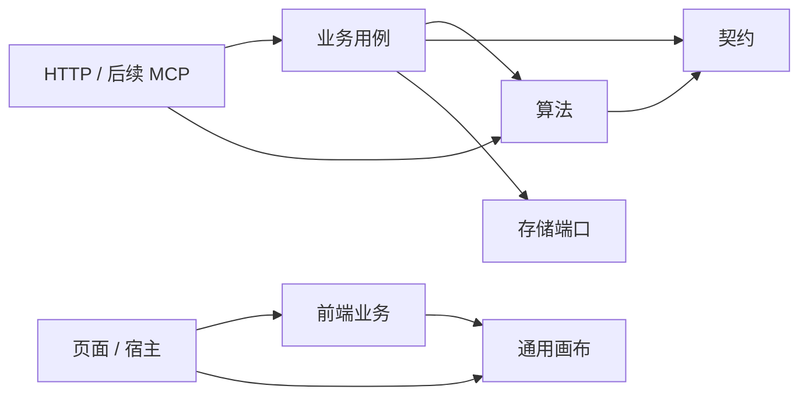

# 代码模块与实施进度

本文件记录实际代码组织和分批验收。总体方案已经批准；首期接入方式为独立服务 + 标准 API。不能把总体设计中的目标能力视为已经交付。

## 1. 模块地图

后端路径均相对 `src/main/java/com/example/cutdemotwo/`：

| 模块 | 路径 | 职责 | 允许的项目内依赖 |
| --- | --- | --- | --- |
| 共享契约 | `contracts/nesting`、`contracts/geometry`、`contracts/jobs`、`contracts/slitting` | 标准排样输入输出、几何、计算作业及兼容 DTO | 仅 contracts |
| 算法 | `algorithm/solver`、`algorithm/toolpath` | 引擎注册、求解、独立校验、刀序优化、一维隔离进程适配 | algorithm、contracts |
| 业务 | `business/cutting`、`business/model` | 业务请求适配、任务、材料、方案、报工及履约 | business、algorithm、contracts、存储端口 |
| 计算用例 | `business/optimization` | 独立计算作业、幂等、调度、取消与结果归档，不改写库存 | algorithm、contracts、存储端口 |
| 存储 | `persistence` | 文件/MySQL 快照与冲突控制 | 业务模型、contracts |
| HTTP | `controller` | 请求解码、调用用例、响应状态 | 业务、算法公共入口、contracts |
| 旧一维集成 | `linear`、`changyang` | 旧一维页面线程池、导入导出及二次裁切；纯内核由标准算法适配器复用 | 现有适配链路，下一批分离 |

前端路径均相对 `src/main/resources/static/js/`：

| 模块 | 路径 | 职责 |
| --- | --- | --- |
| 通用画布内核 | `canvas` | 场景模型、几何绘制、视口换算、命中图与平移缓存 |
| 裁切业务前端 | `business/cutting` | 需求/任务、计算请求、方案编辑、报工、流程引导、业务到画布的适配 |
| 画布宿主适配 | `plugins/cad`、`nesting/nesting-viewer.js` | 挂载舞台、工具交互、业务事件和图层管理 |
| 页面及其他宿主 | `app.js`、`nesting`、`linear`、`inspection`、`plugins` | 组合业务与画布、菜单和页面生命周期 |
| 现有基础设施 | `core` | 请求、消息、工作台共享状态，逐步削减全局依赖 |

### 1.1 依赖方向

画布不加载库存、不提交报工、不依赖全局工作台状态；通过 scene、overlay 和回调接收数据与交互。业务决定如何解释用户操作，服务端最终验证。

这些是**受测试约束的代码模块**，目前仍使用一个 Maven 应用和现有静态 ES modules，不声称已经拆成多个 Maven 制品或完成独立 SDK。

### 1.2 迁移边界与保留事项

- 仅移动 Java 包和内部 ES module 路径；现有 HTTP 路由、JSON 字段、存储快照字段保持兼容。
- 共享几何 DTO 中保留旧展示/质检字段以兼容存量数据；不意味着所有字段都属于最终 v2 算法契约。
- 算法中的 Spring 注册与原生进程适配暂时保留；后续按内核/运行时再拆，当前已禁止依赖业务对象和存储。
- 旧一维页面入口仍独立；标准 SLITTING_1D 已通过纯内核适配接入统一作业，保持整数单位语义，页面迁移待后续完成。
- 旧 CAD 舞台仍为宿主的单实例组织；本批抽取通用内核，不声称已完成多画布实例隔离。
- 业务服务仍使用现有存储端口；全局快照持久化向流水模型的迁移是独立阶段。
- 质量复检与处置已接入现有报工聚合、库存及 UI；接口口径和当前限制见《复检处置接口与验收》。事件独立流水表、身份认证和处置撤销仍待实现。

## 2. 分批实施

| 批次 | 内容 | 状态与验收 |
| --- | --- | --- |
| 01 | AI 开发规范、复检流程补充、算法/契约/业务/画布目录与依赖门禁 | 已完成；2026-10-20 验证与本地重启记录见下 |
| 02 | 产出身份、复检判定、转料头/报废、需求冲减、幂等及追溯 | 已完成；10 件转 8 件且原卷耗用不变，验收见下 |
| 03a | 单实例统一计算作业、持久化结果、能力查询和标准 API 契约 | 已完成；单材料二维输入、独占文件存储，验收见下 |
| 03b | 数据库作业与租约、多实例调度、引擎停止能力、更多问题适配及 UI 接入 | 进行中；内置算法协作停止、唛架编排与页面接入已完成；JDBC 租约调度及归档迁移通过 H2 与本机 MySQL 8.4 验证；一维标准作业及隔离进程已接入；多材料等问题、其余页面与统一资源限制仍待完成 |
| 04 | 执行单与预约、库存流水和对账迁移 | 待实现 |
| 05 | 任务/材料/分析/设置工作台重组 | 待实现；先关键流程原型 |
| 06 | 外部库存适配与 MCP 查询/计算/分析 | 待实现 |

批次 02 不能用覆写原报工或调用整单撤回来替代复检。异形回收不能凭外接矩形生成超出实物的库存。

## 3. 验证入口

- Java：`sh mvnw clean test`（模块迁移需清理旧 class），边界门禁与业务/算法测试一起执行。
- JavaScript：`node --test src/test/js/*.test.mjs`。
- 浏览器：`src/test/browser/` 中现有场景；通过临时库存启动写入测试，纯排样场景可使用运行服务。
- 打包启动：正常构建后启动项目 JAR，确认 `/api/health`、首页、库存与纯求解 API。
- Docker CI 仅复制 `pom.xml` 与 `src` 到构建阶段，架构测试不得依赖缺失的仓库文档或外部路径。

## 4. 批次 01 验收记录（2026-10-20）

- 迁移 42 个后端生产类、26 个前端模块，更新调用方与测试路径；旧包/旧业务目录不残留在打包产物中。
- 消除算法校验对业务 SolveRequest 的依赖，以及几何 DTO 对算法面积计算的反向依赖；共用规则归入契约。保留既有 HTTP/JSON 和算法行为。
- 新增 4 项 Java 架构测试及 4 项 JS 模块/入口检查。Java 门禁在修复前确实发现两项反向依赖，修复后通过。
- 浏览器验收发现已有连续工位缺陷：需求字段顺序不同被 JSON 字符串比较误判为内容修改。改成结构化比较，增加先失败后通过的回归测试；真实需求修改仍被拒绝。
- 修正服装画布测试假设，按裁片身份与实际形状核验多边形和矩形，避免把合法矩形当作漏绘。

| 验证 | 发现/计划项数 | 实际执行 | 成功 | 失败 | 跳过 |
| --- | --- | --- | --- | --- | --- |
| Java（最终 verify） | 195 | 186 | 186 | 0 | 9 |
| JavaScript | 202 | 202 | 202 | 0 | 0 |
| 独立排样浏览器场景 | 21 | 21 | 21 | 0 | 0 |
| 共享画布浏览器场景 | 7 | 7 | 7 | 0 | 0 |
| 服装完整业务流程 | 4 | 4 | 4 | 0 | 0 |
| 连续工位/报工/余料/撤回 | 15 | 15 | 15 | 0 | 0 |
| 重启后 5 个页面加载 | 5 | 5 | 5 | 0 | 0 |

Java 的 9 项跳过因本机缺少原生 C++ 引擎；不代表原生引擎已验证。没有更改构建配置或跳过开关。

写入浏览器测试使用独立 18080 服务和临时库存。8080 已使用新包重启，`/api/health` 返回 UP，库存档案正常读取、健康接口料头数量重启前后均为 112。现有演示初始化逻辑会在启动时保存快照并递增版本，因此不以库存文件字节哈希相等作为重启验收依据。

批次 01 只完成代码模块与开发规范基础；复检处置单列在批次 02，统一异步服务、库存流水和页面重组仍待后续实现。

## 5. 批次 02 验收记录（2026-10-20）

- 报工记录内增加复检处置入口。原良品转料头或报废后扣回需求完成量；原异常件不重复扣量。原报工事实和原材料耗用保留。
- 追加式处置事件、派生料头、需求投影在现有事务中保持一致；验证写入失败回滚、数据库多实例竞争、重启和响应丢失后的幂等重试。
- 回收矩形必须完全位于实物轮廓内；包括凹口穿越校验。隔离料头可在库存查看和追溯，不能扫码选料。禁止通过原报工撤回或演示重置破坏复检链路。
- 报工列表、工位摘要、需求变化说明、当前面积指标、画布异常状态与打印追溯同步更新。利用率仍为净良品面积 ÷ 实际耗用面积，未把回收面积计入良品。
- 浏览器测试发现并修复了表单 `length` 名称与原生集合属性冲突，真实入口现已通过；验证了 1366×768 和 1920×1080 的回收表单。

| 验证 | 发现/计划项数 | 实际执行 | 成功 | 失败 | 跳过 |
| --- | --- | --- | --- | --- | --- |
| Java（最终 verify） | 205 | 196 | 196 | 0 | 9 |
| JavaScript | 207 | 207 | 207 | 0 | 0 |
| 复检真实浏览器流程 | 7 | 7 | 7 | 0 | 0 |
| 连续工位/报工/余料/撤回回归 | 15 | 15 | 15 | 0 | 0 |
| 重启后 5 个页面加载 | 5 | 5 | 5 | 0 | 0 |

9 项 Java 测试因缺少原生 C++ 引擎跳过。写入验收使用独立 18080 服务和临时库存；8080 已打包重启，健康状态 UP。重启前备份库存，核对原有 17 条报工及 15 个任务保持完整，料头可用数量为 112；之后用户新增任务不算作数据漂移。

当前边界：每件一次最终处置、每件最多回收一个矩形；尚无处置撤销、隔离放行、已认证检验人、独立质量流水表或外部库存对账。详见《复检处置接口与验收》。下一批为统一计算作业、能力查询和标准 API。

## 6. 批次 03a 验收记录（2026-10-20）

- 新增 `/api/v2` 能力查询、问题校验、异步提交/查询/取消、归档输入及结果读取；提供 OpenAPI 3.1、JSON Schema 与可运行示例。详见《统一计算作业接口与验收》。
- v2 作业外壳明确使用 `nesting-v1` 单材料二维载荷。输入严格解码；降级与齐套要求显式传入。旧 v1 接口保持兼容。
- 先持久化再受理，幂等键绑定输入哈希；有界并发与队列。取消和超时等待算法真正退出后释放名额，不承诺硬抢占。
- 结果须通过既有独立校验，执行成功、几何可行、齐套完成分别表示；计算不会创建业务任务或改写库存。
- 独占目录、原子文件替换、重启保留结果与幂等记录；未完成作业重启后明确失败，不静默重算。数据库及分布式实现属于 03b。

| 验证 | 发现/计划项数 | 实际执行 | 成功 | 失败 | 跳过 |
| --- | --- | --- | --- | --- | --- |
| Java（最终 verify） | 223 | 214 | 214 | 0 | 9 |
| JavaScript | 207 | 207 | 207 | 0 | 0 |
| 独立排样浏览器场景 | 21 | 21 | 21 | 0 | 0 |
| 共享画布浏览器场景 | 7 | 7 | 7 | 0 | 0 |
| 打包服务 OpenAPI/Schema/HTTP 契约 | 5 | 5 | 5 | 0 | 0 |
| 打包进程重启后结果与幂等 | 1 | 1 | 1 | 0 | 0 |
| 重启后 5 个页面加载 | 5 | 5 | 5 | 0 | 0 |

9 项 Java 测试因缺少原生 C++ 引擎跳过。契约验收脚本为 `src/test/integration/optimization-contracts.py`，使用独立临时库存和 18080 服务；本机 Python 验证依赖安装在临时 venv，不改变项目构建配置。

8080 已使用本批打包产物重启，健康状态 UP，新能力接口可访问。重启前备份库存，逐字段核对除启动版本号外数据保持一致：17 条报工、16 个任务，可用料头数量为 112。重启后首页、裁切、独立排样、服装和库存 5 个页面均返回 200，未出现页面脚本异常。

## 7. 持续目标与独立审查（2026-10-20）

用户要求持续推进直到批准方案全部完成，并安排独立 agent 审查、测试和寻找缺陷。总体目标保持进行中；03b、04、05、06 的未完成项不能以兼容层或文档代替验收。

本轮修复：

- 内置横切、直刀、异形搜索、刀序及独立校验增加协作中断检查；保留中断标志，由作业服务负责最终状态和持久化。取消时不发布未经完整校验的候选解。仍不承诺单次原生几何调用可硬抢占。
- 独立审查复现线程交接时的误拒绝：业务名额已释放但线程池尚未腾出线程，10,000 次受理出现 34/63 次 QUEUE_REJECTED。保持原受理限额，内部队列增加交接槽；独立复测误拒绝为零，主线增加有时限的 10,000 次回归。
- 修复可选 `engine`、裁片 `name` 省略后归档为 null 与公开 Schema 不一致；增加省略字段的实际 HTTP 契约验收。

| 验证 | 发现 | 实际执行 | 成功 | 失败 | 跳过 |
| --- | --- | --- | --- | --- | --- |
| 修改前取消复现 | 7 | 7 | 0 | 7 | 0 |
| 修改后取消专项（含真实运行中中断） | 9 | 9 | 9 | 0 | 0 |
| 全量 Java verify | 233 | 224 | 224 | 0 | 9 |
| 打包服务契约 | 6 | 6 | 6 | 0 | 0 |
| 排样浏览器回归 | 21 | 21 | 21 | 0 | 0 |

原生引擎 9 项仍因环境缺失跳过。独立审查在隔离源码副本和临时库存上执行，不修改用户库存。审查发现的问题按证据修复，随后继续服务编排、数据库调度和管理闭环。

本轮打包后已重启 8080，健康状态 UP；17 条报工、16 个任务和库存内容保持不变（仅启动版本号递增）。首页、唛架页、能力接口及 OpenAPI 均返回 200。

## 8. 服务端唛架编排与页面接入验收（2026-10-20）

- 将固定门幅齐套缩长从浏览器迁入统一计算用例；页面只提交一个作业，API 调用方得到相同的试排历史、已验证结果与利用率口径。算法、业务编排、画布职责保持分离。
- 多次试排共享总时间预算；保留已经验证的最佳齐套结果，后续未齐套、取消或引擎异常不会替换它。缩长属于启发式搜索，不宣称全局最优或不可行证明。
- 增加可选策略及版本契约、API 示例和实际 HTTP 验收；未传策略的旧请求序列化不增加 null 字段，避免改变原幂等输入哈希。
- 独立审查发现并复现轮询网络失败会丢失已受理作业句柄；现已先请求取消服务端作业再清理客户端状态。新增回归及审查方原始故障脚本均通过。

| 验证 | 发现/计划 | 实际执行 | 成功 | 失败 | 跳过 |
| --- | --- | --- | --- | --- | --- |
| 全量 Java verify | 242 | 233 | 233 | 0 | 9 |
| 全量 JavaScript | 210 | 210 | 210 | 0 | 0 |
| 最终打包服务 HTTP 契约 | 7 | 7 | 7 | 0 | 0 |
| 最终打包服务排样浏览器场景 | 21 | 21 | 21 | 0 | 0 |
| 独立审查网络故障复测 | 1 | 1 | 1 | 0 | 0 |

9 项 Java 测试因缺少原生 C++ 引擎跳过，未更改构建配置。写入测试使用 18080 临时库存。8080 已使用最终包重启，健康状态 UP；备份并逐字段核对库存（除启动版本号），17 条报工、16 个任务保持完整，可用料头 112。首页、唛架页、能力接口和唛架 API 示例均返回 200。

03b 仍未全部完成：数据库作业/attempt/租约、多实例调度、一维等问题适配仍需实施；执行与库存流水、工作台重组、外部集成及 MCP 继续按批准方案推进。

## 9. JDBC 作业与租约调度（2026-10-20）

- 新增显式 `cutdemo.jobs.storage=mysql`；默认 file 不变。Flyway V2 添加作业、attempt、结果和全局调度配置，使用既有数据源，迁移完成后启动调度。
- 全局事务控制幂等、配额及领取；跨节点查询读取数据库，取消意图可传递给实际 worker。租约、owner 和递增 token 共同限制进度、续租和最终结果写入。
- 失租尝试保留历史，最多三次、共享首次领取后的总预算；退出节点不取消共享队列。失租终态明确标为 LEASE_LOST，不声称远端进程已实际停止。
- 独立审查确认并修复缺引擎节点抢走作业的问题；领取时按实际能力筛选，跳过不兼容队首。同键重放在当前引擎不可用时仍返回已受理作业。
- 验证覆盖双实例、过期 token 拒写、取消保留、重试预算/次数、全局配额、结果事务失败回滚、持锁期间租约过期，以及真实 Spring 配置和 HTTP 调用。数据库时钟在 MySQL 使用 epoch 毫秒，避免各节点时区差异。

| 验证 | 发现 | 实际执行 | 成功 | 失败 | 跳过 |
| --- | --- | --- | --- | --- | --- |
| 全量 Java verify | 256 | 247 | 247 | 0 | 9 |
| 其中 JDBC 调度专项 | 13 | 13 | 13 | 0 | 0 |
| 其中 JDBC 配置与真实 HTTP | 1 | 1 | 1 | 0 | 0 |
| 独立审查原始探针复测 | 2 | 2 | 2 | 0 | 0 |
| 独立审查持锁过期专项 | 1 | 1 | 1 | 0 | 0 |
| 最终打包服务 HTTP 契约 | 7 | 7 | 7 | 0 | 0 |

新增数据库测试和独立探针均使用隔离 H2 MySQL 模式。真实 MySQL 锁/隔离级别、文件归档导入、已认证租户及配额运维修改仍未验收；不得把本批通过当作数据库生产可用性已完成。原生引擎 9 项跳过原因不变。总体目标仍在进行中。

8080 已使用最终包重启，继续使用原 file 模式，健康状态 UP。重启前备份库存并在启动后逐字段核对（除版本号）：17 条报工、16 个任务和库存内容保持不变，可用料头 112；首页、唛架、独立排样、库存和能力接口均返回 200。本批不改前端代码，未重复上一批 JS 和浏览器套件。

## 10. 文件归档迁移与真实 MySQL 验证（2026-10-20）

- 显式导入旧作业目录，在调度启动前完成。保留 ID、幂等键、输入哈希、终态和结果；未完成作业明确中止，原始 JSON、来源和导入指纹另行保留。
- 持有源目录锁且不修改源 JSON；目标空库校验、作业/结果/迁移证据同事务提交。同归档重复或并发导入安全，不同归档竞争不会部分混入。
- 独立 agent 在隔离副本及真实 MySQL 上复审，8 项全部通过；其新增两项并发探针已纳入主线测试。
- 测试基础设施允许同一批测试选择 H2 或本机临时 MySQL，每项创建独立 UUID schema；不复用用户库存库，不改构建配置或跳过开关。

| 验证 | 发现 | 实际执行 | 成功 | 失败 | 跳过 |
| --- | --- | --- | --- | --- | --- |
| 全量 Java verify（默认 H2） | 267 | 258 | 258 | 0 | 9 |
| 真实 MySQL 8.4.11 调度/迁移/HTTP/配置专项 | 25 | 25 | 25 | 0 | 0 |
| 独立 MySQL 迁移审查与并发探针 | 8 | 8 | 8 | 0 | 0 |
| 最终 JAR 双进程迁移、跨节点查询及源文件保留 | 3 | 3 | 3 | 0 | 0 |
| 最终 JAR MySQL 模式 HTTP 契约 | 7 | 7 | 7 | 0 | 0 |

真实 MySQL 使用本机 13306 与独立临时数据目录，默认 REPEATABLE READ；覆盖双节点竞争、失租写入保护、事务回滚、跨时区续租、迁移与启动顺序。9 项 Java 原生引擎测试仍因缺少原生二进制跳过。上述证据不代表远程 CI 或生产部署完成；其余问题类型、业务闭环、工作台与 MCP 仍继续实施。

最终包在 18080/18081 使用独立 MySQL 库完成实际文件作业迁移和 API 验收，源归档逐文件 SHA-256 不变。8080 已重启，继续保留原文件存储：健康 UP，库存（除启动版本号）、17 条报工、16 个任务均保持一致，可用料头 112；首页、唛架、库存与能力接口返回 200。本轮没有对用户正在使用的数据执行迁移。

## 11. 一维标准计算、独立验收与进程隔离（2026-10-20）

- `SLITTING_1D` 接入相同作业服务和文件/JDBC 归档；统一外壳的 `problem` 按问题类型解码，保留旧二维输入序列化和幂等兼容。补充标准请求、OpenAPI/Schema 与可运行示例。
- 直接复用纯计算内核，不经过旧 REST/Excel DTO 或业务上下文。订单使用字符串身份，卷长 mm 必须为整数米，禁止截断；结果不再按宽度猜测订单、不把订单最大卷长冒充实际排刀卷长。
- 独立验收覆盖候选宽度/步长、切边、工位、逐订单卷长/表面处理/数量、全局超产、面积及履约。审查真实复现的 8 个缺口均修复，原探针复测 8/8 成功。
- 子 JVM 承载原生求解线程；取消和超时等待真实退出，父进程异常退出时子进程自行停止。Java 堆、候选并行、产出总量及输出大小有限额；未声称原生总内存已获得 OS 级硬配额。
- 两种利用率明确分母：计划母卷面积（含固定切边）与计划可用面积（扣固定切边）。输出仅为计划，不改变库存或履约账。

| 验证 | 发现 | 实际执行 | 成功 | 失败 | 跳过 |
| --- | --- | --- | --- | --- | --- |
| 最终全量 Java verify | 287 | 278 | 278 | 0 | 9 |
| 真实 MySQL 一维作业专项（含文件模式对照） | 5 | 5 | 5 | 0 | 0 |
| 独立错误输入/结果探针复测 | 8 | 8 | 8 | 0 | 0 |
| 独立隔离 JUnit 唯一用例 | 10 | 10 | 10 | 0 | 0 |
| 最终 JAR HTTP/OpenAPI/Schema 契约 | 9 | 9 | 9 | 0 | 0 |
| 最终 JAR 运行中取消与超时 | 2 | 2 | 2 | 0 | 0 |
| 8080 重启后页面及新入口 | 5 | 5 | 5 | 0 | 0 |

全量测试首次发现迁移配置测试未注册新增依赖（实际执行 278，成功 277，错误 1，另跳过 9），补齐测试上下文后全量通过，未修改构建配置。9 项原生 C++ 引擎测试仍因环境缺失跳过；一维 OR-Tools Java 子进程已实际运行。打包模式通过 PropertiesLauncher 启动纯计算入口，测试确认服务端进程下不残留取消/超时的子 JVM。

8080 已用最终包重启，健康 UP。重启前已备份库存；逐字段核对除启动 revision 外内容一致，17 条报工、16 个任务、112 个可用料头保持不变。旧一维页面、二次裁切、执行单/预约、库存流水、多材料、工作台重组及 MCP 尚待后续完成，总体目标保持进行中。本批不含远程 CI 或生产部署验收。
