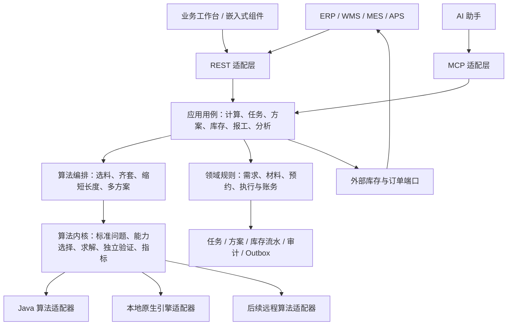
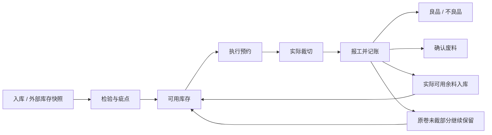

# 搭切平台模块化与业务管理设计方案

版本：0.1，评审稿

日期：2026-10-20

现状基线：CurDemoTwo `9f85992`

范围：产品边界、算法能力、标准输入输出、业务与库存闭环、工作台、AI/MCP 接入、迁移与验收。

**本文是下一阶段设计，不代表所列接口、数据模型和页面已经实现。**“现状”部分来自当前代码及本地页面核查，其余均为建议。此次不修改业务代码。

## 1. 建议先确定的产品定位

把产品定义为：**可以嵌入其他业务系统的搭切优化模块，同时提供可选的业务管理工作台。**

对外交付三种使用方式，但共用同一套算法内核和结果解释：

| 使用方式 | 调用方提供 | 本模块负责 | 库存责任 |
| --- | --- | --- | --- |
| 纯计算 | 材料快照、需求、工艺、目标 | 校验、求解、结果验证、指标与解释 | 不持有业务库存，不扣减 |
| 接入外部 ERP/WMS/MES | 外部订单、库存版本、预约或投产凭证 | 任务、方案、执行反馈、对账 | 外部系统为库存权威来源 |
| 独立管理 | 订单/需求、材料入库与现场报工 | 上述全部能力及内置库存台账 | 本模块为库存权威来源 |

**已确认决策（2026-10-20）：以独立服务 + 标准 REST API 为主要集成方式，其他系统通过 HTTP 接口调用。**首期交付独立部署服务、版本化接口契约和调用示例；模块内部保持清晰依赖，Java SDK 留作后续扩展，不列入首期交付。

SDK 如需落地，优先开放纯算法与校验能力。库存事务、任务持久化、异步作业、权限等仍由应用服务承载，避免把客户应用变成本模块数据库的直接调用者。

### 1.1 本轮设计要解决什么

1. 外部系统能只用算法，不必接受整套管理系统。
2. 新算法可注册、可查询能力、可比较和替换，不需要重写业务页面。
3. 一维、二维、异形和服装唛架共用任务与结果管理，但保留各自的数学模型。
4. 求解、方案选用、执行和报工有明确边界，库存变更可追溯。
5. 人工工作台、API 和 AI 使用相同的业务规则，避免各自维护一条流程。
6. 页面按业务对象和下一步操作组织，演示入口与生产管理分开。

### 1.2 首期不承诺的能力

- 不承诺所有结果全局最优；启发式得到可行解时必须如实标注。
- 不把“排样轮廓”直接当作可下发设备的机床程序。
- 不做完整 ERP、WMS 或工厂级 APS；交期、产线与工序排程通过接口协作。
- 不把 AI 当成几何校验器、库存记账器或设备安全控制器。
- 不为尚未出现的规模拆分大量微服务。

## 2. 现状判断与证据

### 2.1 可以复用的基础

| 现有能力 | 代码证据 | 后续处理 |
| --- | --- | --- |
| 独立二维排样接口 | `controller/NestingController.java`，`/api/v1/nesting/solve` 与 `/engines` | 保留现有协议，作为新计算服务的兼容适配器 |
| 算法注册和能力声明 | `service/solver/ICutSolverEngine.java`、`SolverFactory.java`、`EngineCapabilities.java` | 扩展能力描述，保留引擎适配方式 |
| 引擎结果独立校验、降级信息 | `SolverFactory`、矩形/多边形结果校验器 | 作为所有新引擎的必经出口 |
| 方案与需求版本 | `CuttingWorkflowService`、`CuttingPlan`、`CuttingTask` | 演进为不可变方案版本与明确状态机 |
| 报工幂等、材料基线校验 | `RemnantService.confirmPlan` | 保留业务规则，逐步迁入独立报工服务 |
| 批次报工预览与原子提交 | `RemnantService.reportBatch` | 保留整体校验与整体提交语义 |
| 报工撤回及后续流转保护 | `RemnantService.reverseReport` | 升级为显式冲销记录与材料谱系 |
| 文件/MySQL 存储 | `persistence/InventoryConfiguration`、`JdbcInventoryStore` | 开发演示保留文件；正式管理使用事务数据库 |
| 一维异步求解、重切、撤销、导入导出 | `linear/LinearCutController`、`LinearCutService` | 接入统一作业与方案管理 |
| 页面阶段与下一步动作 | `static/js/workflow-state.js`、`index.html` | 复用交互经验，动作合法性由服务端兜底 |

表中 Java 路径均相对 `src/main/java/com/example/cutdemotwo/`。

### 2.2 当前问题不是简单的“按钮太多”

**当前结果：**首页同时承载任务管理、需求编辑、库存选择、排料、记录和报工；一维工作台另有独立流程，库存档案不在主导航中。用户需要理解实现分区，才能知道下一步做什么。

**证据：**

- `product-entries.js` 的主要导航是介绍、二维裁切、一维裁切、功能演示、跑布验疵；库存档案设为隐藏导航。
- 本地首页已存在“需求→材料→排料→报工”阶段按钮，也有工具菜单。因此问题并非完全没有分组，而是管理对象、作业步骤与算法类型仍混在同一级入口。
- `/api/v1/nesting/solve` 只计算，`/api/solve` 会进入业务方案保存；调用方不能只凭“solve”一词理解副作用。
- 一维作业保存在内存任务上下文中，采用线程池与过期清理；与二维业务库存、报工尚未形成同一闭环。
- `RemnantService` 同时处理母卷、料头、任务、方案、报工、验疵及撤回，修改容易跨越多个责任边界。
- MySQL 已有事务和全局版本冲突保护，但以业务对象 JSON 和整体快照同步为主，不是按库存单元组织的独立流水模型。
- 本次源码检视未发现正式 OpenAPI、MCP、应用级鉴权入口。部署环境是否额外提供网关鉴权，需要接入阶段另行核实。

**根因阶段：**业务对象与生命周期没有统一到应用层，部分编排停留在页面中，管理导航又按算法/演示功能展开。

**下一步：**先确定领域对象、库存权责、状态转换和服务契约，再整理页面；不先做一轮视觉换肤。

### 2.3 需要特别保留的正确语义

- 当前轮廓输出只是裁片边界，不是已排序且可执行的设备刀路。
- 尚未分配的材料面积不等于已确认废料。
- 几何上可行，不一定满足整套衣片数量。
- 材料候选筛选通过，不代表完整几何排样一定成功。
- 报工撤回是账务更正，不意味着真实材料恢复为未裁切状态。
- 服装缩短唛架需要保留完整可行解；某次更短试排失败不能证明该长度数学上不可行。

## 3. 总体架构：一套内核，两类应用入口



### 3.1 逻辑模块及依赖

| 模块 | 职责 | 不应承担 |
| --- | --- | --- |
| `contracts` | 请求、响应、Schema、错误码、事件契约 | 数据库实体与页面状态 |
| `optimization-core` | 几何/数量模型、验证、目标和指标定义 | HTTP、库存修改、用户会话 |
| `solver-adapters` | 引擎能力、参数转换、执行、结果转换 | 自行改变业务需求或扣库存 |
| `optimization-application` | 作业、预算、重试、算法编排、结果归档 | 材料实际出入库 |
| `cutting-management` | 任务、方案选用、执行单、报工、库存规则 | 依赖某个具体求解器 |
| `integration-adapters` | ERP/WMS、文件、事件、MCP、REST | 绕过应用用例直接更新表 |
| `workbench-web` | 页面与可视化、交互编辑 | 最终的权限、幂等和库存校验 |

这些先是逻辑边界。先在当前 Spring Boot 应用中按包拆职责，待依赖稳定后再考虑 Maven 子模块。首期可单应用部署，长耗时或易崩溃的原生求解器由独立 worker/子进程承载。

后续是否独立部署计算服务，依据并发、故障隔离和客户部署需求决定，不以“模块化”自动推导“微服务化”。

### 3.2 两条用例链路

**计算链路：**

输入快照 → 契约校验 → 工艺与能力校验 → 作业排队 → 求解/编排 → 独立结果校验 → 指标与解释 → 返回结果。

**管理链路：**

导入需求 → 建立任务 → 选料 → 生成候选方案 → 比较并选用 → 预约材料/下达执行 → 实际报工 → 库存与需求记账 → 对账分析。

计算链路可以完全脱离管理链路。管理链路调用计算链路，并把选中的结果绑定到明确的任务版本和材料版本。

## 4. 统一模型：统一外壳，保留不同算法问题

### 4.1 三个容易混淆的“任务”

| 对象 | 含义 | 生命周期 |
| --- | --- | --- |
| `CuttingTask` 业务任务 | 要完成哪些订单需求 | 可以跨多次计算、多块材料、多次报工 |
| `OptimizationJob` 计算作业 | 用一份不可变输入运行一次编排策略 | 排队、运行、结束；可重试但保留尝试记录 |
| `PlanVersion` 方案版本 | 可比较、可选用的一份排样/分切结果 | 不可变；修改生成新版本 |

再增加 `ExecutionOrder` 表示已经下达的现场作业；`ProductionReport` 表示现场反馈事实。不能把点击“生成方案”视为生产完成。

### 4.2 问题类型

标准请求采用公共外壳，`problemType` 决定 `problem` 的 Schema：

| 类型 | 输入重点 | 结果重点 |
| --- | --- | --- |
| `SLITTING_1D` | 幅宽、固定切边、需求宽度/长度/数量、组合与重切约束 | 分切组合、重复次数、长度、订单分配 |
| `RECT_NESTING_2D` | 矩形材料、矩形需求、切割模式、刀缝、疵点 | 布局、阶段切线、履约量、余料候选 |
| `CONTOUR_NESTING_2D` | 多边形轮廓、方向、间距、禁放区 | 变换后的轮廓、履约量、占用长度 |

`GARMENT_MARKER` 建议作为轮廓问题上的编排策略：固定门幅、齐套、纱向与缩短长度，不再建立一套与轮廓排样重复的底层几何协议。

不同业务可以通过 `profileId + profileVersion` 应用默认工艺；实际生效参数必须在结果中展开并保存。配置更新不能悄悄改变历史方案含义。

### 4.3 标识、单位与精度

- 对外业务 ID 使用字符串；保留 `externalSystem + externalId` 映射。旧引擎整数 ID 在适配层转换，不向客户暴露数组下标。
- `externalRef` 作为业务引用，不自动承担幂等作用。幂等由专门的键与唯一约束负责。
- 新协议推荐长度统一 mm、面积 mm²、数量为整数；页面可以换算 m、m²，但必须显示单位。
- 一维旧算法存在整数 mm/整数 m 的输入约束，适配层显式检测可表示性；不能通过四舍五入悄悄改变订单。
- 内核依据引擎精度将尺寸转换到受控精度网格；拒绝溢出、非有限数和不可表示数据。精度、误差容限与算法版本一起归档。
- 坐标使用材料局部坐标、左上原点；工位偏移、走料方向和设备坐标转换由执行层单独表达。
- 孔洞、曲线离散、公差、旋转角度等能力必须声明；不支持时明确拒绝，不能降为外包矩形后仍声称等价。

## 5. 原子能力与可扩展算法

### 5.1 原子能力清单

| 能力 | 输入 | 输出 | 业务副作用 |
| --- | --- | --- | --- |
| `validateProblem` | 标准问题 | 字段错误、约束冲突、能力要求 | 无 |
| `normalizeProblem` | 问题与工艺版本 | 标准化问题、单位/ID 映射 | 无 |
| `findMaterialCandidates` | 剩余需求、库存快照、选料策略 | 候选清单及筛选原因 | 无预约、无扣减 |
| `solve` | 标准问题、引擎与预算 | 原始候选解及求解状态 | 无库存副作用 |
| `validateLayout` | 问题与候选布局 | 越界、重叠、间距、疵点、数量等验证报告 | 无 |
| `evaluatePlan` | 通过验证的结果与指标口径 | 分母明确的指标与目标值 | 无 |
| `comparePlans` | 相同或明确可比输入的多个方案 | 差异、排序及原因 | 无 |
| `prepareToolpath` | 验证布局、机器工艺 | 刀路候选及机器适配验证结果 | 不自动下发设备 |

“无业务副作用”不等于不用资源：通过服务运行求解仍会创建作业、消耗预算和生成审计。MCP 工具也必须据此标注。

### 5.2 编排能力

- **齐套缩长：**找到全量可行解后尝试缩短；每次保留已验证的最好完整解，同时返回试探历史。启发式失败不能当成严格不可行证明，也不能据此声称二分搜索得到最短长度。
- **料头优先：**先筛选，再调用求解验证；以履约、用料成本和库存策略综合选择，不强迫使用导致高损耗的料头。
- **多方案对比：**在共同预算内运行不同引擎/种子/目标，按同一评价器比较。
- **多材料分配：**上层分配器决定需求在哪些材料上切，单材料求解器负责布局；逐材料贪心先做可交付基线，联合优化作为后续可替换策略。
- **交期/齐套：**应在需求选择与分配层表达，不能用几何面积利用率替代交付目标。

当前页面中的唛架试排应逐步移到应用层编排，UI、API、MCP 都读取同一份作业过程与结果。

### 5.3 插件契约

沿用 `ICutSolverEngine` 与工厂注册思想，逐步补充：

```text
EngineDescriptor
  id / version / adapterVersion
  supportedProblemTypes / shapes / processModes
  supportedConstraints / objectives / coordinateResolution
  limits: pieces, vertices, materials, time, memory
  supportsCancellation / supportsProgress / deterministicWithSeed
  availability / unavailableReason
```

编排器根据能力筛选引擎。`allowFallback` 显式控制是否允许降级；降级不能降低硬约束，结果必须给出请求引擎、实际引擎、版本和原因。

插件输出一律经过独立校验。接入新算法至少需通过同一组契约、边界、几何、数量和超时取消测试。第三方算法放在适配器后，不允许直接修改任务和库存。

### 5.4 目标函数与结果质量

建议支持有顺序的目标，例如：

1. 满足本次必须完成的需求/整套约束。
2. 在满足硬约束前提下减少材料成本或占用长度。
3. 再优化刀数、换型、余料形态。

不能把不同单位的目标直接相加。需要加权时显式记录权重、归一化规则及版本。

结果分别表达：

- `solutionStatus`：`OPTIMAL / FEASIBLE / INFEASIBLE / NO_SOLUTION_FOUND`。
- `fulfillmentStatus`：`COMPLETE / PARTIAL / NONE`。
- `validationStatus`：`PASSED / REJECTED`。
- `terminationReason`：完成、时限、取消、资源限制、引擎异常。

只有引擎提供可信最优性证明时标为 `OPTIMAL`。超时未找到解是 `NO_SOLUTION_FOUND`；几何可行但少衣片不能标为齐套完成。

## 6. 标准 API 与作业协议

建议新增 `/api/v2`，保留 `/api/v1/nesting` 和现有业务接口。以下为目标契约草案，实施前固化为 OpenAPI 和 JSON Schema。

### 6.1 计算接口

| 方法与路径 | 用途 |
| --- | --- |
| `GET /api/v2/capabilities` | 问题类型、引擎、约束、限额、版本和可用性 |
| `POST /api/v2/problem-validations` | 输入校验与适用能力检查 |
| `POST /api/v2/optimization-jobs` | 创建异步计算作业，返回 202、jobId 与查询地址 |
| `GET /api/v2/optimization-jobs/{id}` | 查询状态、阶段、预算和结果引用 |
| `POST /api/v2/optimization-jobs/{id}/cancellations` | 请求取消，返回实际状态 |
| `GET /api/v2/optimization-jobs/{id}/events` | SSE 进度；轮询始终可用 |
| `GET /api/v2/optimization-results/{id}` | 读取不可变结果、验证和指标 |
| `POST /api/v2/layout-validations` | 校验人工/外部调整布局 |
| `POST /api/v2/plan-comparisons` | 同口径方案比较 |

同步便利接口可后续提供，但复用同一用例和限额。不要让长耗时计算必须依赖一个持续打开的 HTTP 请求。

### 6.2 公共请求示例

以下是矩形问题的目标结构示例，不可直接发送给现有 v1 接口：

```json
{
  "schemaVersion": "2.0",
  "clientRequestId": "erp-20261020-001",
  "problemType": "RECT_NESTING_2D",
  "units": {"length": "mm", "area": "mm2"},
  "problem": {
    "materials": [
      {
        "id": "stock-001",
        "revision": "17",
        "shape": {"type": "RECTANGLE", "width": 1500, "height": 2000},
        "quantity": 1,
        "exclusions": []
      }
    ],
    "demands": [
      {
        "id": "order-line-001",
        "quantity": 2,
        "shape": {"type": "RECTANGLE", "width": 500, "height": 600},
        "allowedRotations": [0]
      }
    ],
    "process": {
      "mode": "GUILLOTINE",
      "kerfMm": 2,
      "pieceGapMm": 0,
      "trimMm": {"left": 0, "right": 0, "top": 0, "bottom": 0}
    }
  },
  "strategy": {
    "id": "single-material",
    "version": "1",
    "requireComplete": true,
    "objectives": [{"metric": "occupiedLengthMm", "direction": "MIN"}]
  },
  "execution": {
    "engine": "auto",
    "allowFallback": true,
    "timeLimitMs": 10000,
    "seed": 42
  }
}
```

`materials` 为统一外壳预留数组；当前单材料引擎适配器对多材料输入必须返回能力不支持，不能只取第一块。材料版本在纯计算中是追溯信息，在投产/报工时才用于业务并发校验。

通用请求头使用 `Idempotency-Key`、调用链标识与身份凭据。租户和权限从认证上下文确定，不能信任请求体自报的 `tenantId`。

### 6.3 标准结果

| 字段组 | 必须表达的内容 |
| --- | --- |
| 标识与追溯 | resultId、jobId、inputHash、schema/工艺/指标/引擎版本、seed |
| 状态 | 解状态、终止原因、完整履约状态、独立验证状态 |
| 算法信息 | 请求/实际引擎、降级原因、运行耗时与资源预算 |
| 排料明细 | 材料实例、需求行、裁片实例、位置、旋转、形状；一维为组合及重复次数 |
| 履约 | 每条需求请求量、完成量、缺口及可证实的原因 |
| 材料区域 | 总材料、有效加工区、占用区、保留尾料、候选余料 |
| 指标 | value、unit、numerator、denominator、basis、metricVersion |
| 可解释证据 | 违反的约束、试探历史、瓶颈、对比依据、是否已证明 |
| 附件引用 | 完整布局、预览图、报表；有权限及有效期控制 |

大结果不全塞进 SSE 或模型上下文；分页读取明细，使用授权的结果附件。附件不能提供任意服务器文件路径读取能力。

### 6.4 错误与兼容

错误统一返回 `code / message / fieldErrors / traceId / retryable / details`。字段错误给出 JSON Pointer，例如 `/problem/demands/0/quantity`。

| 情况 | HTTP 语义 | 示例业务码 |
| --- | --- | --- |
| JSON/字段/单位非法 | 400 | `INVALID_INPUT` |
| 未认证/无权访问 | 401/403 | `UNAUTHENTICATED`、`FORBIDDEN` |
| 版本或幂等冲突 | 409 | `STALE_MATERIAL`、`IDEMPOTENCY_CONFLICT` |
| 契约合法但能力不支持 | 422 | `UNSUPPORTED_CONSTRAINT` |
| 超出并发或配额 | 429 | `QUOTA_EXCEEDED` |
| 必选引擎不可用 | 503 | `ENGINE_UNAVAILABLE` |

已受理作业的算法失败通过作业资源表达，不把后续 GET 状态查询变成 HTTP 500。严格不可行也属于计算结果，不是传输错误。

版本内新增可选字段应兼容旧调用方；重要默认值必须文档化。写入侧拒绝未知字段，扩展字段使用命名空间；读取侧允许约定的新增字段。破坏性变更升级主版本，并提供迁移期适配。

### 6.5 异步可靠性

作业状态：`QUEUED → RUNNING → SUCCEEDED / FAILED / CANCELLED / TIMED_OUT`。取消请求不是立即成功；可增加 `CANCEL_REQUESTED` 过渡态。

- 数据库存储作业、输入快照、尝试记录和结果；重启不能让已接受作业静默丢失。
- worker 使用租约、心跳和 fencing token；过期 worker 不可覆盖新尝试结果。
- 超时/取消可保留已验证的最佳结果，通过 `resultRef` 暴露，但不能伪装成正常完成。
- 同一幂等键+相同规范化请求返回同一作业；同键不同内容返回 409。幂等键按租户与操作隔离，保留期明确。
- Java 引擎协作取消；无法中断的原生引擎使用可终止子进程，并限制时间、内存、输出大小。
- 限制请求体、轮廓顶点、裁片数量、并发与排队长度；数值先基准测试再配置，不凭空承诺 SLA。
- 进度先提供阶段和已用时间；没有可测进度时不显示虚假的完成百分比。

## 7. 管理体系：任务、材料、执行、账务各自明确

### 7.1 领域对象

| 对象 | 核心字段/含义 |
| --- | --- |
| `DemandOrder / DemandLine` | 外部订单映射、品项、规格、需求量、交期、齐套组 |
| `CuttingTask` | 本次生产组织范围、需求版本、工艺快照、业务状态 |
| `MaterialSpec / MaterialLot` | 材质与规格、批次、颜色/纹理等匹配要求 |
| `StockUnit` | 一卷、一张、一块余料的独立身份、几何、库位、质量及版本 |
| `DefectMap` | 绑定材料版本和坐标系的疵点/禁放区域 |
| `Reservation` | 某执行单占用哪个材料单元、范围/数量、失效时间 |
| `PlanVersion` | 任务版本、材料快照、作业结果、父版本、调整原因 |
| `ExecutionOrder` | 选定方案、设备/工位、预约、下达与执行状态 |
| `ProductionReport` | 实际耗用、逐件良品/不良、实际余料、操作者与时间 |
| `InventoryLedger` | 不可变的入出库、转移、调整、冲销流水 |
| `DemandLedger` | 良品履约、返工/不良、冲销及来源报工 |
| `IntegrationDelivery` | 对外事件、发送状态、重试与对账结果 |

一维与二维共用任务外壳、方案版本、报告和追溯，但报工明细采用分类型结构：一维保留分切组合、长度、卷数，二维保留裁片实例。不能为了统一表结构丢掉业务量纲。

### 7.2 主要状态转换

| 对象 | 状态 | 核心规则 |
| --- | --- | --- |
| 业务任务 | 草稿 → 待排料 → 待执行 → 执行中 → 已完成/已关闭 | 多执行单时按剩余需求聚合状态，完成不等于手动关闭 |
| 方案 | 候选 → 已选用 → 被替代/失效 | 调整生成新版本；失效原因可见 |
| 执行单 | 待下达 → 已下达 → 执行中 → 已报工；未执行可取消 | 现场已开工不允许当作普通草稿删除 |
| 报工 | 草稿 → 已预检 → 已记账 → 已冲销 | 预检不锁死事实；提交时重新校验 |
| 外部同步 | 待发送 → 等待确认 → 已确认/待处理异常 | 与本地报工状态分开显示 |

一项任务可同时有执行中的工位和待排的剩余需求。任务列表显示聚合状态，详情保留各执行单状态，不用单一枚举掩盖并行作业。

质量状态、库存可用性和同步状态分开建模。例如“待检”不能被塞进“已预约”枚举：一块材料可以同时处于待检且已被禁止预约的规则状态。

### 7.3 需求完成量

```text
净良品完成量 = 已记账良品量 - 已冲销良品量
剩余需求量 = 订单需求量 - 净良品完成量
可规划需求量 = 剩余需求量 - 有效执行单占用需求量
```

允许超产必须是显式业务规则并单独记录，不能用 `max(0, …)` 掩盖超报。

候选方案之间可以覆盖同一需求；仅选用并下达的执行单占用生产需求，不能把每次试算都算成“已安排”。

### 7.4 材料闭环



**库存规则：**

1. 母卷未裁尾部仍属于原材料，默认不再创建一块同面积的余料。
2. 只有实际分离、确认尺寸与状态、可独立存放的材料才生成余料库存。
3. 计划余料只是预测，报工确认后的实际余料才可再次预约。
4. 缺陷材料不是全部不可用；按缺陷几何和工艺规则判断。
5. 纯求解与预览永不扣减材料。
6. 同一材料的预约范围不能重叠；首期可整卷/整块串行预约，后续再做区段预约。
7. 尺寸不足、已报废、已耗尽、质量不合格、被他人预约必须给出不同原因。
8. 母卷→余料→再次裁切保持父子谱系，支持追溯每次转化。

### 7.5 库存流水与数量守恒

流水至少包含：业务单号、材料单元、事件类型、数量/几何变化、变化前后版本、来源报告、操作者、时间和关联冲销流水。

余额表用于快速查询；不可变流水用于追溯与重建。将“修改库存数字”改为明确的入库、领用、余料入库、移库、盘点调整、报废和冲销。

对二维加工区，校核同一边界内的面积分解：

```text
实际领用面积
= 良品净面积 + 不良品净面积 + 确认可用余料面积
  + 确认废料面积 + 刀缝/修边等损耗面积
```

分项必须互不重叠；疵点不能既全算废料又计入余料。未裁原卷尾部不进入本次领用面积。允许测量公差但必须记录差额，超差进入核查。

一维场景按算法的宽度、长度、重复卷数建立对应的面积和数量守恒；长度与卷数不能直接相加。财务按重量记账时需要独立的实测/换算规则与来源，不假设面积等于重量。

### 7.6 报工事务

内置库存模式下，一次提交在同一数据库事务中完成：

1. 校验身份、幂等键和提交内容哈希。
2. 锁定或版本校验执行单、材料、预约和需求余额，统一锁顺序。
3. 校验实际切长、良品/不良数量、余料几何及重复报工。
4. 写报工、库存流水、需求流水、余料谱系，更新余额与状态。
5. 写 Outbox 事件和审计，提交事务。
6. 事务提交后异步通知外部系统。

任何一步失败均不得留下“库存扣了、需求没完成”或“余料生成了、原料没扣”的半套结果。

报工幂等要比较内容。相同键、相同内容返回原回执；相同键却修改数量应冲突，而非静默返回旧结果。

### 7.7 撤回、盘点与外部库存

已记账报告不能物理删除。冲销生成关联记录；有后续余料流转或母卷后续加工时阻止直接回退，并展示依赖链。

真实已经裁切时，撤回错误账务不代表可以把布重新拼回去。现场事实通过更正报工、材料形态调整和盘点单保持一致。

外部 WMS 模式采用明确的协调流程：

1. 读取带版本的库存快照。
2. 在选用/下达时由 WMS 预约；本地保存预约凭证。
3. 实际报工形成待发送的耗用与余料反馈。
4. WMS 接受后记录外部凭证，完成对账；拒绝时进入异常处理。
5. 超时重试必须复用幂等键；不以网络超时推定对方未扣库。

不能声称跨两个独立系统的本地事务可以保证原子提交。采用 Outbox、幂等接收、状态查询与人工异常处理实现最终一致；客户没有预约能力时，标明只能在投产前重新校验并接受竞争风险。

每个接入组织/库区必须明确唯一库存权威来源。禁止一边由本系统正式扣库，一边让 WMS 再扣同一笔。

## 8. 指标与反馈：先统一分母

### 8.1 指标定义

| 指标 | 口径 | 适用说明 |
| --- | --- | --- |
| 实际用布利用率 | 合格布局裁片净面积 ÷ 实际占用毛料面积 | 计划指标；固定门幅唛架分母为门幅×占用长度 |
| 可裁区利用率 | 裁片净面积 ÷ 同一占用边界内有效可裁面积 | 扣边/禁放区域需按几何并集扣除，单独显示 |
| 试排区占用比 | 占用长度 ÷ 试排长度 | 用于解释缩长过程，不等于材料利用率 |
| 需求完成率 | 本次完成需求量 ÷ 本次要求量 | 不同计量单位分别统计，不能混加件/卷/米 |
| 齐套率 | 完整套数 ÷ 要求套数 | 部分衣片完成不能折算为完整套 |
| 实际良品产出率 | 实际良品净面积 ÷ 本次实际领用面积 | 报工指标，与计划利用率分开 |
| 可回收余料率 | 确认可用余料面积 ÷ 本次实际领用面积 | 与良品产出率不同 |
| 方案偏差 | 实际值 - 计划值 | 对应同一执行单、口径与单位 |

“实际用布利用率”中的“实际占用”表示方案几何占用，不代表现场已报工；页面在执行前显示“预计用布利用率”，报工后另显示“实际良品产出率”，避免阶段混淆。

对于整张板材：若整张出库后余料重新入库，分母应按整张领用口径，并单列可回收率；如果仅按局部加工区评价，名称应为“加工区利用率”。不可把各行业都套成唛架末端裁长口径。

### 8.2 用现有服装示例解释

此前已核查的上衣结果：试排长度 2492 mm、占用长度 1831 mm、尾部 661 mm、门幅 1500 mm。

- 约 72.1% 是裁片净面积相对于 `1500 × 1831` 的比例。
- `1831 ÷ 2492 ≈ 73.5%` 是试排长度的占用比。
- 661 mm 尾部未使用，不能当作已经损耗；占用区内部的缝隙仍计入分母。

因此 UI 不应只显示“利用率”三个字。每个指标点击后可查看公式、分子、分母、单位、口径版本和数据来源。

### 8.3 结果分析的可信边界

系统可以确定性地解释：哪些需求未完成、哪个约束不满足、哪个候选材料被排除、哪次试排没有找到完整解。

“如果允许旋转可能更好”属于建议，需要以新参数运行对比后才能给出改善数字。AI 不能把猜测当成已验证原因，也不能仅因失败就断言问题无解。

## 9. 页面与信息架构

### 9.1 主导航

建议生产管理端采用四个主要入口：

| 主入口 | 一级内容 | 收纳的现有功能 |
| --- | --- | --- |
| 任务 | 任务列表、当前任务、需求、方案、执行与报工 | 新建/打开任务、一维与二维作业、方案/报工记录 |
| 材料 | 母卷/板材、余料、预约、验疵、库存流水 | 库存档案、料头、跑布验疵、库位与报废 |
| 分析 | 用料、履约、余料流转、计划实际偏差 | 指标解释、方案对比、导出 |
| 设置 | 工艺模板、算法与资源、设备、集成、权限 | 工艺切刀参数、引擎能力、API/MCP 配置 |

介绍、场景演示、示例数据移到独立“演示与帮助”入口；生产操作不以“载入示例”作为默认下一步。演示使用隔离数据空间，禁止演示重置入口修改正式库存。

一维/二维/服装是任务类型和作业视图，不再作为整套管理体系的平行入口。旧直达链接保留并转到对应视图，避免破坏已有使用习惯。

### 9.2 任务列表与详情

任务列表提供：任务号、来源订单、类型、需求/完成量、交期、当前状态、材料占用、最近活动、下一步。

支持常用筛选“待排料、待执行、待报工、异常、已完成”，按角色保存个人视图。批量动作只提供对所有选中对象都合法的操作，并展示不适用原因。

详情结构：

```text
任务 C-20261020-001 · 上衣 · 待排料                  [生成方案] [更多]
需求 18 件 / 已完成 0 件     材料已选择     工艺检查通过

需求 ── 材料 ── 方案 ── 执行与报工

┌ 当前阶段的输入/摘要 ┐  ┌─────────────────────────────┐
│ 需求摘要           │  │ 排样画布 / 一维分切组合        │
│ 所选材料           │  │                               │
│ 工艺模板           │  │ 占用边界、尾料、疵点图例       │
│ [展开调整]         │  │                               │
└────────────────────┘  └─────────────────────────────┘

结果：18/18 件   预计用布利用率 72.1%   占用长度 1831 mm
次级面板：未完成原因 / 方案比较 / 刀序 / 尝试记录 / 操作记录
```

这是一份结构草图，不是最终视觉稿。不同阶段切换主工作区内容，避免四套表单同时展开。

### 9.3 动作层级

| 场景 | 主操作 | 同级次操作 | 收到详情/更多 |
| --- | --- | --- | --- |
| 任务缺需求 | 添加/导入需求 | 编辑任务信息 | 草稿管理 |
| 需求有效、未选材料 | 选择材料 | 查看推荐原因 | 库存维护入口 |
| 条件齐全 | 生成方案 | 调整工艺 | 高级算法参数 |
| 得到可行完整方案 | 选用方案 | 比较、调整 | 导出、打印、运行详情 |
| 方案已选用 | 下达执行 | 查看预约 | 取消选用、失效原因 |
| 现场执行中 | 提交报工 | 保存报工草稿 | 异常说明 |
| 已记账 | 查看回执/安排剩余需求 | 查看余料 | 冲销申请、更正记录 |

一个页面可以有多个功能，但只突出当前最合理的主动作。不同对象的管理动作放回对应详情：报废属于材料，撤回属于报工，重切属于方案，不并列挂在全局工具栏。

### 9.4 页面行为与权限

- 服务端提供 `allowedActions` 与不可操作原因；前端据此组织动作，服务端执行时再次验证。
- 没权限的动作可隐藏；有权限但条件不足的动作显示禁用原因，不能让用户猜。
- 工艺模板默认折叠显示关键摘要；展开后按工艺分组，不暴露内部类名、引擎异常堆栈。
- 用户调整布局后显示“未验证”；验证通过才能选用，调整生成新版本。
- 任务中显示材料摘要，点击进入材料详情；不在任务页复制完整库存管理。
- “验疵”由材料详情进入，并保留原来的专用全屏操作界面。
- 报工表按“实际耗用→产出核对→余料→确认”展开；库存影响预览清楚展示。
- 结果画布保持主视觉，测量、缩放等工具贴近画布；记录、帮助和诊断默认收纳。
- 对齐、颜色、数字单位、键盘焦点和错误反馈统一；状态不能只靠颜色区分。
- 小屏保留任务处理与报工能力；复杂轮廓编辑优先桌面，不压缩成难操作的画布。

### 9.5 角色视角

| 角色 | 常用入口 | 可执行范围 |
| --- | --- | --- |
| 计划员 | 任务、方案比较 | 建任务、计算、选用、下达 |
| 库管/质检 | 材料、预约、验疵 | 入库、检验、库位、盘点与余料 |
| 操作员 | 我的执行单 | 查看工单、实际报工、异常反馈 |
| 管理员 | 设置与审计 | 工艺、集成、角色、资源限额 |
| 分析人员/AI 分析身份 | 结果与分析 | 授权范围内读取、比较、提出建议 |

小团队可以一人拥有多个角色，不强行增加审批环节。投产和报工是否审批由客户业务配置，但权限与状态校验始终在服务端。

## 10. AI / MCP 接入

### 10.1 定位与依赖

MCP 是应用能力的另一个适配层，与 REST 调用相同用例。AI 负责意图理解、参数建议、调用编排和解释，确定性程序负责几何、库存、权限和状态转换。

建议先开放“查询→计算→对比→解释”，随后按客户授权开放“保存方案→下达→报工”。无需等待 AI 才完成标准 API，也不为 AI 另建库存逻辑。

MCP 工具用 `inputSchema` 描述参数，配合 `outputSchema` 与 `structuredContent` 返回结构化结果；工具注解只是行为提示，不代替授权检查。依据：[MCP Tools 规范](https://modelcontextprotocol.io/specification/2025-06-18/server/tools)。实施时选定与客户端共同支持的协议版本，不把这里引用的版本视为最新版本承诺。

### 10.2 建议工具目录

| 工具 | 行为 | 权限/边界 |
| --- | --- | --- |
| `get_cutting_capabilities` | 查询算法、工艺和限额 | 只读 |
| `get_cutting_task` | 读取任务、剩余需求、合法下一步 | 任务读取权限 |
| `find_material_candidates` | 查询并解释候选材料 | 库存读取；不预约 |
| `validate_cutting_problem` | 校验输入 | 限额控制；不改业务 |
| `submit_optimization_job` | 创建计算作业 | 消耗计算配额；不是只读工具 |
| `get_optimization_job` | 查询进度与结果引用 | 只读，限定所属作业 |
| `cancel_optimization_job` | 请求取消 | 作业写权限 |
| `compare_cutting_results` | 确定性比较已存结果 | 结果读取权限；不改方案 |
| `save_plan_candidate` | 把结果绑定到任务版本 | 方案写权限，校验输入来源与版本 |
| `preview_execution_order` | 预览下达与预约影响 | 不实际占库 |
| `release_execution_order` | 下达并预约 | 执行写权限及客户确认策略 |
| `preview_production_report` | 预检耗用、产出、余料 | 不记账 |
| `submit_production_report` | 实际提交报工 | 报工权限、幂等及完整业务校验 |
| `get_material_trace` | 查材料谱系与流转 | 库存读取权限 |

首版不提供“执行任意 SQL”“任意更新状态”“运行任意系统命令”等通用工具。AI 不通过点击页面绕过已建立的应用接口。

### 10.3 一次 AI 协作的完整流程

用户：“用现有料头优先完成这批上衣，保持纱向，给我比较两种方案。”

1. AI 读取任务和能力，检查“这批”对应的任务是否明确。
2. 查询可用料头及版本，说明哪些因尺寸/材质/缺陷不适用。
3. 构造两个在同一硬约束下的策略请求，受统一计算预算限制。
4. 等待作业并读取已验证结果，比较齐套、占用长度、成本与余料。
5. 给出带 resultId、指标口径和理由的建议。
6. 用户选用后保存方案；是否下达执行，取决于明确的业务授权。
7. 现场实际报工后分析计划与实际偏差，不把预测值当成实际数据。

AI 遇到输入缺失时询问；可从任务中确定的参数自动填充并显示来源。工艺硬约束不能为了提高利用率而擅自放宽。

### 10.4 授权、审计与安全

- MCP/REST 均从服务端认证上下文解析调用者、组织、数据范围和权限；模型不能通过参数扩大权限。
- 远程 MCP 接入按所选协议的授权流程集成，不把宿主系统访问令牌直接传给模型或任意下游。依据：[MCP Authorization 规范](https://modelcontextprotocol.io/specification/2025-06-18/basic/authorization)。
- 需要人工确认的写操作，可用绑定操作者、对象版本、命令内容哈希、有效期的确认凭证；不能接受模型自行填写 `approved: true` 作为证据。
- 提交前仍重新检查材料与需求版本。预览与确认之间发生变化必须重新预检。
- 审计保存发起用户、AI 客户端、工具、请求摘要、结果引用、授权依据和关联业务单。
- 外部订单备注、上传文件和算法解释文本属于数据，不得变成可覆盖系统权限的指令。
- 工具错误提供结构化原因，前端和 AI 都可展示；内部日志与敏感材料信息不直接全量返回。
- AI 分析保留“事实、推断、建议”的区别，并链接到可复核结果。

## 11. 对外集成与管理 API

### 11.1 管理接口分组

| 资源 | 建议接口方向 |
| --- | --- |
| 需求 | `/api/v2/demand-orders`，外部行映射、版本更新、导入预检 |
| 任务 | `/api/v2/cutting-tasks`，明细、剩余量、合法操作 |
| 方案 | `/api/v2/plan-versions`，由结果生成、调整新版本、比较 |
| 执行单 | `/api/v2/execution-orders`，预览、下达、开始、取消 |
| 材料 | `/api/v2/stock-units`，查询、详情、谱系、疵点 |
| 预约 | `/api/v2/reservations`，创建、释放、到期及冲突 |
| 报工 | `/api/v2/production-reports`，预检、提交、回执 |
| 冲销 | `/api/v2/production-reports/{id}/reversals`，原因与依赖检查 |
| 库存流水 | `/api/v2/inventory-ledger`，筛选、对账、导出 |
| 集成状态 | `/api/v2/integration-deliveries`，失败原因、重试、确认 |

这不是要求一次实现全部接口。每期以可闭环用例为单位落地，先冻结会被客户依赖的契约。

### 11.2 事件

建议事件包括 `OptimizationCompleted`、`PlanSelected`、`ExecutionReleased`、`ProductionReported`、`ReportReversed`、`StockChanged`。

公共事件携带 `eventId / eventType / schemaVersion / occurredAt / aggregateId / aggregateVersion / correlationId / payload`。

- 采用至少一次投递，接收方按 eventId 去重。
- 同一业务对象按版本处理；乱序先缓冲或重新查询当前状态。
- 回调超时重试并进入失败队列，页面可见，不静默丢弃。
- 回调地址由管理员配置并验证；避免从计算请求接收任意内网 URL。
- 首期轮询足够可用；事件推送是增强能力，不能成为获取结果的唯一方式。

## 12. 数据持久化与迁移

### 12.1 建议表组

| 表组 | 内容 |
| --- | --- |
| 计算 | `optimization_job`、`optimization_attempt`、`optimization_result` |
| 需求与任务 | `demand_order`、`demand_line`、`cutting_task`、任务需求关联 |
| 方案与执行 | `plan_version`、`execution_order`、`reservation` |
| 材料 | `material_spec`、`material_lot`、`stock_unit`、`defect_map` |
| 记账 | `production_report`、报告明细、`inventory_ledger`、`demand_ledger` |
| 集成与治理 | `idempotency_record`、`outbox_event`、`integration_delivery`、`audit_event` |

业务查询与并发控制需要的字段正规化；复杂几何、不可变输入/结果可使用版本化 JSON 或附件。不是一刀切地把所有 JSON 拆成大量细表。

幂等键、外部业务映射、报告凭证设置相应唯一约束；余额使用行版本/锁与数据库事务，不只依赖 JVM `synchronized`。索引按任务、材料、状态、时间和组织范围设计。

### 12.2 渐进迁移步骤

1. 建立现有 DTO、状态、接口和指标的映射清单；明确无法自动迁移的历史数据。
2. 备份并制作可重复导入脚本；保留原 ID、来源、版本、创建时间与原始快照。
3. 新建计算作业与结果存储，先接入只计算链路。
4. 以兼容适配器接入现有二维引擎与一维服务，保持旧接口可用。
5. 新建管理用例，先迁移任务/方案，再迁移预约/报工/流水。
6. 切换库存权威前做余额、报工、谱系对账；迁移时设短暂写入窗口控制，避免新旧同时记账。
7. 旧页面逐步调用新用例；同一库存写操作只有一个正式写入路径。
8. 稳定后关闭旧写接口，保留有期限的只读兼容和导出能力。

已有数据库没有完整历史流水时，使用明确标识的“迁移期初余额”建立起点，不虚构过去每次库存变化。

影子验证仅比较计算结果与读模型；禁止生产库存双写后再“比较谁对”。回滚必须考虑切换后的新业务单，不能直接恢复旧备份覆盖已完成报工。

## 13. 分阶段交付与验收

### 阶段 A：冻结业务与契约

交付：术语表、库存权责、对象/状态图、指标字典、OpenAPI/Schema 初稿、页面结构与关键流程原型。

验收：纯计算、外部库存、内置库存三个典型流程均能完整走通设计；每一步有输入、输出、副作用和失败处理。确认一维报工量纲及整卷/区段预约策略。

### 阶段 B：标准算法服务

交付：统一作业、结果、能力查询；现有引擎适配；唛架编排服务化；契约文档与调用示例。

验收：

- 一个外部脚本只通过 API 完成输入校验、求解、查询和结果读取，不依赖浏览器。
- 一维/矩形/轮廓至少各一条贯穿样例。
- 不支持约束、超时、取消、降级、部分履约能明确区分。
- 重启后的已接受作业有可追踪终态；过期 worker 不能覆盖结果。
- 纯计算链路不改变业务库存。

### 阶段 C：管理闭环

交付：任务/方案/执行单、内置预约、正式报工、库存与需求流水、余料谱系、冲销。

验收：

- 同时提交冲突计划时，库存与需求不会超扣/超报。
- 重复提交返回同一回执；同幂等键不同数量冲突。
- 批量报工失败时无半成品记账。
- 余料未确认不能用，后续已流转不能直接冲销上游。
- 计划、实际、余额和流水可对账。

### 阶段 D：工作台整理

交付：任务、材料、分析、设置四入口；按阶段显示主动作；一维/二维类型视图；演示隔离。

验收：从空任务到报工完成不依赖记忆隐藏入口；主要动作有清晰状态与失败原因；不用为常规操作打开全部高级参数。桌面完整作业、小屏查看与报工分别验收。

### 阶段 E：外部集成与 AI

交付：外部库存适配、Outbox 对账、MCP 查询/计算/对比；按客户需要增加授权写操作。

验收：断网重试不重复扣库；AI 与 UI 对同一请求得到相同业务校验；跨组织读取被拒绝；未授权写入失败；每个 AI 结论能追溯到结果与口径。

阶段 D 的原型可在 A 开始，视觉实现随 C 的状态机逐步落地。阶段 E 的只读/计算 MCP 可在 B 后先接入，不必等所有管理页面完成。

### 13.1 测试与运行指标

需要维护四类自动化验证：

1. **契约测试：**版本、单位、默认值、字段错误、幂等、权限。
2. **算法验真：**几何不越界不重叠、疵点/间距/纱向、需求不超量、目标/指标一致；不同算法允许布局不同。
3. **业务事务：**竞争报工、预约冲突、重复事件、崩溃恢复、冲销依赖、面积/数量守恒。
4. **端到端：**API-only、人工工作台、MCP 使用相同用例并核对副作用。

算法基准集记录问题类型、规模、硬件、预算、可行率、齐套率、目标值及耗时分布。先建基线，再约定性能门槛；不能凭演示速度推断生产 SLA。

运行观测至少包括队列等待、求解耗时、失败/降级率、无解与未找到解、取消延迟、冲突报工、对账积压。日志通过 taskId/jobId/resultId/reportId/traceId 串联。

每次交付报告实际执行/成功/失败/跳过数量，原生引擎不可用导致跳过要明确披露。

## 14. 已确认决策、建议与待确认项

| 决策 | 当前结论 | 影响 |
| --- | --- | --- |
| 首要接入方式 | 已确认：独立服务 + 标准 REST API | 首期交付独立服务与接口契约；SDK 后续扩展 |
| 库存权威 | 每个集成范围唯一权威，支持外部/内置模式 | 防止双扣与难以对账 |
| 初期技术形态 | 模块化单体 + 可隔离算法 worker | 控制改造成本并保留扩展空间 |
| 问题模型 | 公共外壳 + 分类型 Schema | 统一接入又不抹平一维/二维差异 |
| 默认管理导航 | 任务、材料、分析、设置 | 页面围绕业务对象而非演示算法 |
| 首期 AI 范围 | 查询、计算、比较、解释 | 先建立可验证价值，再开放业务写入 |
| 首期预约粒度 | 整材料单元，必要时串行 | 实现简单；部分并行用卷需求需再细化 |
| 设备控制 | 刀路与设备后处理独立设计 | 避免预览结果被误当生产指令 |

后续真正影响实施范围的客户信息：首个对接系统及其库存/预约能力、主要材料行业、典型订单规模与并发、是否多租户、实际设备协议。暂缺这些信息不影响完成当前结构设计，但影响性能指标和集成适配工作量。首期接入方式已经确认，不再作为待决项。

## 15. 下一轮应交付的具体材料

建议先将本稿评审收敛为四份可直接指导开发的资产：

1. **业务蓝图：**任务、执行、报工、材料的状态转换表及命令规则。
2. **接口契约包：**OpenAPI、分类型 JSON Schema、三类完整输入输出与错误样例。
3. **工作台原型：**任务列表、任务作业、材料详情、报工确认四个关键页面。
4. **迁移任务清单：**对应现有类与接口的改动顺序、兼容策略、验收和回滚条件。

先贯通“接一笔需求→算出方案→确认执行→报工→库存与需求对账”的一条生产闭环，再扩展算法与行业模板。这样新增能力只需接入已有用例和视图，不再不断向首页堆按钮。
