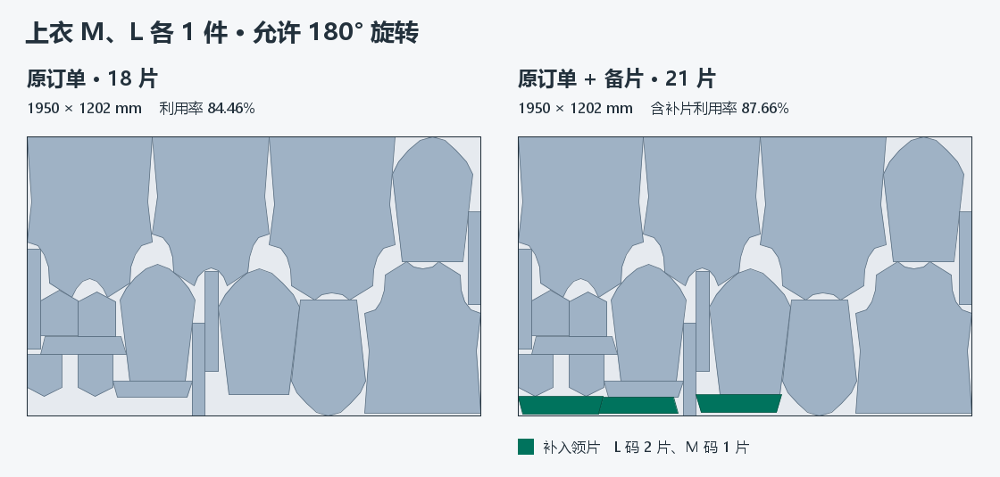

# 服装唛架密排实测

## 上衣版底补片复核（2026-11-17）

　　对照使用截图所选的 1950 mm 上衣唛架，M、L 码各一件、允许 180° 旋转。以这 18 片已经排好的原始位置为起点，在实际占用的 1202 mm 内搜索同款备片。原作业记录中的试排窗长为 1257.5 mm。

| 同一版 | 原衣片 | 补入 | 唛架长 mm | 已放裁片净面积 mm² | 利用率 |
| --- | ---: | --- | ---: | ---: | ---: |
| 原版 | 18 片 | 0 片 | 1202 | 1,979,680 | 84.46% |
| 版底补片 | 18 片 | L 领片 2 片、M 领片 1 片 | 1202 | 2,054,596 | 87.66% |

　　三片分别落在原版左下和中下方。新增净面积 74,916 mm²，含补片利用率增加 3.20 个百分点。复核了 21 片的边界与 210 对轮廓。成衣仍为两件，每件平均用长 601 mm。表中数值来自同一归档布局的前后对照，重新试算时会随首次排出的原版而变化。

　　同日浏览器重新试算 1950 mm 时，掉头搜索返回了另一份 1201 mm 的齐套版，齐套利用率 84.53%，本次补入 0 片。两份版图的原片位置不同。服装页「试算条件」旁的问号可随时打开上图，对照原来 1202 mm 版底的三片领片。

## 原七个示例的同版长补片

　　每个示例取一份已齐套且允许 180° 的归档原版。默认上衣取截图中的 1950 mm，其余取各示例最小幅宽。每组固定全部原片坐标，在相同的幅宽与占用长度内限时搜索同款备片，并对补入后的轮廓、边界和数量逐项复核。七版中五版有增益，另外两版在本次搜索中未找到补片位置。

| 示例 | 幅宽 mm | 唛架长 mm | 补片数 | 齐套利用率 | 含补片利用率 | 本机原作业号前缀 |
| --- | ---: | ---: | ---: | ---: | ---: | --- |
| 上衣 · 三种门幅对比 | 1950 | 1202.00 | 3 | 84.46% | 87.66% | 90b64f4e |
| 上衣 · 两件 M 搭一件 L | 1600 | 2189.54 | 0 | 82.60% | 82.60% | 49fc04ad |
| 长裤 · 单码厚牛仔 | 1450 | 1513.16 | 4 | 77.46% | 83.96% | 807bb72f |
| 半裙 · 双码轻薄料 | 1400 | 3080.89 | 7 | 77.55% | 83.05% | 8a8407e6 |
| 背心 · 针织包条 | 1500 | 1128.43 | 10 | 66.30% | 76.26% | 6bca1b81 |
| 短裤 · 同码双件 | 1450 | 1260.57 | 0 | 79.67% | 79.67% | cbf67bf3 |
| 围裙 · 帆布长系带 | 1200 | 1440.74 | 3 | 72.75% | 80.75% | a71bd64a |

## 固定方向与掉头基准（2026-11-16）

　　2026-11-16，在本机通过服装试算页使用的标准作业接口依次运行。原七个示例共 15 组「款式、配码、幅宽」，新加三例另有 5 组。每组在优化前后各算两次，分别固定纱向和允许 0°/180°。相同输入使用同一款式的全部主辅片，片间距为零。只有几何校验通过且齐套的实际排料才计入利用率。

　　旧版每次作业最多 10 秒、5 轮。新版保留原搜索预算，追加固定门幅直接缩长和轮廓压紧，每次作业最多 14 秒、7 轮。开启旋转时，先算固定方向，再用固定齐套方案向上取整到 0.1 mm 的实际长度作为掉头试排初长。如果缩短初长后未能齐套，系统用原始起长复试一次。旋转列按同幅宽可用的最高齐套利用率填写，复试或沿用固定排法会在表中注明。两次限时搜索的起点可能随固定方案变化，独立运行的版本差值包含这部分波动。

## 原七个示例

　　15 个幅宽等权平均，新版固定方向为 73.63%，允许掉头为 78.36%，增加 4.73 个百分点，14 组提高、1 组持平。单看掉头结果，旧版平均为 77.61%，本轮新版有 13 组提高、1 组持平、1 组回落。回落的是 1600 mm 混码上衣，82.91% 降至 82.15%。

| 示例 | 有效幅宽 mm | 旧版固定 % | 旧版允许 180° % | 新版固定 % | 新版允许 180° % | 新版旋转增益（百分点） | 新版实际掉头片数 |
| --- | ---: | ---: | ---: | ---: | ---: | ---: | ---: |
| 上衣 · 三种门幅对比 | 1600 | 79.77 | 82.91 | 80.09 | 82.15 | +2.06 | 4 |
| 上衣 · 三种门幅对比 | 1850 | 82.28 | 84.14 | 82.28 | 84.14 | +1.86 | 7 |
| 上衣 · 三种门幅对比 | 1950 | 80.61 | 82.91 | 80.74 | 84.53 | +3.79 | 6 |
| 上衣 · 两件 M 搭一件 L | 1600 | 79.48 | 80.50 | 80.22 | 82.60 | +2.38 | 14 |
| 上衣 · 两件 M 搭一件 L | 1850 | 82.04 | 84.41 | 82.67 | 84.50 | +1.83 | 14 |
| 长裤 · 单码厚牛仔 | 1450 | 57.84 | 75.82 | 58.30 | 77.46 | +19.16 | 3 |
| 长裤 · 单码厚牛仔 | 1550 | 66.76 | 78.08 | 66.76 | 78.72 | +11.96 | 3 |
| 半裙 · 双码轻薄料 | 1400 | 73.29 | 77.21 | 77.09 | 77.55 | +0.45 | 4 |
| 半裙 · 双码轻薄料 | 1500 | 73.42 | 73.42 | 74.62 | 74.71（复试） | +0.09 | 6 |
| 背心 · 针织包条 | 1500 | 60.09 | 64.95 | 60.09 | 66.30 | +6.21 | 2 |
| 背心 · 针织包条 | 1750 | 53.02 | 65.72 | 54.92 | 65.97 | +11.05 | 2 |
| 短裤 · 同码双件 | 1450 | 72.06 | 78.95 | 74.51 | 79.67 | +5.16 | 4 |
| 短裤 · 同码双件 | 1600 | 79.40 | 81.50 | 82.28 | 82.62 | +0.35 | 7 |
| 围裙 · 帆布长系带 | 1200 | 66.06 | 72.19 | 68.12 | 72.75 | +4.63 | 2 |
| 围裙 · 帆布长系带 | 1500 | 78.92 | 81.41 | 81.73 | 81.73 | 0.00 | 5 |

## 新增密排示例

　　1750 mm 背心的纸样、克重和 1∶1 尺码比相同。允许掉头时，把 M/L 各 1 件改成各 3 件，利用率由 65.97% 升至 75.78%。1400 mm 直裁抽褶裙的固定方向已达到本例的面积上限。浏览器验收图中，试排窗为 1460 mm，四片裙身和四段腰头刚好铺满前 1360 mm，余下 100 mm 斜纹尾段不计入实际唛架。

| 示例 | 有效幅宽 mm | 旧版固定 % | 旧版允许 180° % | 新版固定 % | 新版允许 180° % | 新版旋转增益（百分点） | 新版实际掉头片数 |
| --- | ---: | ---: | ---: | ---: | ---: | ---: | ---: |
| 六片裙 · 梯形裙片交错密排 | 1270 | 66.68 | 88.89 | 67.72 | 91.07 | +23.35 | 6 |
| 六片裙 · 梯形裙片交错密排 | 1400 | 61.39 | 86.41 | 61.43 | 87.12 | +25.69 | 6 |
| 抽褶裙 · 直裁满幅对照 | 1400 | 99.54 | 99.54 | 100.00 | 100.00 | 0.00 | 0 |
| 抽褶裙 · 直裁满幅对照 | 1500 | 93.01 | 93.01 | 93.33 | 93.33 | 0.00 | 0 |
| 背心 · 混码六件合排 | 1750 | 69.37 | 73.71 | 70.34 | 75.78 | +5.44 | 6 |

## 新增搜索实际省了多少布

　　原七个示例完成 30 次主试和 1 次复试。1500 mm 半裙的掉头主试排入 13/14 片，恢复到原始 5175 mm 起长后排齐，实际只占 2984.69 mm。下面取每个方向最终采用的齐套作业，同一次作业内有 22 个比常规搜索的最佳齐套方案再缩短超过 0.01 mm，另有 2 个通过直接定幅缩长首次排齐。30 份齐套版均执行了轮廓压紧，其中 13 份又缩短超过 0.01 mm。

| 新增搜索缩短量最大的五个原示例方案 | 有效幅宽 mm | 方向 | 常规搜索最短齐套 mm | 最终齐套 mm | 节省 mm |
| --- | ---: | --- | ---: | ---: | ---: |
| 半裙 · 双码轻薄料 | 1500 | 固定 | 3150.30 | 2988.44 | 161.86 |
| 围裙 · 帆布长系带 | 1500 | 固定 | 1084.90 | 1026.00 | 58.90 |
| 围裙 · 帆布长系带 | 1200 | 固定 | 1586.60 | 1538.71 | 47.89 |
| 半裙 · 双码轻薄料 | 1400 | 固定 | 3145.60 | 3099.00 | 46.60 |
| 短裤 · 同码双件 | 1450 | 固定 | 1393.70 | 1347.83 | 45.87 |

　　利用率按衣片净面积 ÷（有效幅宽 × 实际占用长度）计算。组间简单平均对每个幅宽赋相同权重。试算未计生产缝份修正、片间刀距和拉布端损。两件直裁抽褶裙的 1400 mm 对照在几何上能恰好满幅，其余款式的全局最优值未知。
